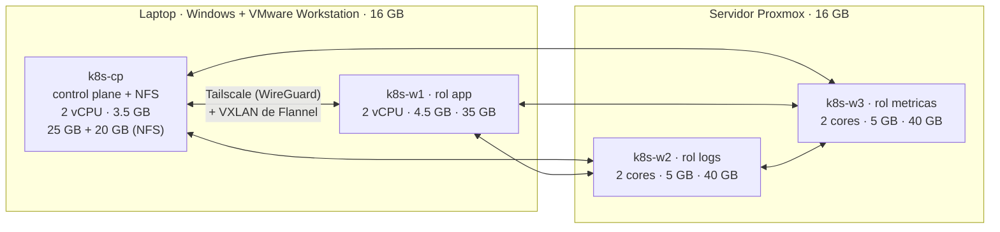

# Etapa 1 · Clúster Kubernetes de la Boletera, desde cero

Proyecto 3 · Boletera de conciertos · DevOps 2026
Rol: Plataforma / CD

Este documento cuenta **cómo se construyó el clúster y por qué se tomó cada
decisión**. Abarca desde la creación de las máquinas virtuales hasta tener los
4 nodos en `Ready`, con la red verificada y la instalación probada como
idempotente. Los pasos exactos para reproducirlo están en el
[README](../README.md); aquí está el razonamiento.

---

## Índice

1. [Resultado final](#1-resultado-final)
2. [Por qué un clúster nuevo y no el de clase](#2-por-qué-un-clúster-nuevo-y-no-el-de-clase)
3. [Por qué 4 nodos](#3-por-qué-4-nodos)
4. [Requisitos del sistema: mínimos y recomendados](#4-requisitos-del-sistema-mínimos-y-recomendados)
5. [Sistema operativo y particiones](#5-sistema-operativo-y-particiones)
6. [Máquinas virtuales en VMware Workstation (laptop)](#6-máquinas-virtuales-en-vmware-workstation-laptop)
7. [Máquinas virtuales en Proxmox (servidor)](#7-máquinas-virtuales-en-proxmox-servidor)
8. [Después de instalar Rocky Linux](#8-después-de-instalar-rocky-linux)
9. [La red entre nodos: Tailscale](#9-la-red-entre-nodos-tailscale)
10. [Por qué se cambió el DNS de los nodos](#10-por-qué-se-cambió-el-dns-de-los-nodos)
11. [Red de pods: Flannel en vez de Calico](#11-red-de-pods-flannel-en-vez-de-calico)
12. [El MTU: Tailscale y Flannel](#12-el-mtu-tailscale-y-flannel)
13. [Preparación con el script 00](#13-preparación-con-el-script-00)
14. [Ansible: instalación, llaves SSH e inventario](#14-ansible-instalación-llaves-ssh-e-inventario)
15. [Qué hace cada playbook](#15-qué-hace-cada-playbook)
16. [Verificación e idempotencia](#16-verificación-e-idempotencia)
17. [Problemas encontrados y cómo se resolvieron](#17-problemas-encontrados-y-cómo-se-resolvieron)
18. [Lo que sigue](#18-lo-que-sigue)

---

## 1. Resultado final

```
$ kubectl get nodes -o wide -L boletera.io/zona -L boletera.io/app -L boletera.io/logs -L boletera.io/metricas
NAME     STATUS   ROLES           VERSION   INTERNAL-IP       CONTAINER-RUNTIME    ZONA      APP    LOGS   METRICAS
k8s-cp   Ready    control-plane   v1.37.2   100.108.78.119    containerd://2.4.2   laptop
k8s-w1   Ready    worker          v1.37.2   100.103.221.107   containerd://2.4.2   laptop    true
k8s-w2   Ready    worker          v1.37.2   100.105.140.124   containerd://2.4.2   proxmox          true
k8s-w3   Ready    worker          v1.37.2   100.85.132.48     containerd://2.4.2   proxmox                 true
```



| Componente | Versión | Dónde se fija |
|---|---|---|
| Rocky Linux | 10.2 (kernel 6.12.0-211.74.1) | ISO de instalación + `dnf update` |
| Kubernetes (kubeadm, kubelet, kubectl) | 1.37.2 | `group_vars/all.yml` → `k8s_version` |
| containerd.io | 2.4.2 | `group_vars/all.yml` → `containerd_version` |
| Flannel | v0.28.10 | `templates/kube-flannel.yml.j2` |
| CoreDNS / etcd | v1.14.6 / 3.7.0 | los elige kubeadm 1.37.2 |
| Tailscale | 1.104.7 | versión estable al instalar |
| ansible-core | 2.16.16 | paquete de Rocky 10 |
| Helm (solo control plane) | v4.3.1 | `group_vars/all.yml` → `helm_version` |

---

## 2. Por qué un clúster nuevo y no el de clase

El proyecto permite dos caminos: **Opción A**, un clúster nuevo e instalado
con kubeadm o Ansible, o **Opción B**, reutilizar el clúster del curso. Se eligió
la **Opción A**. Este era el estado del clúster de clase:

| Clúster de clase (k8s-nodo + k8s-worker1) | Problema para el proyecto |
|---|---|
| 2 nodos (1 control plane + 1 worker) | La rúbrica exige **3 nodos `Ready`**; con 2, el rubro de Clúster vale 0. |
| CNI Calico, instalado a mano en clase | No estaba documentado de forma reproducible, y Calico da problemas sobre una VPN (sección 11). |
| Worker con `/var` de 2.1 GB al 82 % | Ahí viven las imágenes de contenedores. Solo la de OpenSearch pesa ~1 GB, así que el nodo entraría en `DiskPressure` y Kubernetes empezaría a desalojar pods. |
| Al worker se le borró la partición de swap y arrancaba en modo de emergencia | Se arregló, pero la VM quedó con particiones parchadas. |
| Tiene los laboratorios y evidencias de las tareas del curso | Reutilizarlo obligaba a borrar ese trabajo. |
| Ambas VMs viven en la laptop | No había cómo sumar la memoria del servidor Proxmox, que OpenSearch necesita. |

Con un clúster nuevo:

- Los 4 nodos salen **de la misma ISO y del mismo playbook**, sin restos de prácticas anteriores. Eso es más fácil de documentar y de defender en la presentación.
- La instalación queda escrita como código (Ansible) y se puede repetir en otro hardware. Eso cubre el "documentar la instalación completa" de la Opción A.
- El clúster de clase **se conservó apagado, sin modificar**, como respaldo de las tareas.

---

## 3. Por qué 4 nodos

El mínimo es 3 (1 control plane + 2 workers). La primera propuesta fue un
worker ligero en la laptop y uno grande (10 GB, 80 GB) en Proxmox. Se cambió a
**1 control plane + 3 workers** por estas razones:

- **Portabilidad.** Cada worker cabe en una máquina modesta (≤ 5 GB). Si el servidor Proxmox no está disponible el día de la presentación, un worker se puede recrear en otra laptop, por ejemplo la del compañero de equipo (8 GB). No hace falta mover una VM de 10 GB que no cabría.
- **Aislamiento.** OpenSearch (logs) y Prometheus (métricas) son lo que más memoria usa. En nodos separados, si uno se queda sin memoria no tumba al otro ni a la tienda.
- **Roles claros.** Cada worker tiene un rol y el repositorio GitOps elige el nodo **por rol, no por nombre**:

  | Rol | Nodo hoy | Qué corre ahí |
  |---|---|---|
  | `app` | k8s-w1 (laptop) | tienda (frontend, eventos, órdenes, reservaciones), PostgreSQL, Traefik, Argo CD |
  | `logs` | k8s-w2 (Proxmox) | OpenSearch + Dashboards, Jaeger |
  | `metricas` | k8s-w3 (Proxmox) | Prometheus, Grafana, Alertmanager, builds de Tekton |

  Mover un rol a otro nodo es cambiar una línea del inventario y volver a correr `04-workers.yml`; los manifiestos no cambian.

- **Costo:** cada nodo extra gasta cerca de 1 GB de RAM entre el sistema operativo, kubelet, containerd, kube-proxy y Flannel. Con 32 GB entre los dos equipos, es un precio aceptable.
- **Riesgo aceptado:** más nodos significa más piezas que pueden fallar en la demo. Para compensarlo, cada nodo tiene `Start at boot` y la red se verifica con un script (sección 16).

**Por qué la laptop tiene el control plane y el worker `app`:** las demos 1
(commit → Tekton → Argo CD) y 2 (borrar el pod de la base de datos) dependen
sobre todo de esos dos nodos. Si la conexión con el servidor de casa falla
durante la presentación, la tienda sigue funcionando y solo se pierde la parte
de observabilidad, que cubre el video de respaldo.

---

## 4. Requisitos del sistema: mínimos y recomendados

### 4.1 Mínimos (de kubeadm y de Rocky Linux 10)

| Requisito | Valor mínimo | Por qué | ¿Se cumple? |
|---|---|---|---|
| CPU | 2 por nodo de control plane | `kubeadm init` falla con menos de 2 CPU | ✅ 2 en todos |
| Nivel de CPU | **x86-64-v3** (AVX2, BMI2, FMA, MOVBE) | Rocky Linux 10 se compiló para ese nivel; con una CPU virtual más vieja el instalador se detiene con `Fatal glibc error: CPU does not support x86-64-v3` | ✅ (en Proxmox requirió CPU `host`, sección 7) |
| RAM | 2 GB por máquina | Sin eso no quedan recursos para los pods | ✅ 3.5–5 GB |
| Swap | Apagada | El kubelet, por defecto, no arranca con swap activa; la memoria de los pods se calcula sin contar swap | ✅ sin partición de swap |
| Conectividad | Todos los nodos se alcanzan entre sí | API 6443, kubelet 10250, VXLAN 8472/udp, NFS 2049 | ✅ por Tailscale |
| Identidad única | hostname, MAC y `product_uuid` distintos por nodo | El clúster identifica a cada nodo por su nombre | ✅ (VMs creadas desde cero, no clonadas) |
| Hora sincronizada | NTP activo | Certificados y etcd fallan con relojes desfasados | ✅ chronyd en todos |

### 4.2 Recomendados para este proyecto

Los mínimos solo garantizan que Kubernetes arranque. Lo recomendado sale de
**lo que va a correr en cada nodo**:

| Nodo | Recomendado | Instalado | Explicación |
|---|---|---|---|
| k8s-cp | 2 vCPU · 3.5 GB · 30 GB + 20 GB | 2 vCPU · 3.5 GB · **25 GB** + 20 GB | etcd, API server, scheduler, controller-manager, CoreDNS y el servidor NFS. En reposo usa 1.3 GB. Su disco del sistema solo guarda etcd e imágenes del control plane (hoy al 14 %). |
| k8s-w1 | 2 vCPU · 4.5 GB · 40 GB | 2 vCPU · 4.5 GB · **35 GB** | 4 microservicios (frontend y un backend con 2 réplicas), PostgreSQL, Traefik y Argo CD (0.5–1 GB). |
| k8s-w2 | 2 cores · 5 GB · 50 GB | 2 cores · 5 GB · **40 GB** | OpenSearch (heap de 1–1.5 GB más memoria fuera del heap), OpenSearch Dashboards y Jaeger. Sus datos usan el disco local. |
| k8s-w3 | 2 cores · 5 GB · 50 GB | 2 cores · 5 GB · **40 GB** | Prometheus (1–2 GB según retención), Grafana, Alertmanager y los builds de Kaniko en Tekton (1–2 GB mientras construyen). |

Los discos quedaron 5–10 GB por debajo de lo recomendado. **Son suficientes
para el proyecto** (los workers están al 8 %) y se pueden agrandar después, sin
reinstalar, porque `/` es la última partición de cada disco.

### 4.3 Memoria apartada para el sistema

En la configuración del kubelet se apartó memoria para que los pods no puedan
dejar sin RAM al sistema operativo:

| Reserva | Valor | Para qué |
|---|---|---|
| `systemReserved` | 512 Mi RAM, 200m CPU | sistema operativo, sshd, tailscaled, NetworkManager |
| `kubeReserved` | 256 Mi RAM, 100m CPU | kubelet y containerd |
| `evictionHard` memoria | 300 Mi | si quedan menos, Kubernetes desaloja un pod de forma controlada |
| `evictionHard` disco | 10 % nodefs, 15 % imagefs, 5 % inodos | igual, para disco |

Sin estas reservas, OpenSearch o un build de Kaniko podrían usar toda la RAM y
congelar la VM completa. El nodo pasaría a `NotReady` y se perdería todo lo que
corre en él. Con ellas, Kubernetes saca un pod antes de llegar a ese punto.

Así se ve la memoria que queda para los pods (`allocatable`):

| Nodo | RAM de la VM | Para pods | CPU para pods |
|---|---|---|---|
| k8s-cp | 3.3 GiB | 2.25 GiB | 1700m |
| k8s-w1 | 4.3 GiB | 3.2 GiB | 1700m |
| k8s-w2 | 4.7 GiB | 3.7 GiB | 1700m |
| k8s-w3 | 4.7 GiB | 3.7 GiB | 1700m |

### 4.4 Los equipos anfitriones

| Equipo | RAM | Para las VMs | Le queda al anfitrión |
|---|---|---|---|
| Laptop (Windows 11, i7-1265U) | 16 GB | 8 GB (cp 3.5 + w1 4.5) | 8 GB para Windows, el navegador y la presentación |
| Servidor Proxmox (i5-9300H) | 16 GB (~13 GB libres) | 10 GB (w2 5 + w3 5) | ~3 GB para Proxmox y lo que ya corría |

---

## 5. Sistema operativo y particiones

**ISO:** `Rocky-10.2-x86_64-minimal.iso`
SHA-256 `aac6ac3ce781b91a91ce78463405f66c611a5dca4b3840c79e5e01d97302f6c8`.
Se usó la misma en las 4 VMs.

**Opciones en el instalador (Anaconda):**

| Opción | Valor | Por qué |
|---|---|---|
| Selección de software | **Minimal Install** | Menos paquetes = menos RAM, menos disco y menos cosas que actualizar. |
| Usuario | `ansible`, marcado como **administrador** (grupo `wheel`) | Es el usuario con el que Ansible se conecta a todos los nodos. |
| Root | con contraseña | Acceso de emergencia desde la consola. |
| Kdump | **desactivado** | Kdump reserva RAM (`crashkernel`) para capturar volcados si el kernel falla. En estas VMs no se analizan volcados y esa memoria hace falta para los pods. |
| Zona horaria | America/Mexico_City, con NTP | Certificados, logs y trazas necesitan la misma hora en todos los nodos. |
| Particionado | **manual, estándar (sin LVM), XFS** | Ver la tabla siguiente. |

**Particiones (firmware UEFI, tabla GPT):**

| Punto de montaje | Tamaño | Sistema de archivos | Por qué |
|---|---|---|---|
| `/boot/efi` | 600 MiB | vfat | La exige el arranque UEFI. |
| `/boot` | 1 GiB | xfs | Kernels e initramfs. Con 1 GiB caben varias versiones del kernel durante las actualizaciones. |
| `/` | el resto | xfs | Todo lo demás, **incluido `/var`**. |
| *(swap)* | **ninguna** | — | El kubelet no la admite (ver 4.1). Es mejor no crearla que crearla y desactivarla después: en el clúster de clase, borrar la partición de swap dejó al worker arrancando en modo de emergencia, porque GRUB todavía la buscaba. |

**¿Por qué no separar `/var`?** containerd guarda las imágenes en
`/var/lib/containerd` y el kubelet guarda los volúmenes `local-path` y los logs en
`/var/lib/kubelet` y `/var/log`. Un `/var` separado y chico es justo lo que llenó
al worker del clúster de clase (2.1 GB al 82 %). Con todo en `/` no hay que
adivinar cuánto espacio necesita cada carpeta.

**Segundo disco del control plane (20 GB, `/dev/nvme0n2`):** se deja **vacío** en
el instalador. Lo formatea el playbook 02 como XFS y lo monta en `/srv/nfs`, y
ahí se guardan los volúmenes NFS (PostgreSQL y otros datos chicos). Va aparte
del sistema por dos razones:

1. Si los volúmenes NFS se llenan, **no se llena el disco de etcd y del API server**. Un etcd sin espacio detiene todo el clúster.
2. La alerta "disco del servidor NFS arriba del 80 %" que pide la rúbrica mide justo ese disco, sin mezclarlo con el sistema.

Se podría usar un solo disco de 40 GB, pero se perderían esas dos ventajas a
cambio de casi nada. Por eso se mantuvo.

---

## 6. Máquinas virtuales en VMware Workstation (laptop)

Las VMs de la laptop son **k8s-cp** y **k8s-w1**.

| Opción | k8s-cp | k8s-w1 | Por qué |
|---|---|---|---|
| Firmware | **UEFI** | **UEFI** | Arranque moderno con GPT; es lo que espera el particionado de la sección 5. |
| Procesadores | 1 procesador × 2 núcleos | 1 × 2 | kubeadm exige 2 CPU en el control plane; en el worker es lo mínimo razonable. |
| Memoria | 3584 MB | 4608 MB | Sección 4.2. |
| Disco | NVMe, 25 GB + **2º disco NVMe 20 GB** | NVMe, 35 GB | NVMe es el controlador más rápido que ofrece VMware. Por eso los discos se llaman `nvme0n1` y `nvme0n2`, y `nfs_disk` en `group_vars/all.yml` es `/dev/nvme0n2`. |
| Asignación del disco | **sin pre-asignar** | sin pre-asignar | El archivo crece según se usa; no ocupa 45 GB de la laptop desde el primer día. |
| Red | **NAT (VMnet8)** | NAT | Ver abajo. |

**Por qué NAT y no Bridged:** en modo *Bridged* cada VM pide su IP a la red
donde esté la laptop. En la escuela o en un hotspot esa IP cambia, o la red no
permite varias MAC por equipo. Con NAT las VMs siempre están en la red privada
de VMware (`192.168.87.0/24`, puerta de enlace y DNS en `192.168.87.2`) y salen a
internet por la laptop, sin depender de la red de afuera. La desventaja de NAT
es que nadie de fuera puede llegar a las VMs, y eso lo resuelve Tailscale
(sección 9).

| VM | IP en VMware NAT |
|---|---|
| k8s-cp | 192.168.87.140 |
| k8s-w1 | 192.168.87.141 |

---

## 7. Máquinas virtuales en Proxmox (servidor)

Las VMs de Proxmox son **k8s-w2** y **k8s-w3**. Deben ser **VMs (QEMU/KVM), no
contenedores LXC**: un contenedor comparte el kernel del anfitrión y no puede
cargar los módulos ni cambiar los parámetros de kernel que Kubernetes necesita.

| Pestaña / opción | Valor | Activar o desactivar | Por qué |
|---|---|---|---|
| System → Machine | `q35` | — | Chipset moderno con PCIe. |
| System → BIOS | **OVMF (UEFI)** + EFI disk | — | Igual que en VMware. |
| System → Pre-Enroll keys | **desmarcado** | desactivar | Deja Secure Boot apagado y evita problemas al arrancar o al cargar módulos de kernel. |
| System → SCSI controller | **VirtIO SCSI single** | — | Controlador paravirtualizado: el más rápido, y permite un hilo de E/S por disco. |
| Disks → Bus | SCSI, 40 GB | — | — |
| Disks → **Discard** | ✅ | activar | Cuando Linux borra datos, avisa al almacenamiento de Proxmox (`fstrim`) y el disco delgado se encoge. Sin esto, el disco solo crece. |
| Disks → **IO thread** | ✅ | activar | Un hilo de E/S propio por disco; menos latencia cuando OpenSearch o Prometheus escriben mucho. |
| Disks → SSD emulation | (opcional) | — | Hoy está apagado: Linux ve el disco como giratorio (`ROTA=1`). No afecta el funcionamiento. |
| CPU → Cores | 2 (1 socket) | — | — |
| CPU → **Type** | **`host`** | cambiar | **Obligatorio.** El tipo por defecto (`x86-64-v2-AES`) oculta instrucciones de la CPU real, y Rocky 10 exige x86-64-v3. Así fallaba el instalador: `Fatal glibc error: CPU does not support x86-64-v3`. Con `host`, la VM ve la CPU real del servidor (i5-9300H), que sí cumple. |
| Memory | **5120 MiB** | — | Sección 4.2. |
| Memory → **Ballooning Device** | ❌ | **desactivar** | Con ballooning, Proxmox puede quitarle RAM a la VM en caliente. Kubernetes ya habría programado pods contando con esa memoria, y desaparecería sin aviso. |
| Network | VirtIO, bridge **`vmbr0`** | — | La VM queda en la red de la casa con salida a internet, no en la red interna del firewall OPNsense. |
| Options → **Start at boot** | ✅ | activar | Si el servidor se reinicia, los nodos vuelven solos. |
| Options → **QEMU Guest Agent** | ✅ | activar | Ver 7.1. |

| VM | IP en la red de la casa |
|---|---|
| k8s-w2 | 192.168.0.123 |
| k8s-w3 | 192.168.0.73 |

### 7.1 QEMU Guest Agent: qué es y para qué sirve

Es un pequeño servicio (`qemu-guest-agent`) que corre **dentro** de la VM y habla
con Proxmox por un canal interno (virtio-serial). Sin él, Proxmox solo ve la VM
"desde afuera". Con él:

- **Apagado y reinicio limpios:** los botones *Shutdown* y *Reboot* de Proxmox le piden al sistema que se apague ordenadamente. Kubernetes, containerd y los volúmenes cierran bien, en vez de depender de una señal ACPI que a veces se ignora.
- **IPs visibles:** la pestaña *Summary* de la VM muestra sus direcciones IP.
- **Respaldos y snapshots consistentes:** antes de un respaldo, Proxmox puede congelar momentáneamente los sistemas de archivos (`fsfreeze`), así la copia no queda a medio escribir.

Se activa en dos lados:

1. Dentro de la VM:
   ```bash
   sudo dnf install -y qemu-guest-agent
   ```
2. En Proxmox: *Options → QEMU Guest Agent → Enabled*. Luego hay que **apagar y volver a encender** la VM desde Proxmox; un reinicio desde dentro no agrega el canal.

En VMware no aplica; su equivalente son las *VMware Tools* (`open-vm-tools`).
La instalación mínima de Rocky no las incluye y en k8s-cp y k8s-w1 no están
instaladas. Son opcionales; si se quiere el mismo apagado limpio desde VMware:
`sudo dnf install -y open-vm-tools`.

---

## 8. Después de instalar Rocky Linux

En cada VM, desde la consola:

1. **Actualizar todo:**
   ```bash
   sudo dnf -y update && sudo reboot
   ```
   Así los 4 nodos quedaron con el mismo kernel (6.12.0-211.74.1).
2. **Comprobar que quedó como se esperaba** (se revisó en las 4):
   - `swapon --show` sin resultado (sin swap).
   - `cat /proc/cmdline` sin `crashkernel` ni referencias a swap.
   - `systemctl is-enabled kdump` → no existe.
   - `lsblk` con las particiones de la sección 5.
   - Con `/lib64/ld-linux-x86-64.so.2 --help`, `x86-64-v3` debe aparecer como `supported`.

El hostname **no se configura aquí**: lo pone el script 00 (sección 13).

---

## 9. La red entre nodos: Tailscale

### 9.1 El problema

Los nodos viven en **redes distintas que no se ven entre sí**:

| Nodo | Red | Problema |
|---|---|---|
| k8s-cp, k8s-w1 | `192.168.87.0/24`, NAT de VMware dentro de la laptop | Desde fuera de la laptop no se puede llegar a ellos. |
| k8s-w2, k8s-w3 | `192.168.0.0/24`, red de la casa | No saben cómo llegar a la red privada de VMware. |

Además, la laptop cambia de red (casa, escuela, hotspot) y con ella cambiaría
cualquier IP que usáramos para el clúster. Kubernetes guarda la IP de cada nodo
en sus certificados y su configuración; si cambia, el clúster deja de funcionar.

### 9.2 La solución: una VPN en malla (Tailscale)

Tailscale crea una red privada cifrada (WireGuard) entre todos los equipos de la
cuenta, sin importar en qué red física esté cada uno. Cada nodo recibe una
interfaz `tailscale0` con una **IP fija del rango `100.64.0.0/10`**:

| Nodo | IP de Tailscale |
|---|---|
| k8s-cp | 100.108.78.119 |
| k8s-w1 | 100.103.221.107 |
| k8s-w2 | 100.105.140.124 |
| k8s-w3 | 100.85.132.48 |

**¿Por qué esas IPs?** Las asigna Tailscale, una por máquina, y no cambian
aunque la máquina se mueva de red. Vienen del rango `100.64.0.0/10`, reservado
para *Carrier-Grade NAT* (RFC 6598). No se usa en redes de casa ni de oficina,
así que no choca con `192.168.x.x`, ni con la red de pods (`10.244.0.0/16`), ni
con la de services (`10.96.0.0/12`).

Esas IPs son **la identidad de cada nodo en Kubernetes**:

- `ansible_host` en el inventario → Ansible se conecta por ahí.
- `node-ip` del kubelet y `advertiseAddress` del API server → es la `INTERNAL-IP` de cada nodo.
- `--iface=tailscale0` en Flannel → el tráfico entre pods viaja por el túnel.
- `/etc/hosts` de cada nodo → `k8s-api.boletera` apunta a la IP de Tailscale del control plane.
- La exportación NFS solo acepta esas 4 IPs.

**El API server se nombra, no se numera:** los workers se conectan a
`k8s-api.boletera:6443` (`controlPlaneEndpoint`), un nombre que se resuelve en
`/etc/hosts`. Si algún día cambia la IP del control plane, basta editar
`/etc/hosts`, sin rehacer certificados ni volver a unir los workers.

### 9.3 Configuración de Tailscale en los nodos

El script 00 levanta Tailscale con:

```bash
tailscale up --hostname=<nodo> --accept-dns=false --accept-routes=false
```

| Opción | Por qué |
|---|---|
| `--hostname` | El nombre del nodo en la consola de Tailscale, igual al de Kubernetes. |
| `--accept-dns=false` | Tailscale no reescribe `/etc/resolv.conf`. Si lo hiciera, el DNS del nodo pasaría a `100.100.100.100`, y CoreDNS reenvía a ese mismo DNS las consultas externas de los pods; los pods podrían quedarse sin DNS. |
| `--accept-routes=false` | En la tailnet hay un *subnet router* (Kali hacia la red de OpenVPN/OPNsense) que anuncia otras redes. Los nodos no aceptan esas rutas, para que ninguna choque con las redes de pods o services. |

**En la consola de Tailscale:**

- **Disable key expiry** en los 4 nodos. Por defecto la llave de cada máquina vence en unos meses; al vencer, el nodo sale de la VPN y Kubernetes lo marca `NotReady`.
- **Access controls:** las ACL deben permitir TCP y UDP entre los 4 nodos. Sin `proto`, las reglas de Tailscale solo dejan pasar TCP, UDP e ICMP. Este detalle decidió el CNI (sección 11).

### 9.4 Conexión directa, no por relay

Tailscale intenta una **conexión directa** entre cada par de nodos. Si no la
logra, manda el tráfico por un **relay (DERP)** en internet.

- **Antes del playbook 01:** laptop ↔ Proxmox iba por el relay de **Dallas** (`relay "dfw"`). Funcionaba, pero cada paquete daba la vuelta por Estados Unidos aunque los equipos estuvieran en la misma casa.
- **La causa:** las VMs de la laptop están detrás del NAT de VMware, así que solo ellas pueden iniciar la conexión hacia las de Proxmox. firewalld en w2 y w3 bloqueaba esa entrada al puerto UDP **41641** de Tailscale.
- **La solución:** el playbook 01 abre `41641/udp` en la zona `public` de firewalld.
- **Después:** las 6 parejas de nodos van **directo**, con 1–4 ms de latencia:

  ```
  w1 → k8s-w2: pong from k8s-w2 (100.105.140.124) via 192.168.0.123:41641 in 3ms
  w2 → k8s-w3: pong from k8s-w3 (100.85.132.48) via 192.168.0.73:41641 in 1ms
  ```

Para revisarlo: `tailscale status` debe decir `direct` (no `relay`), o usar
`tailscale ping <nodo>`.

### 9.5 firewalld: confiar en el túnel, no en la LAN

En vez de abrir en cada nodo los puertos de Kubernetes (6443, 10250, 8472/udp,
2049…) hacia la red física, se puso la interfaz **`tailscale0` en la zona
`trusted`** de firewalld. El tráfico entre nodos ya va cifrado y filtrado por las
ACL de Tailscale.

| Zona | Contenido | Efecto |
|---|---|---|
| `trusted` | `tailscale0`, `cni0`, `flannel.1`, `10.244.0.0/16`, `10.96.0.0/12` | Todo permitido entre nodos y entre pods. |
| `public` (interfaz física) | ssh, cockpit, dhcpv6-client, **41641/udp** | La red de afuera solo ve SSH y el puerto de Tailscale. |

Poner `cni0` y `flannel.1` en `trusted` es el mismo arreglo del troubleshooting
de la clase 1 ("DNS interno falla → agregarlas a la zona trusted"): sin él,
firewalld bloquea el tráfico de los pods hacia CoreDNS.

---

## 10. Por qué se cambió el DNS de los nodos

Hubo dos problemas de DNS distintos: uno en los nodos de Proxmox (10.1–10.2) y
otro en los de VMware (10.3). Desde la sección 10.4, el playbook 01 revisa y
corrige ambos.

### 10.1 Proxmox: los DNS del proveedor caen en el rango de Tailscale

k8s-w2 y k8s-w3 recibían por DHCP los DNS del proveedor de internet (izzi):

```
nameserver 100.65.69.63
nameserver 100.65.70.69
nameserver 100.65.69.62
```

Esas direcciones están **dentro de `100.64.0.0/10`, el mismo rango que usa
Tailscale**. Al instalarse, Tailscale agrega una regla de firewall para que nadie
desde la red física se haga pasar por un equipo de la VPN: **descarta todo
paquete con origen en `100.64.0.0/10` que no llegue por `tailscale0`**.

Esta es la regla real, leída en k8s-w2 con `sudo iptables -S ts-input`:

```
-A ts-input -s 100.64.0.0/10 ! -i tailscale0 -j DROP
```

Las respuestas de esos DNS llegan por la interfaz física (`ens18`), así que se
habrían descartado. El DNS se cambió antes de instalar Tailscale, como
prevención. El resultado, de no hacerlo, habría sido este:

1. El nodo se queda **sin DNS**. Los DNS IPv6 del proveedor no lo salvan, porque Linux solo usa los **3 primeros** `nameserver` de `/etc/resolv.conf`, y los tres primeros eran esos.
2. Sin DNS, `dnf` no instala paquetes y containerd no descarga imágenes.
3. CoreDNS reenvía las consultas externas al DNS del nodo, así que **los pods también** se quedarían sin resolver nombres de internet.

### 10.2 La solución en Proxmox

Antes de instalar Tailscale se fijaron DNS públicos en esos dos nodos, ignorando
los que manda el DHCP:

```bash
sudo nmcli con mod ens18 ipv4.ignore-auto-dns yes ipv4.dns "1.1.1.1 8.8.8.8" ipv6.ignore-auto-dns yes
sudo nmcli con up ens18
```

Para comprobarlo: `/etc/resolv.conf` solo muestra `1.1.1.1` y `8.8.8.8`, y
`getent hosts pkgs.k8s.io` responde.

k8s-cp y k8s-w1 no tienen este problema: usan el DNS del NAT de VMware
(`192.168.87.2`), que no está en el rango de Tailscale. Pero tenían otro.

### 10.3 VMware: el dominio de búsqueda `localdomain`

**Síntoma.** Al instalar Argo CD, la Application `root` sí leyó el repositorio
de GitHub, pero `namespaces`, que lee el mismo repositorio, se quedó con
`SYNC STATUS` vacío (`Unknown`) y este error:

```
failed to list refs: Get "https://github.com/obeedt/equipoEmpiroso-gitops.git/info/refs?service=git-upload-pack":
context deadline exceeded (Client.Timeout exceeded while awaiting headers)
```

Argo CD esperó 15 segundos a GitHub y se rindió.

**Causa.** El DHCP de VMware les da a k8s-cp y k8s-w1 un dominio de búsqueda:

```
search localdomain
nameserver 192.168.87.2
```

Los pods heredan ese `search` del nodo donde corren, y Kubernetes les pone
`options ndots:5`. Con eso, para buscar `github.com` (que tiene menos de 5
puntos) un pod de Argo CD en k8s-w1 prueba primero con cada dominio de
búsqueda:

```
search argocd.svc.cluster.local svc.cluster.local cluster.local localdomain
nameserver 10.96.0.10
options ndots:5
```

| Nombre que prueba | Quién contesta | Tiempo |
|---|---|---|
| `github.com.argocd.svc.cluster.local` | CoreDNS: no existe | inmediato |
| `github.com.svc.cluster.local` | CoreDNS: no existe | inmediato |
| `github.com.cluster.local` | CoreDNS: no existe | inmediato |
| `github.com.localdomain` | DNS de VMware: no existe | **5,154 ms** |
| `github.com` | DNS de VMware | 93 ms |

Esos tiempos se midieron en k8s-w1 con `getent hosts`. Cada búsqueda se hace
para IPv4 y para IPv6, así que una sola consulta puede pasar de los 15 s de
Argo CD. A veces funciona porque CoreDNS guarda las respuestas 30 segundos;
por eso `root` sí pasó y `namespaces` no.

No es solo un problema de Argo CD: cualquier pod en k8s-w1 sufriría esos 5 s en
cada nombre de internet (los microservicios, Tekton al clonar, las descargas
de imágenes).

**Solución.** Se conserva el DNS de VMware, que funciona en cualquier red donde
esté la laptop, y solo se quita el dominio de búsqueda automático:

```bash
sudo nmcli con mod ens160 ipv4.ignore-auto-dns yes ipv4.dns 192.168.87.2
sudo nmcli device reapply ens160      # aplica sin tirar la red
kubectl -n argocd rollout restart deployment argocd-repo-server   # los pods viejos conservan su resolv.conf
```

Después, `/etc/resolv.conf` solo tiene `nameserver 192.168.87.2` y la
Application `namespaces` pasó a **Synced / Healthy**.

### 10.4 Lo que hace el playbook 01

Para que una reinstalación no repita ninguno de los dos problemas, el playbook
01 ahora, en cada nodo:

1. **Se detiene** si algún DNS del nodo está en `100.64.0.0/10`, con un mensaje que apunta a esta sección. Ese caso (10.1) se arregla antes de instalar Tailscale, así que no se corrige solo.
2. Si `/etc/resolv.conf` tiene una línea `search`, ejecuta en la conexión de NetworkManager de la interfaz principal `ipv4.ignore-auto-dns yes` e `ipv6.ignore-auto-dns yes`, y fija **los mismos servidores DNS** que ya tenía. Luego aplica el cambio con `nmcli device reapply`.
3. Si el nodo ya no tiene `search`, como en Proxmox o en una segunda corrida, no hace nada. Así se mantiene `changed=0`.

---

## 11. Red de pods: Flannel en vez de Calico

Kubernetes no trae red de pods propia; se instala un **CNI**. El paquete
original del proyecto (`k8s-boletera.zip`) usaba **Calico**. Al revisarlo se
cambió a **Flannel**.

### 11.1 Qué problemas tenía Calico en este clúster

| Problema | Detalle |
|---|---|
| Faltaban sus definiciones (CRDs) | El manifiesto `tigera-operator.yaml` de Calico v3.33.0 ya no incluye las CRDs (ahora vienen en `operator-crds.yaml`). La instalación habría fallado. |
| Un valor mal escrito | `iptablesMarkMask` en `FelixConfiguration` estaba como texto (`"0xff000000"`) y el campo es numérico; la API lo rechaza. |
| **Choque de marcas con Tailscale** | Calico y Tailscale marcan paquetes en netfilter para decidir su ruta. Las marcas de Calico, por defecto, se encimaban con los bits que usa Tailscale; había que mover la máscara de Calico a mano. |
| **IPIP bloqueado** | El modo por defecto de Calico encapsula con IPIP (protocolo IP 4), y las ACL de Tailscale sin `proto` solo dejan pasar TCP, UDP e ICMP. Había que cambiar Calico a VXLAN. |
| MTU a mano | Calico necesitaba que se le fijara el MTU para el túnel de Tailscale. |

Calico se podía hacer funcionar, pero con **tres ajustes delicados** que habría
que explicar y mantener.

### 11.2 Por qué Flannel

| | Flannel | Calico |
|---|---|---|
| Se usó en clase | ✅ | ❌ |
| Encapsulado | **VXLAN por UDP 8472**, que las ACL de Tailscale sí dejan pasar | IPIP por defecto (bloqueado) |
| MTU | **Lo calcula solo** a partir de `tailscale0` | Hay que fijarlo |
| Marcas de netfilter | No las usa | Chocan con las de Tailscale |
| Consumo | Un pod pequeño por nodo | Operator + calico-node + typha |
| **NetworkPolicy** | ❌ no la aplica | ✅ |

Lo único que se pierde es **NetworkPolicy** (reglas de firewall entre pods). El
proyecto no la pide. En producción, con políticas de red, se usaría Calico con
los ajustes de 11.1.

### 11.3 Cómo quedó Flannel

- Manifiesto oficial de **v0.28.10**, con dos cambios: la red `10.244.0.0/16` y el argumento **`--iface=tailscale0`**. Sin ese argumento, Flannel usaría la interfaz de la ruta por defecto (la LAN), y los nodos de la laptop y de Proxmox no se verían.
- Cada nodo recibe una subred `/24` para sus pods:

  | Nodo | Subred de pods |
  |---|---|
  | k8s-cp | 10.244.0.0/24 |
  | k8s-w3 | 10.244.1.0/24 |
  | k8s-w2 | 10.244.2.0/24 |
  | k8s-w1 | 10.244.4.0/24 |

  La `10.244.3.0/24` se saltó porque w2 y w3 se unieron casi al mismo tiempo: el controlador intentó darle una segunda subred a w2, Kubernetes la rechazó y la liberó. No afecta en nada.
- NetworkManager tiene la orden de **no tocar** `cni0`, `flannel.1` ni las interfaces `veth*` (`/etc/NetworkManager/conf.d/flannel.conf`). Si las administrara, podría quitarles la configuración que les pone Flannel.

---

## 12. El MTU: Tailscale y Flannel

El **MTU** es el tamaño máximo de paquete que cabe en una interfaz. Cada túnel
agrega cabeceras, así que el espacio útil se reduce en cada capa:

```
 Red física (ens160/ens18) ......... MTU 1500
 └─ Tailscale (WireGuard) .......... MTU 1280   ← tailscale0
    └─ VXLAN de Flannel ............ MTU 1230   ← flannel.1 y la eth0 de cada pod
       (1280 − 50: 20 IP + 8 UDP + 8 VXLAN + 14 Ethernet interno)
```

- **Tailscale usa 1280:** WireGuard agrega 60–80 bytes de cabeceras, y 1280 es el MTU mínimo garantizado de IPv6. Con ese valor, los paquetes cifrados caben en casi cualquier red sin fragmentarse.
- **Flannel resta 50:** el paquete del pod va dentro de VXLAN, y VXLAN va dentro de Tailscale. Si los pods usaran 1500, sus paquetes grandes no cabrían en el túnel y **se perderían en silencio**. Ese es el síntoma más engañoso de un MTU mal puesto: un ping chico funciona, pero las descargas, las respuestas HTTP grandes y el TLS se quedan colgados.
- **Flannel lo calcula solo:** lee el MTU de `tailscale0` (por `--iface`) y escribe el resultado en `/run/flannel/subnet.env`:

  ```
  FLANNEL_NETWORK=10.244.0.0/16
  FLANNEL_SUBNET=10.244.0.1/24
  FLANNEL_MTU=1230
  FLANNEL_IPMASQ=true
  ```

**Cómo se comprueba:**

1. El playbook 03 **falla** si `FLANNEL_MTU` no es el MTU de `tailscale0` menos 50.
2. `verificar-red.sh` manda, entre cada par de workers, un ping del tamaño máximo (1202 bytes de datos + 28 de cabeceras = 1230) con la bandera **"no fragmentar"** (`ping -M do`). Si el MTU estuviera mal, ese ping no pasaría.

---

## 13. Preparación con el script 00

Ansible se conecta a los nodos por su IP de Tailscale, así que Tailscale tiene
que existir **antes** de usar Ansible. Por eso hay un paso que se corre a mano,
una vez, en cada VM: `00-tailscale-bootstrap.sh`.

**Copiar los archivos** desde Windows. Las VMs mínimas no traen `tar` ni
`unzip`, así que se copia la carpeta, no el zip:

```powershell
cd C:\Users\obed7\Documents\Uni\DevOps
scp -r .\k8s-boletera-flannel ansible@192.168.87.140:~/                               # control plane: todo
scp .\k8s-boletera-flannel\00-tailscale-bootstrap.sh ansible@192.168.87.141:~/        # k8s-w1
scp .\k8s-boletera-flannel\00-tailscale-bootstrap.sh ansible@192.168.0.123:~/         # k8s-w2
scp .\k8s-boletera-flannel\00-tailscale-bootstrap.sh ansible@192.168.0.73:~/          # k8s-w3
```

**Ejecutarlo** con el nombre de cada nodo:

```bash
cd ~/k8s-boletera-flannel && sudo bash ./00-tailscale-bootstrap.sh k8s-cp   # en el control plane
sudo bash ~/00-tailscale-bootstrap.sh k8s-w1                                 # en k8s-w1 (w2, w3 igual)
```

Se usa `sudo bash ./script.sh` porque al pasar por un zip de Windows el archivo
pierde el permiso de ejecución.

**Qué hace:**

1. **Hostname permanente** con `hostnamectl set-hostname`, que lo guarda en `/etc/hostname`. Debe coincidir con el nombre del inventario, porque Kubernetes registra cada nodo con ese nombre.
2. **sudo sin contraseña para `ansible`** (`/etc/sudoers.d/ansible`, validado con `visudo -cf`). Al crear el usuario como administrador en el instalador, sudo pide contraseña, y Ansible fallaría con "Missing sudo password". Este es el último `sudo` que pide contraseña.
3. **Instala Tailscale** desde su repositorio oficial para RHEL 10 y habilita `tailscaled`.
4. **`tailscale up`** con las opciones de 9.3. Muestra un enlace que se abre en el navegador para autorizar la máquina en la cuenta de Tailscale.
5. Imprime la **IP 100.x** del nodo, que después va en el inventario.

Después, en la consola de Tailscale: *Disable key expiry* en los 4 nodos.

---

## 14. Ansible: instalación, llaves SSH e inventario

Ansible corre **desde el control plane**, como el usuario **`ansible`**, nunca
como root.

### 14.1 Instalar Ansible

```bash
sudo dnf install -y ansible-core      # ansible-core 2.16.16, del repositorio de Rocky 10
```

Los playbooks solo usan módulos `ansible.builtin`, igual que en clase, así que
no hace falta instalar colecciones.

### 14.2 Llave SSH de `ansible` hacia los workers

```bash
ssh-keygen -t ed25519                       # ruta por defecto, sin frase de acceso
ssh-copy-id ansible@100.103.221.107         # k8s-w1
ssh-copy-id ansible@100.105.140.124         # k8s-w2
ssh-copy-id ansible@100.85.132.48           # k8s-w3
```

Ansible entra por SSH con esa llave y luego usa `sudo` sin contraseña (script 00).
Se copia por la **IP de Tailscale**, la misma que usa el inventario.

> **Lección aprendida:** la primera vez estos comandos se corrieron como
> **root**. Eso creó la llave en `/root/.ssh` y la autorizó en los workers, pero
> Ansible, corriendo como `ansible`, busca su llave en `/home/ansible/.ssh`. Se
> corrigió así:
> 1. Se cambió de usuario con `su - ansible`.
> 2. Se generó y copió la llave de `ansible`.
> 3. Se quitó de los workers la llave de root:
>    ```bash
>    ansible workers -e ansible_become=false -m ansible.builtin.lineinfile \
>      -a "path=/home/ansible/.ssh/authorized_keys regexp='root@k8s-cp$' state=absent"
>    ```
> 4. Se borró la llave de `/root/.ssh`.
>
> Por la misma razón, `ansible-playbook` se corre **sin sudo**: con sudo, Ansible
> usaría la llave de root.

### 14.3 Inventario

`inventario.ini` es **el único archivo con IPs**. Todo lo demás (plantillas,
`/etc/hosts`, NFS, comprobaciones) las toma de ahí:

```ini
[control_plane]
k8s-cp  ansible_host=100.108.78.119  ansible_connection=local  zona=laptop

[workers]
k8s-w1  ansible_host=100.103.221.107  zona=laptop   boletera_roles=app
k8s-w2  ansible_host=100.105.140.124  zona=proxmox  boletera_roles=logs
k8s-w3  ansible_host=100.85.132.48    zona=proxmox  boletera_roles=metricas

[nfs_server]
k8s-cp
```

| Variable | Para qué |
|---|---|
| `ansible_host` | IP de **Tailscale** del nodo (no la de VMware ni la de la casa). El playbook 01 se detiene si no coincide con la IP real de `tailscale0`. |
| `ansible_connection=local` | El control plane se administra a sí mismo sin SSH. Si algo de red falla a media instalación, Ansible no pierde el nodo más importante. |
| `zona` | Dónde vive la VM (`laptop` o `proxmox`); solo informativa. |
| `boletera_roles` | Roles del worker, separados por coma **sin espacios**. Se convierten en etiquetas `boletera.io/<rol>=true`. |

Prueba de conexión (los 4 deben salir en `SUCCESS`):

```bash
cd ~/k8s-boletera-flannel && ansible all -m ansible.builtin.ping
```

---

## 15. Qué hace cada playbook

```bash
cd ~/k8s-boletera-flannel && ansible-playbook site.yml     # sin sudo
```

`site.yml` corre los cuatro en orden:

### 01 · Prerrequisitos (los 4 nodos)

| Paso | Por qué |
|---|---|
| Comprobar que `ansible_host` es de Tailscale y coincide con `tailscale0` | Detiene la instalación antes de romper algo si el inventario está mal. |
| `/etc/hosts` con los 4 nodos y `k8s-api.boletera` | Resolución por nombre sin depender de un DNS externo. |
| DNS del nodo: ninguno en `100.64.0.0/10` y sin dominio de búsqueda del DHCP | Sección 10. |
| Swap apagada y comentada en `/etc/fstab` | Refuerzo, aunque ya se instaló sin swap. |
| Paquetes: `nfs-utils`, `iproute-tc`, `tar`, `jq` | `nfs-utils` lo usa el kubelet para montar los volúmenes NFS. |
| Módulos `overlay`, `br_netfilter`, `vxlan` | El sistema de archivos de los contenedores, el filtrado del tráfico de los bridges y el túnel de Flannel. |
| sysctl: `ip_forward`, `bridge-nf-call-iptables` | Que el nodo enrute el tráfico de pods y kube-proxy lo vea. |
| sysctl: `vm.max_map_count=262144` | **OpenSearch no arranca** con el valor por defecto (65530). |
| sysctl: `fs.inotify.*` | Fluent Bit y muchos pods vigilando archivos de log. |
| SELinux en **permissive** | Igual que el clúster de clase; evita bloqueos con los volúmenes NFS y `local-path`. |
| NetworkManager no toca `cni0`, `flannel.1`, `veth*` | Sección 11.3. |
| firewalld: zonas `trusted` y puerto 41641/udp | Secciones 9.4 y 9.5. |
| containerd **2.4.2** del repositorio de Docker | El `config.toml` que trae deshabilita el plugin CRI; se regenera el de por defecto y se pone `SystemdCgroup = true`, para que containerd y el kubelet usen el mismo administrador de cgroups (systemd). |
| kubelet, kubeadm y kubectl **1.37.2** exactos | El repositorio de Kubernetes queda con `exclude`, para que un `dnf update` cualquiera no cambie la versión del clúster. |

### 02 · Servidor NFS (control plane)

1. Comprueba que existe `/dev/nvme0n2`.
2. **Lo formatea solo si está vacío** (`blkid` sin sistema de archivos); si ya tiene uno, lo respeta.
3. Lo monta en `/srv/nfs` por **UUID** en `/etc/fstab`; los nombres `/dev/...` pueden cambiar entre arranques.
4. Exporta `/srv/nfs/k8s` **solo a las 4 IPs del clúster**. Con `no_root_squash`, cualquier otro equipo de la tailnet podría escribir como root, por eso no se exporta a toda la red.

### 03 · Control plane

1. `kubeadm init` con `templates/kubeadm-init.yaml.j2`:
   - `controlPlaneEndpoint: k8s-api.boletera:6443` (por nombre, sección 9.2).
   - `advertiseAddress` y `node-ip` con la IP de Tailscale.
   - Certificados del API server válidos para el nombre, la IP de Tailscale, `k8s-cp` y `127.0.0.1`.
   - `podSubnet 10.244.0.0/16`, `serviceSubnet 10.96.0.0/12`.
   - Reservas de memoria y CPU del kubelet (sección 4.3). kubeadm las guarda en el ConfigMap `kubelet-config`, y los workers las reciben al unirse.
   - `kubernetesVersion` = la versión exacta de kubeadm instalado. Sin esto, kubeadm buscaría en internet "la última estable", que podría no coincidir.
2. Kubeconfig para root (`/root/.kube/config`).
3. Instala **git** y **Helm v4.3.1** (solo en el control plane). Son las herramientas para instalar Argo CD: git clona el repo GitOps y Helm instala el chart. Helm se descarga del sitio oficial (`get.helm.sh`) y se **verifica su SHA-256** antes de instalarlo; si ya está la versión correcta, no se toca. Los workers no necesitan ninguno de los dos: Argo CD y Tekton traen su propio git dentro de sus pods.
4. Instala Flannel y espera a que arranque.
5. **Comprueba** que el nodo se registró con su IP de Tailscale, que Flannel encapsula por esa IP y que el MTU es el de `tailscale0` − 50.

### 04 · Workers

1. **Antes de unir nada**, comprueba los roles: que sean válidos (`app`, `logs`, `metricas`) y que cada rol tenga al menos un worker. Si no, los pods de ese rol quedarían en `Pending`.
2. Crea un token de unión temporal (30 minutos).
3. Cada worker comprueba que resuelve `k8s-api.boletera` y alcanza el puerto 6443 por Tailscale, y luego hace `kubeadm join`.
4. Borra el archivo con el token del worker.
5. Etiqueta los nodos: `node-role.kubernetes.io/worker`, `boletera.io/zona` y `boletera.io/<rol>=true`. Quita los roles que el nodo ya no tiene.
6. **Comprueba** que los 4 nodos están `Ready` y que cada uno usa su IP de Tailscale, tanto el kubelet como Flannel.

### Paso manual al final: kubeconfig para `ansible`

El playbook 03 solo deja el kubeconfig de root. Para usar `kubectl` como
`ansible` sin `sudo`:

```bash
mkdir -p ~/.kube && sudo cp /etc/kubernetes/admin.conf ~/.kube/config \
  && sudo chown ansible:ansible ~/.kube/config && chmod 600 ~/.kube/config
```

Ese archivo da acceso de administrador al clúster: queda con permisos `600` y
**nunca se sube a Git**.

---

## 16. Verificación e idempotencia

### 16.1 La red: `verificar-red.sh`

```bash
sudo bash ./verificar-red.sh
```

Crea un pod de prueba en **cada worker**, prueba lo que suele fallar en un
clúster sobre VPN y al final borra todo:

| Prueba | Qué demuestra |
|---|---|
| Ping entre pods de **cada par** de workers (w1↔w2, w1↔w3, w2↔w3) | VXLAN funciona por Tailscale entre laptop y Proxmox, y entre los dos nodos de Proxmox. |
| Ping del tamaño máximo con "no fragmentar" en cada par | El MTU de 1230 es correcto (sección 12). |
| DNS interno (`kubernetes.default.svc.cluster.local`) desde cada worker | Los pods llegan a CoreDNS, que vive en el control plane; prueba de paso el camino worker ↔ control plane. |
| Salida HTTPS a internet desde cada worker | El enmascaramiento (`--ip-masq`) de Flannel funciona y los pods pueden descargar cosas. |
| `tailscale status` | Caminos directos, no relay. |

**Resultado:** todas las pruebas pasaron.

### 16.2 Idempotencia

Se volvió a correr `ansible-playbook site.yml` sobre el clúster ya instalado.
Una instalación idempotente **no cambia nada si todo ya está como debe**:

```
PLAY RECAP
k8s-cp   : ok=66  changed=0  unreachable=0  failed=0  skipped=8  rescued=0  ignored=0
k8s-w1   : ok=29  changed=0  unreachable=0  failed=0  skipped=5  rescued=0  ignored=0
k8s-w2   : ok=29  changed=0  unreachable=0  failed=0  skipped=5  rescued=0  ignored=0
k8s-w3   : ok=29  changed=0  unreachable=0  failed=0  skipped=5  rescued=0  ignored=0
```

Esa corrida es del 15 de noviembre, antes de agregar el ajuste de DNS (sección
10.4) y git/Helm (sección 15). Con esas tareas nuevas los números de `ok`
cambian, pero `changed` debe seguir en 0.

Después de esos cambios se comprobó con una **corrida de prueba**
(`ansible-playbook --check site.yml`), que calcula qué cambiaría sin tocar
nada:

```
PLAY RECAP
k8s-cp   : ok=48  changed=0  unreachable=0  failed=0  skipped=34
k8s-w1   : ok=23  changed=0  unreachable=0  failed=0  skipped=14
k8s-w2   : ok=23  changed=0  unreachable=0  failed=0  skipped=14
k8s-w3   : ok=23  changed=0  unreachable=0  failed=0  skipped=14
```

Para que `--check` diera resultados correctos, los comandos que **solo leen**
(`kubeadm version`, `helm version`, `blkid`, `nmcli -g`) llevan
`check_mode: false`, así que también corren en la prueba. Sin eso, Ansible no
los ejecuta, sus resultados quedan vacíos y la prueba reporta cambios falsos.
El token de unión no se crea en `--check`, así que tampoco se intenta extraer.

`changed=0` en los 4 nodos confirma que los playbooks describen un **estado**,
no una lista de comandos. Se pueden volver a correr sin riesgo, por ejemplo
para agregar un nodo o cambiar un rol. Los `skipped` son los pasos que solo
corren la primera vez (`kubeadm init`, `join`, formatear el disco NFS).

### 16.3 Revisión final del estado

| Revisión | Resultado |
|---|---|
| Nodos | 4 `Ready`, v1.37.2, containerd 2.4.2, mismo kernel |
| Pods del sistema | 14 en `Running`, 0 reinicios |
| API server | `readyz check passed` |
| Certificados | vencen en 364 días |
| Control plane | conserva su taint: las cargas del proyecto no corren ahí |
| Flannel | VXLAN por `tailscale0` en los 4 nodos, MTU 1230 |
| Tailscale | 6 caminos directos, 1–4 ms |
| NFS | `/srv/nfs` (20 GB, XFS) exportado solo a las 4 IPs; los workers lo ven con `showmount -e k8s-cp` |
| Seguridad | Sin tokens de unión en los workers; solo la llave de `ansible@k8s-cp` autorizada |
| RAM en reposo | cp 1.3/3.3 GB · w1 0.8/4.3 GB · w2 0.7/4.7 GB · w3 0.7/4.7 GB |

---

## 17. Problemas encontrados y cómo se resolvieron

| # | Síntoma | Causa | Solución |
|---|---|---|---|
| 1 | Worker del clúster de clase arranca en modo de emergencia | Se borró la partición de swap, pero GRUB aún la pedía (`resume=`, `rd.lvm.lv=.../swap`) | Quitar esos argumentos con `grubby`. En el clúster nuevo, instalar sin swap desde el principio. |
| 2 | El paquete original con Calico no habría instalado | Faltaban las CRDs, había un valor mal escrito y Calico choca con Tailscale | Cambiar a Flannel (sección 11). |
| 3 | El paquete original tenía otros errores | `sudo ansible-playbook` (llave de root), sin sudo sin contraseña, disco `/dev/sdb` en vez de NVMe, NFS exportado a toda la tailnet, versiones sin fijar, filtros `jsonpath` que Ansible rompía al quitar las comillas | Corregidos en el paquete actual y comprobados en el clúster de clase antes de usarlos. |
| 4 | `Fatal glibc error: CPU does not support x86-64-v3` en Proxmox | Tipo de CPU por defecto de Proxmox | CPU tipo `host` (sección 7). |
| 5 | Los DNS del proveedor caen en el rango de Tailscale | izzi usa DNS en `100.64.0.0/10` | DNS fijos 1.1.1.1 / 8.8.8.8 en w2 y w3 (sección 10). |
| 6 | El hostname se perdía al reiniciar | Se usó `hostname`, que solo cambia el nombre hasta el siguiente arranque | `hostnamectl set-hostname`, que ya hace el script 00. |
| 7 | La llave SSH quedó en root | Los comandos de la sección 14.2 se corrieron como root | Rehacerlo como `ansible` y quitar la llave de root (sección 14.2). |
| 8 | Laptop ↔ Proxmox por el relay de Dallas | firewalld bloqueaba 41641/udp | Abrir el puerto en el playbook 01 (sección 9.4). |
| 9 | `kubectl` como `ansible` → `localhost:8080 connection refused` | Solo root tenía kubeconfig | Copiar `admin.conf` a `~/.kube/config` (sección 15). |
| 10 | Argo CD: Application `namespaces` en `Unknown`, `context deadline exceeded` al leer GitHub | Los pods en los nodos de VMware heredaban `search localdomain`, y el DNS de VMware tarda 5 s en rechazar `github.com.localdomain` | Quitar el dominio de búsqueda del DHCP en k8s-cp y k8s-w1; ahora lo hace el playbook 01 (sección 10.3). |
| 11 | git y Helm instalados a mano en el control plane para el bootstrap de Argo CD | No eran parte de la instalación | Ahora los instala el playbook 03, con Helm verificado por SHA-256 (sección 15). |

---

## 18. Lo que sigue

Este paquete deja el clúster listo, pero el rubro de **Clúster** también pide
un **Ingress controller** y un **StorageClass** funcionando. Se instalan en la
siguiente etapa, desde el repositorio GitOps con Argo CD:

1. **Argo CD** (lo único que se instala a mano) con patrón **app-of-apps**.
2. **Traefik** como Ingress controller.
3. **StorageClasses:** `nfs` (provisioner sobre `/srv/nfs/k8s` del control plane) para PostgreSQL, y `local-path` para OpenSearch y Prometheus en el disco de su propio worker.
4. Namespaces `tienda`, `monitoring`, `tekton-pipelines`, `argocd` y `logging`.
