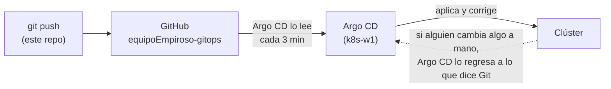
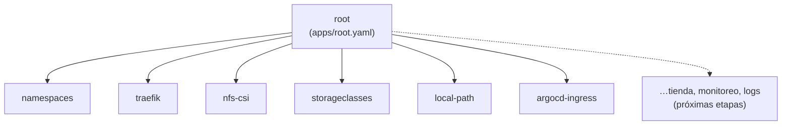

# Etapa 2 · Argo CD y el patrón app-of-apps

Proyecto 3 · Boletera de conciertos · DevOps 2026
Rol: Plataforma / CD · 16 de noviembre de 2026

Esta etapa instala **Argo CD**, la herramienta que aplica al clúster lo que hay
en este repositorio. A partir de aquí rige la regla central del proyecto:
**nadie aplica manifiestos con `kubectl apply`, todo cambio entra por Git**.
Argo CD fue lo único que se instaló a mano; todo lo demás lo instala él.

---

## Índice

1. [Resultado](#1-resultado)
2. [Cómo funciona GitOps con Argo CD](#2-cómo-funciona-gitops-con-argo-cd)
3. [Versiones y compatibilidad](#3-versiones-y-compatibilidad)
4. [Preparación](#4-preparación)
5. [Archivos de esta etapa](#5-archivos-de-esta-etapa)
6. [Instalación de Argo CD](#6-instalación-de-argo-cd)
7. [Acceso a la interfaz web](#7-acceso-a-la-interfaz-web)
8. [Contraseña de administrador](#8-contraseña-de-administrador)
9. [El patrón app-of-apps](#9-el-patrón-app-of-apps)
10. [DNS de los pods hacia GitHub](#10-dns-de-los-pods-hacia-github)
11. [Verificación y prueba de self-heal](#11-verificación-y-prueba-de-self-heal)
12. [Cómo reproducir esta etapa](#12-cómo-reproducir-esta-etapa)
13. [Evidencias](#13-evidencias)

---

## 1. Resultado

```
$ kubectl -n argocd get applications
NAME         SYNC STATUS   HEALTH STATUS
namespaces   Synced        Healthy
root         Synced        Healthy
```

| Qué | Estado |
|---|---|
| Argo CD v3.6.1 | 5 componentes en `Running`, todos en k8s-w1 (rol `app`) |
| Application raíz `root` | Lee la carpeta `apps/` y crea las demás Applications |
| Application `namespaces` | Creó `tienda`, `monitoring` y `logging` desde Git |
| Self-heal | Comprobado: al borrar `logging` a mano, Argo CD lo volvió a crear |
| Interfaz web | Primero por port-forward; desde la etapa 3, en http://argocd.100.103.221.107.nip.io |

En la etapa 3 se agregaron 5 Applications más (Traefik, NFS, local-path,
StorageClasses e Ingress de Argo CD). Las 7 están en `Synced / Healthy`.

---

## 2. Cómo funciona GitOps con Argo CD



- **Git es la única fuente de verdad.** Lo que está en `main` es lo que debe haber en el clúster.
- Argo CD compara continuamente Git con el clúster. Si hay diferencias:
  - **Sincroniza** (`automated`): aplica lo nuevo de Git.
  - **Poda** (`prune`): borra del clúster lo que se quitó de Git.
  - **Se autocorrige** (`selfHeal`): deshace los cambios hechos a mano.
- Cada componente se describe con un objeto **Application**: qué carpeta o chart leer, en qué versión y en qué namespace instalarlo.

---

## 3. Versiones y compatibilidad

El documento del proyecto pide revisar la matriz de compatibilidad contra la
versión de Kubernetes y fijar las versiones. El clúster usa **Kubernetes 1.37.2**.

| Componente | Versión | Por qué esa |
|---|---|---|
| Argo CD | **v3.6.1** (4 nov 2026) | En la tabla oficial *Tested Kubernetes versions*, **3.6 es la única versión probada con Kubernetes 1.37** (también con 1.36, 1.35 y 1.34). La serie 3.5 solo llega a 1.36. |
| Chart de Helm `argo/argo-cd` | **10.18.0** | El chart oficial (repositorio `argoproj/argo-helm`) que instala Argo CD v3.6.1. |
| Helm | **v4.3.1** (15 oct 2026) | Versión estable con más de dos semanas publicada. Se usa solo en el control plane para esta instalación. |

Fuentes:
[Argo CD · Tested Kubernetes versions](https://argo-cd.readthedocs.io/en/stable/operator-manual/tested-kubernetes-versions/) ·
[Releases de Argo CD](https://github.com/argoproj/argo-cd/releases) ·
[Releases de argo-helm](https://github.com/argoproj/argo-helm/releases) ·
[Releases de Helm](https://github.com/helm/helm/releases)

---

## 4. Preparación

### 4.1 Repositorios públicos

Los dos repositorios (`equipoEmpiroso-gitops` y `equipoEmpiroso-app`) se
hicieron **públicos**, cosa que el documento del proyecto permite ("públicos o
con acceso al profesor"):

- Argo CD lee el repositorio sin credenciales. Con un repo privado habría que crear un token de GitHub y guardarlo como Secret en el clúster.
- El webhook de GitHub hacia Tekton (etapa de CI) es más sencillo.
- El profesor puede revisarlos sin invitaciones.

No hay riesgo de publicar secretos: el `.gitignore` bloquea kubeconfigs, logs,
`.env` y cualquier `*secret*.yaml` (salvo los Sealed Secrets, que van cifrados).

### 4.2 git y Helm en el control plane

La instalación se hace desde k8s-cp, con dos herramientas:

| Herramienta | Para qué |
|---|---|
| **git** | Clonar este repositorio en el control plane (`~/equipoEmpiroso-gitops`) y leer de ahí el `values.yaml` de Argo CD. |
| **Helm v4.3.1** | Instalar el chart de Argo CD. Se descarga de `get.helm.sh` y se **verifica su SHA-256** antes de instalarlo. |

Las dos se instalan con el **playbook 03 del clúster**
(`cluster/03-control-plane.yml`), para que una reinstalación las tenga desde el
principio. Solo van en el control plane: los workers no las necesitan, porque
Argo CD y Tekton traen su propio git dentro de sus pods.

---

## 5. Archivos de esta etapa

| Archivo | Qué hace |
|---|---|
| [`plataforma/argocd/values.yaml`](../plataforma/argocd/values.yaml) | Configuración de Argo CD para Helm (sección 6). |
| [`apps/root.yaml`](../apps/root.yaml) | La Application **raíz**: lee `apps/` y crea todas las demás (sección 9). |
| [`apps/namespaces.yaml`](../apps/namespaces.yaml) | Primera Application "hija": aplica la carpeta `plataforma/namespaces`. |
| [`plataforma/namespaces/namespaces.yaml`](../plataforma/namespaces/namespaces.yaml) | Los namespaces `tienda`, `monitoring` y `logging`. |

---

## 6. Instalación de Argo CD

### 6.1 Configuración (`plataforma/argocd/values.yaml`)

```yaml
global:
  nodeSelector:
    boletera.io/app: "true"     # todo Argo CD en el worker con el rol "app" (k8s-w1)

configs:
  params:
    server.insecure: true       # Argo CD sirve HTTP; el Ingress (etapa 3) va por HTTP

dex:
  enabled: false                # sin inicio de sesión con GitHub/Google: ahorra memoria

notifications:
  enabled: false                # las alertas van por Alertmanager → Telegram
```

| Opción | Por qué |
|---|---|
| `global.nodeSelector` | Usa las etiquetas de rol que pone el playbook 04. Argo CD vive junto a la tienda en k8s-w1, en la laptop: la demo de despliegue no depende del servidor de casa. |
| `server.insecure: true` | Argo CD no cifra con su propio certificado. Dentro de la tailnet el tráfico ya va cifrado por WireGuard, y así el Ingress de Traefik puede reenviarle HTTP simple. |
| `dex` y `notifications` apagados | No se usan, y cada uno es un pod menos. |

### 6.2 Instalación (el único `helm install` hecho a mano)

En k8s-cp, como `ansible`:

```bash
helm repo add argo https://argoproj.github.io/argo-helm && helm repo update
helm install argocd argo/argo-cd --version 10.18.0 -n argocd --create-namespace \
  -f ~/equipoEmpiroso-gitops/plataforma/argocd/values.yaml
```

Resultado: todos los pods en **k8s-w1**, sin reinicios.

| Pod | Qué hace |
|---|---|
| `argocd-server` | Interfaz web y API |
| `argocd-repo-server` | Clona los repositorios y genera los manifiestos (charts de Helm o YAML) |
| `argocd-application-controller` | Compara Git con el clúster y sincroniza |
| `argocd-applicationset-controller` | Genera Applications desde plantillas (viene por defecto; no se usa) |
| `argocd-redis` | Caché interna |
| `argocd-redis-secret-init` | Tarea de una sola vez: crea la contraseña de Redis y termina (`Completed`) |

---

## 7. Acceso a la interfaz web

### 7.1 Al principio: port-forward

El Service `argocd-server` es de tipo `ClusterIP`: solo tiene una IP **dentro**
del clúster (red `10.96.0.0/12`), que no se alcanza desde la laptop. En esta
etapa todavía no había Ingress controller, así que la única forma de entrar era
un **port-forward**:

```bash
kubectl -n argocd port-forward svc/argocd-server 8080:80 --address 100.108.78.119
```

`kubectl` abre un túnel a través del API server hasta el Service, y lo expone en
el puerto 8080 de la IP de Tailscale del control plane. Desde Windows se
entraba a `http://100.108.78.119:8080`.

Funciona, pero tiene límites:

- La terminal tiene que quedarse abierta; si se cierra o se cae la sesión, se pierde el acceso.
- Depende de que alguien con `kubectl` y credenciales de administrador lo levante.
- No es la forma en que se expone un servicio de verdad (la rúbrica pide Ingress con un host).

### 7.2 Después: por Ingress, sin port-forward

En la etapa 3 se instaló **Traefik** y se agregó un Ingress para Argo CD. Desde
entonces se entra directo a:

**http://argocd.100.103.221.107.nip.io**

El nombre `nip.io` resuelve a la IP que lleva escrita (`100.103.221.107`, k8s-w1
en Tailscale). Traefik escucha en el puerto 80 de ese nodo y, por el nombre
pedido (`argocd....`), reenvía la petición al Service de Argo CD. Ya no hace
falta ninguna terminal abierta. Los detalles están en la
[etapa 3](03-ingress-y-almacenamiento.md#6-argo-cd-por-ingress).

---

## 8. Contraseña de administrador

1. Al instalarse, Argo CD crea una contraseña aleatoria para `admin` en el Secret `argocd-initial-admin-secret`:
   ```bash
   kubectl -n argocd get secret argocd-initial-admin-secret -o jsonpath='{.data.password}' | base64 -d; echo
   ```
2. Se entró a la interfaz con esa contraseña y se cambió en *User Info → Update Password*. La nueva está en el gestor de contraseñas, **no en Git**.
3. Se borró el Secret inicial, como recomienda la guía oficial de Argo CD:
   ```bash
   kubectl -n argocd delete secret argocd-initial-admin-secret
   ```

---

## 9. El patrón app-of-apps

En vez de crear cada Application a mano, hay **una sola Application raíz**
(`root`) que lee la carpeta `apps/`. Cada archivo de esa carpeta es otra
Application. Para agregar un componente al clúster, basta con un archivo nuevo
en `apps/` y un `git push`. Este patrón da **punto extra** en la rúbrica.



### 9.1 `apps/root.yaml`

```yaml
spec:
  source:
    repoURL: https://github.com/obeedt/equipoEmpiroso-gitops.git
    targetRevision: main
    path: apps
    directory:
      exclude: root.yaml        # no se administra a sí misma
  syncPolicy:
    automated:
      prune: true               # si se borra un archivo de apps/, se borra su Application
      selfHeal: true
```

Se aplicó **una sola vez**, a mano. Es el arranque de todo y el único
`kubectl apply` del proyecto:

```bash
kubectl apply -f ~/equipoEmpiroso-gitops/apps/root.yaml
```

`root` se excluye a sí misma (`exclude: root.yaml`) para no quedar en un ciclo
donde se administra y se poda a sí misma.

### 9.2 La primera Application hija: `namespaces`

`apps/namespaces.yaml` aplica `plataforma/namespaces/namespaces.yaml`, que crea
`tienda`, `monitoring` y `logging`. Sirvió para comprobar que el patrón funciona
antes de instalar componentes reales.

Dos namespaces quedaron fuera a propósito:

| Namespace | Por qué no está aquí |
|---|---|
| `argocd` | Lo crea Helm al instalar Argo CD. Si esta Application lo administrara con `prune`, un error en Git podría borrar al propio Argo CD. |
| `tekton-pipelines` | Lo crea el instalador de Tekton. Si también lo creara esta Application, dos Applications pelearían por el mismo recurso. |

### 9.3 Cada cuánto revisa Git

Argo CD revisa el repositorio **cada 3 minutos**. Para no esperar, el botón
*Refresh* de la interfaz lo revisa en ese momento.

---

## 10. DNS de los pods hacia GitHub

Argo CD tiene que llegar a GitHub desde dentro de un pod, y le da **15 segundos**
a cada consulta. Para que esa conexión sea rápida y estable, se ajustó el DNS de
los nodos de VMware (k8s-cp y k8s-w1).

**Por qué hizo falta.** El DHCP de VMware les da a esos nodos un *dominio de
búsqueda* (`search localdomain`). Los pods heredan ese `search` del nodo donde
corren, y Kubernetes les pone `options ndots:5`. Con eso, para buscar
`github.com` un pod prueba primero cada dominio de búsqueda:

| Nombre que prueba | Quién contesta | Tiempo |
|---|---|---|
| `github.com.argocd.svc.cluster.local` | CoreDNS | inmediato |
| `github.com.svc.cluster.local` | CoreDNS | inmediato |
| `github.com.cluster.local` | CoreDNS | inmediato |
| `github.com.localdomain` | DNS de VMware | **5,154 ms** |
| `github.com` | DNS de VMware | 93 ms |

Esos 5 segundos para `localdomain`, que no existe, se repetían en cada búsqueda
(para IPv4 y para IPv6) y dejaban la consulta cerca del límite de Argo CD. No
solo afectaba a Argo CD: cualquier pod en k8s-w1 los habría sufrido.

**Qué se cambió.** Se quitó el dominio de búsqueda automático y se conservó el
mismo servidor DNS de VMware, que funciona en cualquier red donde esté la laptop:

```bash
sudo nmcli con mod ens160 ipv4.ignore-auto-dns yes ipv4.dns 192.168.87.2
sudo nmcli device reapply ens160      # aplica sin cortar la red
kubectl -n argocd rollout restart deployment argocd-repo-server   # para que tome el resolv.conf nuevo
```

Este ajuste quedó en el **playbook 01 del clúster**, que además se detiene si
algún nodo usa un DNS dentro del rango de Tailscale (`100.64.0.0/10`). Detalle
completo en
[`cluster/docs/01-cluster-desde-cero.md`, sección 10](../cluster/docs/01-cluster-desde-cero.md#10-por-qué-se-cambió-el-dns-de-los-nodos).

---

## 11. Verificación y prueba de self-heal

```bash
kubectl -n argocd get applications      # root y namespaces: Synced / Healthy
kubectl get ns tienda monitoring logging
```

**Prueba de self-heal** (adelanto de la demo 2 de la presentación): se borró un
namespace a mano, sin tocar Git.

```bash
kubectl delete ns logging && kubectl get ns logging -w
```

Argo CD detectó que el clúster ya no coincidía con Git y lo volvió a crear. Las
fechas de creación lo muestran:

```
NS           CREADO
tienda       2026-11-17T02:11:40Z    ← creados por Argo CD al inicio
monitoring   2026-11-17T02:11:40Z
logging      2026-11-17T02:37:53Z    ← recreado por Argo CD después de borrarlo
```

---

## 12. Cómo reproducir esta etapa

Con el clúster de la etapa 1 listo y como `ansible` en k8s-cp:

```bash
git clone https://github.com/obeedt/equipoEmpiroso-gitops.git ~/equipoEmpiroso-gitops
helm repo add argo https://argoproj.github.io/argo-helm && helm repo update
helm install argocd argo/argo-cd --version 10.18.0 -n argocd --create-namespace \
  -f ~/equipoEmpiroso-gitops/plataforma/argocd/values.yaml
kubectl -n argocd get pods -o wide                                   # esperar todos Running
kubectl -n argocd get secret argocd-initial-admin-secret -o jsonpath='{.data.password}' | base64 -d; echo
kubectl apply -f ~/equipoEmpiroso-gitops/apps/root.yaml             # de aquí en adelante, todo por Git
```

Después: cambiar la contraseña de `admin` y borrar `argocd-initial-admin-secret`.
Con `root` aplicado, Argo CD instala también todo lo de la etapa 3.

---

## 13. Evidencias

Van en [`docs/evidencias/`](evidencias/):

- Interfaz de Argo CD con las Applications en `Synced / Healthy`.
- `kubectl -n argocd get pods -o wide` (todos en k8s-w1).
- La prueba de self-heal: `kubectl delete ns logging` y el namespace recreado.
