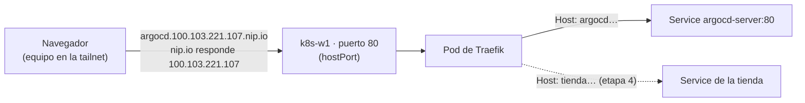

# Etapa 3 · Ingress y almacenamiento (Traefik, NFS y local-path)

Proyecto 3 · Boletera de conciertos · DevOps 2026
Rol: Plataforma / CD · 16 de noviembre de 2026

El rubro de **Clúster** pide, además de los nodos `Ready`, un **Ingress
controller** y un **StorageClass** funcionando. Esta etapa los instala, todo por
GitOps: cada componente es una Application de Argo CD en `apps/` y su
configuración vive en `plataforma/`. No se aplicó nada a mano.

---

## Índice

1. [Resultado](#1-resultado)
2. [Versiones y compatibilidad](#2-versiones-y-compatibilidad)
3. [Cómo los instala Argo CD](#3-cómo-los-instala-argo-cd)
4. [Archivos de esta etapa](#4-archivos-de-esta-etapa)
5. [Traefik: el Ingress controller](#5-traefik-el-ingress-controller)
6. [Argo CD por Ingress](#6-argo-cd-por-ingress)
7. [StorageClass `nfs`: driver CSI de NFS](#7-storageclass-nfs-driver-csi-de-nfs)
8. [StorageClass `local-path`](#8-storageclass-local-path)
9. [Descarga de imágenes: espejo de Docker Hub](#9-descarga-de-imágenes-espejo-de-docker-hub)
10. [Prueba de volúmenes](#10-prueba-de-volúmenes)
11. [Rubro de Clúster: qué queda cubierto](#11-rubro-de-clúster-qué-queda-cubierto)
12. [Evidencias](#12-evidencias)

---

## 1. Resultado

```
$ kubectl -n argocd get applications
NAME             SYNC STATUS   HEALTH STATUS
argocd-ingress   Synced        Healthy
local-path       Synced        Healthy
namespaces       Synced        Healthy
nfs-csi          Synced        Healthy
root             Synced        Healthy
storageclasses   Synced        Healthy
traefik          Synced        Healthy

$ kubectl get sc
NAME            PROVISIONER                            RECLAIMPOLICY   VOLUMEBINDINGMODE
local-path      cluster.local/local-path-provisioner   Delete          WaitForFirstConsumer
nfs (default)   nfs.csi.k8s.io                         Delete          Immediate

$ kubectl get ingress -A
NAMESPACE   NAME            CLASS     HOSTS                           ADDRESS           PORTS
argocd      argocd-server   traefik   argocd.100.103.221.107.nip.io   100.103.221.107   80
```

| Componente | Dónde corre |
|---|---|
| Traefik | 1 pod en k8s-w1, escuchando en el puerto 80 del nodo |
| Driver CSI de NFS | Controlador en k8s-w1 + un pod `csi-nfs-node` en **cada uno de los 4 nodos** |
| local-path-provisioner | 1 pod (en k8s-w2) + pods auxiliares de corta vida en el nodo donde se crea cada volumen |

---

## 2. Versiones y compatibilidad

| Componente | Versión | Por qué esa | Compatibilidad declarada |
|---|---|---|---|
| Traefik (chart) | **42.2.0** (30 oct 2026) | Chart estable con más de dos semanas publicado | `kubeVersion: '>=1.30.0-0'` |
| Traefik (proxy) | **v3.7.17** (30 oct 2026) | El chart trae v3.7.16; v3.7.17 corrige el aviso de seguridad GHSA-xv5x-242w-7hf7 | — |
| csi-driver-nfs | **4.13.6** (23 oct 2026) | Driver oficial de Kubernetes (SIG Storage), en estado GA y con mantenimiento activo | Kubernetes 1.21+ |
| local-path-provisioner | **v0.0.37** (5 ago 2026) | Última versión estable de Rancher | `kubeVersion: ">=1.12.0-r0"` |
| busybox (pod auxiliar de local-path) | **1.37.0** | El chart usa `latest`; se fija una versión para que no cambie sola | — |

Ninguno de los tres proyectos menciona Kubernetes 1.37 por nombre: todos piden
una versión **mínima**, y 1.37 la cumple.

Fuentes:
[traefik-helm-chart](https://github.com/traefik/traefik-helm-chart/releases) ·
[Traefik](https://github.com/traefik/traefik/releases) ·
[csi-driver-nfs](https://github.com/kubernetes-csi/csi-driver-nfs) ·
[local-path-provisioner](https://github.com/rancher/local-path-provisioner/releases)

---

## 3. Cómo los instala Argo CD

### 3.1 Charts de Helm con valores en Git (dos fuentes)

Traefik y el driver de NFS se instalan desde su **chart oficial**, pero la
configuración vive en este repositorio. Para eso, sus Applications tienen
**dos fuentes**:

```yaml
sources:
  - repoURL: https://traefik.github.io/charts       # 1) el chart oficial, versión fija
    chart: traefik
    targetRevision: 42.2.0
    helm:
      valueFiles:
        - $values/plataforma/traefik/values.yaml    # ← archivo de la fuente 2
  - repoURL: https://github.com/obeedt/equipoEmpiroso-gitops.git
    targetRevision: main
    ref: values                                     # 2) este repo, llamado "$values"
```

Así no se copia el chart al repo, y cambiar la configuración es editar un
`values.yaml` y hacer `git push`. Argo CD lo aplica solo.

### 3.2 Chart de local-path dentro del repositorio

Rancher no publica un repositorio de Helm para local-path-provisioner: el chart
solo existe dentro de su repositorio de GitHub. Para no depender de clonar ese
repositorio completo (historial y dependencias de Go) cada vez que Argo CD
revisa la Application, el chart se **copió sin modificar** en
`plataforma/local-path/chart/`:

- Es la carpeta `deploy/chart/local-path-provisioner` de la etiqueta **v0.0.37** (commit `49b2be8`), con su licencia Apache 2.0 (`chart/LICENSE`).
- Nuestra configuración va aparte, en `plataforma/local-path/values.yaml`; la Application la lee con `valueFiles: ../values.yaml`.
- Para actualizar de versión se reemplaza la carpeta `chart/` por la de la etiqueta nueva.

A esta práctica se le llama *vendorizar* el chart: la instalación queda
completa dentro de nuestro repo y fija a una versión exacta.

### 3.3 Opciones de sincronización

| Application | Opciones | Por qué |
|---|---|---|
| `traefik` | `CreateNamespace=true`, `ServerSideApply=true` | Crea el namespace `traefik`. Las CRDs de Traefik son grandes y se aplican mejor del lado del servidor. |
| `local-path` | `CreateNamespace=true` | Crea `local-path-storage`. |
| `storageclasses` | `selfHeal` **sin `prune`** | Si un StorageClass se borra de Git por error, Argo CD no lo borra del clúster: los volúmenes que dependen de él quedan a salvo. |
| las demás | `prune` + `selfHeal` | Comportamiento GitOps normal. |

---

## 4. Archivos de esta etapa

| Archivo | Qué hace |
|---|---|
| [`apps/traefik.yaml`](../apps/traefik.yaml) | Application de Traefik (chart oficial + `values.yaml` de este repo). |
| [`plataforma/traefik/values.yaml`](../plataforma/traefik/values.yaml) | Configuración de Traefik (sección 5). |
| [`apps/argocd-ingress.yaml`](../apps/argocd-ingress.yaml) | Application del Ingress de Argo CD. |
| [`plataforma/argocd-ingress/ingress.yaml`](../plataforma/argocd-ingress/ingress.yaml) | El Ingress `argocd.100.103.221.107.nip.io` (sección 6). |
| [`apps/nfs-csi.yaml`](../apps/nfs-csi.yaml) | Application del driver CSI de NFS. |
| [`plataforma/nfs/values.yaml`](../plataforma/nfs/values.yaml) | Configuración del driver (sección 7). |
| [`apps/storageclasses.yaml`](../apps/storageclasses.yaml) | Application de los StorageClasses propios. |
| [`plataforma/storageclasses/nfs.yaml`](../plataforma/storageclasses/nfs.yaml) | El StorageClass `nfs`, predeterminado (sección 7). |
| [`apps/local-path.yaml`](../apps/local-path.yaml) | Application de local-path (chart de este repo). |
| [`plataforma/local-path/values.yaml`](../plataforma/local-path/values.yaml) | Configuración de local-path (sección 8). |
| [`plataforma/local-path/chart/`](../plataforma/local-path/chart/) | Chart de Rancher v0.0.37, sin modificar. |
| [`.gitignore`](../.gitignore) | Excepción para `chart/templates/registry-secret.yaml`: es una plantilla sin datos, pero la regla `*secret*.yaml` la habría excluido. |
| [`cluster/01-prerequisitos.yml`](../cluster/01-prerequisitos.yml) | Espejo de Docker Hub en containerd (sección 9). |

---

## 5. Traefik: el Ingress controller

Un **Ingress controller** recibe las peticiones HTTP que llegan al clúster y,
según el nombre pedido (el *host*), las reenvía al Service correcto. Los objetos
`Ingress` de cada aplicación le dicen qué nombre va a qué Service.

### 5.1 Cómo se expone: puerto 80 de k8s-w1 por Tailscale



| Decisión | Por qué |
|---|---|
| **`hostPort: 80`** en k8s-w1 | Traefik escucha directo en el puerto 80 del nodo. El plugin `portmap` que trae Flannel hace la redirección del puerto del nodo al pod. |
| Service **`ClusterIP`**, no `LoadBalancer` | Un `LoadBalancer` necesita quién le asigne una IP externa (un proveedor de nube o MetalLB). En este clúster nadie lo haría y el Service se quedaría en `Pending` para siempre. |
| Solo en **k8s-w1** (`nodeSelector` rol `app`) | La tienda y Argo CD viven ahí, en la laptop: la demo no depende del servidor de casa. |
| Por la **IP de Tailscale** de k8s-w1 | `tailscale0` está en la zona `trusted` de firewalld, así que el puerto 80 se alcanza desde cualquier equipo de la tailnet. La interfaz física sigue cerrada. |
| Nombres **`nip.io`** | `argocd.100.103.221.107.nip.io` resuelve a `100.103.221.107` sin configurar ningún DNS. Es el formato que sugiere el documento del proyecto (`equipoN.<IP>.nip.io`). |

**Alcance:** las URLs solo abren desde equipos conectados a la tailnet. Para la
demo con la laptop del equipo basta.

### 5.2 `plataforma/traefik/values.yaml`

```yaml
image:
  tag: v3.7.17                     # corrige GHSA-xv5x-242w-7hf7
deployment:
  kind: Deployment
  replicas: 1
nodeSelector:
  boletera.io/app: "true"          # k8s-w1
ports:
  web:
    hostPort: 80
updateStrategy:                    # con hostPort: primero se detiene el pod viejo
  type: RollingUpdate
  rollingUpdate:
    maxUnavailable: 1
    maxSurge: 0
service:
  spec:
    type: ClusterIP
ingressClass:
  enabled: true
  isDefaultClass: true             # los Ingress sin clase también los atiende Traefik
  name: traefik
providers:
  kubernetesIngress:
    enabled: true
    publishedService:
      enabled: false
    ingressEndpoint:
      ip: "100.103.221.107"        # dirección que muestran los Ingress
resources:
  requests: { cpu: 100m, memory: 64Mi }
  limits: { memory: 256Mi }
```

| Opción | Para qué |
|---|---|
| `updateStrategy` con `maxSurge: 0` | Con `hostPort`, dos pods no pueden ocupar el puerto 80 del mismo nodo. La estrategia por defecto crea el pod nuevo antes de borrar el viejo, y el nuevo se quedaría esperando el puerto. Así, al actualizar, primero se detiene el viejo. |
| `ingressEndpoint.ip` | Los Ingress anuncian `100.103.221.107` como su dirección. Así `kubectl get ingress` la muestra, y Argo CD marca los Ingress como `Healthy` (sin dirección se quedan en `Progressing`). |
| `resources` | La rúbrica pide `requests` y `limits` en todos los contenedores. |

Antes de subirlo, `helm template` confirmó que el esquema del chart acepta
todos los valores (el chart rechaza claves desconocidas).

---

## 6. Argo CD por Ingress

`plataforma/argocd-ingress/ingress.yaml`:

```yaml
apiVersion: networking.k8s.io/v1
kind: Ingress
metadata:
  name: argocd-server
  namespace: argocd
spec:
  ingressClassName: traefik
  rules:
    - host: argocd.100.103.221.107.nip.io
      http:
        paths:
          - path: /
            pathType: Prefix
            backend:
              service:
                name: argocd-server
                port:
                  number: 80
```

| Antes (etapa 2) | Ahora |
|---|---|
| `kubectl port-forward` en una terminal del control plane | Un Ingress en Git, aplicado por Argo CD |
| `http://100.108.78.119:8080`, mientras la terminal siguiera abierta | **http://argocd.100.103.221.107.nip.io**, siempre disponible |
| Requiere a alguien con `kubectl` y credenciales de administrador | Basta con estar en la tailnet |

El Ingress apunta al puerto **80** de `argocd-server` porque Argo CD se instaló
con `server.insecure: true` (etapa 2): sirve HTTP y Traefik se lo reenvía tal
cual.

---

## 7. StorageClass `nfs`: driver CSI de NFS

### 7.1 Qué es y por qué este driver

Un **StorageClass** le dice a Kubernetes cómo crear volúmenes cuando un pod pide
uno con un `PersistentVolumeClaim` (PVC). Con **aprovisionamiento dinámico**
nadie crea los volúmenes a mano: el PVC basta.

Se eligió **csi-driver-nfs**, el driver oficial de Kubernetes para NFS, en vez
de `nfs-subdir-external-provisioner` (la opción clásica): está en estado GA, se
sigue manteniendo y sus imágenes están fijadas a la versión del chart
(`nfsplugin:v4.13.6`). Su costo es un pod pequeño por nodo (~60 MiB).

| Pieza | Dónde | Qué hace |
|---|---|---|
| `csi-nfs-controller` | k8s-w1 | Crea y archiva la carpeta de cada volumen en el servidor NFS |
| `csi-nfs-node` (DaemonSet) | los 4 nodos | Monta el volumen en el nodo donde corre cada pod; tolera el taint del control plane |

### 7.2 `plataforma/storageclasses/nfs.yaml`

```yaml
apiVersion: storage.k8s.io/v1
kind: StorageClass
metadata:
  name: nfs
  annotations:
    storageclass.kubernetes.io/is-default-class: "true"
provisioner: nfs.csi.k8s.io
parameters:
  server: 100.108.78.119          # IP de Tailscale de k8s-cp
  share: /srv/nfs/k8s
  subDir: ${pvc.metadata.namespace}-${pvc.metadata.name}
  onDelete: archive
reclaimPolicy: Delete
volumeBindingMode: Immediate
```

| Parámetro | Para qué |
|---|---|
| `server` / `share` | El NFS que montó el playbook 02 en el segundo disco del control plane (20 GB), exportado **solo a las 4 IPs de Tailscale** del clúster. |
| `subDir` | Una carpeta legible por volumen: `/srv/nfs/k8s/<namespace>-<pvc>`. |
| `onDelete: archive` | Al borrar un PVC, la carpeta se **renombra** (`archived-…`) en lugar de borrarse. Si alguien borra por error el PVC de la base de datos, los datos siguen ahí. |
| predeterminado | Un PVC sin `storageClassName` usa `nfs`. Así lo pide el documento del proyecto ("StorageClass funcional (NFS)"). |

El StorageClass está en su propio archivo y no lo crea el chart
(`storageClass.create: false` en `plataforma/nfs/values.yaml`): así queda a la
vista en Git y su Application no lo poda.

**Para qué se usa:** PostgreSQL. Si su pod se mueve de nodo, sus datos lo siguen,
porque viven en el control plane y no en el worker.

---

## 8. StorageClass `local-path`

El volumen es una carpeta en el **disco del propio worker**
(`/opt/local-path-provisioner`). Es más rápido que NFS porque no pasa por la red,
pero el volumen queda **atado a ese nodo**.

| Opción (`plataforma/local-path/values.yaml`) | Para qué |
|---|---|
| `defaultClass: false` | El predeterminado es `nfs`; local-path se pide explícitamente. |
| `volumeBindingMode: WaitForFirstConsumer` | El volumen no se crea hasta saber en qué nodo correrá el pod, y se crea en ese nodo. |
| `helperImage.tag: "1.37.0"` | El pod auxiliar que crea y borra las carpetas usa busybox con versión fija (el chart traía `latest`). |
| `resources` | `requests` y `limits` para el pod del provisioner. |

**Para qué se usa:** OpenSearch (rol `logs`, k8s-w2) y Prometheus (rol
`metricas`, k8s-w3). Escriben mucho y siempre corren en su nodo, así que no
necesitan que sus datos los sigan.

| | `nfs` | `local-path` |
|---|---|---|
| Datos en | control plane, por red | disco del worker |
| Si el pod cambia de nodo | los datos lo siguen | el pod vuelve a su nodo |
| Acceso | `ReadWriteMany` (varios nodos a la vez) | `ReadWriteOnce` (un nodo) |
| Al borrar el PVC | carpeta archivada | carpeta borrada |
| Uso | PostgreSQL | OpenSearch, Prometheus |

---

## 9. Descarga de imágenes: espejo de Docker Hub

### 9.1 Por qué

Traefik, local-path-provisioner y busybox vienen de **Docker Hub**. Para
descargar de Docker Hub, containerd primero pide un permiso (*token*) a
`auth.docker.io`, que está detrás de **Cloudflare**.

Al instalar esta etapa, **Cloudflare no respondía desde la red de la casa**: ni
`auth.docker.io`, ni `hub.docker.com`, ni `cloudflare.com`, ni `1.1.1.1`. Pasaba
igual desde Windows, desde las VMs de la laptop y desde las de Proxmox. En
cambio GitHub, ghcr.io, quay.io y registry.k8s.io sí respondían. Era una
condición de la red externa, fuera del clúster, pero bastaba para que ninguna
imagen de Docker Hub se pudiera descargar.

### 9.2 Qué se configuró

Google mantiene un **espejo público de Docker Hub** (`mirror.gcr.io`) que no
pasa por Cloudflare. El playbook 01 del clúster configura containerd en los 4
nodos para usarlo:

1. `config_path = '/etc/containerd/certs.d'` en `/etc/containerd/config.toml`, en los dos plugins que descargan imágenes (CRI y *transfer*).
2. `/etc/containerd/certs.d/docker.io/hosts.toml`:
   ```toml
   server = "https://registry-1.docker.io"

   [host."https://mirror.gcr.io"]
     capabilities = ["pull", "resolve"]
   ```
   containerd intenta primero el espejo y, si falla, Docker Hub directo.
3. Reinicia containerd. Los contenedores que ya corrían **no se detienen**.

Antes de aplicarlo se probó en k8s-w1 con `ctr --hosts-dir`, en un namespace de
containerd aparte que Kubernetes no ve: `busybox:1.37.0` y
`rancher/local-path-provisioner:v0.0.37` bajaron en **6 s cada una** por el
espejo. Una corrida de prueba del playbook (`--check --diff`) mostró solo los
cambios esperados: 4 por nodo, 0 fallas. Ya aplicado, una corrida de prueba de
todo `site.yml` dio `changed=0` en los 4 nodos: la configuración quedó estable.

**Ventaja que se queda:** Docker Hub limita las descargas anónimas por IP. Con el
espejo, los builds de Tekton y los microservicios no chocan con ese límite
durante la demo.

### 9.3 DNS de los nodos de Proxmox

Por la misma razón se cambiaron los DNS de k8s-w2 y k8s-w3. El primero era
`1.1.1.1` (Cloudflare), así que cada consulta esperaba 5 s a que fallara antes de
pasar al segundo. Ahora usan dos proveedores distintos, ninguno de Cloudflare:

```bash
sudo nmcli con mod ens18 ipv4.dns "8.8.8.8 9.9.9.9"     # Google y Quad9
sudo nmcli device reapply ens18
```

Resultado: de 5,032 ms a **29–44 ms** por consulta.

---

## 10. Prueba de volúmenes

Comprueba los dos StorageClasses de punta a punta. Se hizo en un namespace
temporal (`prueba-volumenes`) que se borró al terminar; nada de esto está en
Git, porque es una verificación y no parte de la plataforma.

### 10.1 Los pasos

| Paso | Qué se hizo | Qué demuestra |
|---|---|---|
| 1 | Dos PVC de 1 GiB: `datos-nfs` (`nfs`, `ReadWriteMany`) y `datos-local` (`local-path`, `ReadWriteOnce`) | `datos-nfs` queda `Bound` al instante (`Immediate`); `datos-local` queda `Pending` hasta que un pod lo use (`WaitForFirstConsumer`). |
| 2 | Pod `escritor` en **k8s-w2** que escribe un texto en los dos volúmenes | Los volúmenes se crean, se montan y se puede escribir. `datos-local` pasa a `Bound` en k8s-w2. |
| 3 | Se borra `escritor`. Pod `lector-nfs` en **k8s-w3** y pod `lector-local` **sin elegir nodo** | **NFS:** el otro nodo lee el mismo texto, porque los datos siguen al pod. **local-path:** el scheduler manda el pod **solo a k8s-w2**, porque el volumen tiene afinidad con ese nodo. |
| 4 | Se borra el namespace | NFS **archiva** la carpeta (`archived-…`); local-path la **borra**. |

Pod escritor (paso 2):

```yaml
apiVersion: v1
kind: Pod
metadata:
  name: escritor
  namespace: prueba-volumenes
spec:
  nodeSelector:
    kubernetes.io/hostname: k8s-w2
  containers:
    - name: escritor
      image: docker.io/library/busybox:1.37.0
      command: ["sh", "-c", "echo \"escrito en $(cat /etc/hostname) el $(date)\" | tee /nfs/prueba.txt /local/prueba.txt; sleep 3600"]
      volumeMounts:
        - { name: nfs, mountPath: /nfs }
        - { name: local, mountPath: /local }
      resources:
        requests: { cpu: 10m, memory: 16Mi }
        limits: { memory: 32Mi }
  volumes:
    - name: nfs
      persistentVolumeClaim: { claimName: datos-nfs }
    - name: local
      persistentVolumeClaim: { claimName: datos-local }
```

Los lectores (paso 3) son iguales, pero solo montan su volumen y hacen `cat` del
archivo. `lector-nfs` lleva `nodeSelector` hacia k8s-w3; `lector-local` no lleva
ninguno.

Comandos de verificación:

```bash
kubectl -n prueba-volumenes get pvc,pod -o wide
kubectl -n prueba-volumenes logs lector-nfs        # leído en k8s-w3
kubectl -n prueba-volumenes logs lector-local      # leído en k8s-w2
kubectl get pv -o custom-columns=PVC:.spec.claimRef.name,CLASE:.spec.storageClassName,NODO:.spec.nodeAffinity.required.nodeSelectorTerms[*].matchExpressions[*].values[*]
sudo ls -la /srv/nfs/k8s/                          # en k8s-cp
```

### 10.2 Resultado

Después de borrar el namespace de prueba:

| Dónde | Qué quedó |
|---|---|
| NFS en k8s-cp (`/srv/nfs/k8s/`) | `archived-prueba-volumenes-datos-nfs/`, con el archivo intacto: `escrito en escritor el Tue Nov 17 03:56:51 UTC 2026` |
| k8s-w2 (`/opt/local-path-provisioner/`) | vacío: local-path borró la carpeta |
| `kubectl get pv` | `No resources found`: no quedaron volúmenes huérfanos |

La prueba del paso 3 con NFS es la misma idea que la prueba obligatoria de la
rúbrica para la base de datos ("borrar el pod de la BD y el pedido sigue
existiendo"), y se repetirá con PostgreSQL en la siguiente etapa.

---

## 11. Rubro de Clúster: qué queda cubierto

| Pide la rúbrica | Estado |
|---|---|
| 3 nodos `Ready` (1 control plane + 2 workers) | ✅ 4 nodos `Ready` (etapa 1) |
| Ingress controller | ✅ Traefik, con Argo CD publicado por Ingress |
| StorageClass funcional (NFS) | ✅ `nfs` predeterminado, probado de punta a punta; además `local-path` |
| Red de pods entre nodos | ✅ Flannel sobre Tailscale, verificado con `verificar-red.sh` (etapa 1) |
| Instalación documentada (opción A) | ✅ `cluster/` + documentos de las etapas 1, 2 y 3 |

---

## 12. Evidencias

Van en [`docs/evidencias/`](evidencias/):

- `kubectl get sc` con `nfs (default)` y `local-path`.
- `kubectl -n prueba-volumenes get pvc,pod -o wide` con los dos PVC en `Bound`.
- Logs de `lector-nfs` (en k8s-w3) y de `lector-local` (en k8s-w2).
- `ls /srv/nfs/k8s/` con la carpeta `archived-prueba-volumenes-datos-nfs`.
- Interfaz de Argo CD con las 7 Applications en `Synced / Healthy`.
- `kubectl get ingress -A` y el navegador en http://argocd.100.103.221.107.nip.io.
