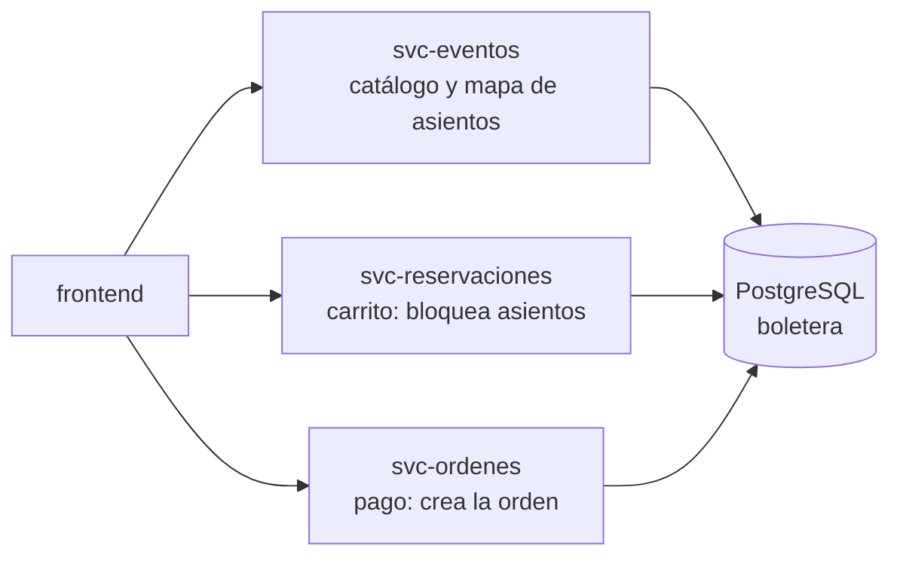

# Etapa 4 · PostgreSQL en StatefulSet con volumen persistente

Proyecto 3 · Boletera de conciertos · DevOps 2026
Rol: Plataforma / CD (+ Desarrollo, por el diseño del esquema) · 17 de noviembre de 2026

Esta etapa instala la base de datos de la boletera: **PostgreSQL 18.7** en un
**StatefulSet** con su volumen en el StorageClass **`nfs`**, el esquema que
usarán los microservicios y datos de ejemplo. Cubre el rubro **BD y
persistencia**: PVC en `Bound`, y al borrar el pod de la base el pedido sigue
existiendo.

---

## Índice

1. [Resultado](#1-resultado)
2. [Versión e imagen](#2-versión-e-imagen)
3. [Archivos de esta etapa](#3-archivos-de-esta-etapa)
4. [El StatefulSet](#4-el-statefulset)
5. [Credenciales: dos Secrets fuera de Git](#5-credenciales-dos-secrets-fuera-de-git)
6. [Diseño del esquema](#6-diseño-del-esquema)
7. [Datos de ejemplo](#7-datos-de-ejemplo)
8. [Scripts de inicialización y cambios futuros](#8-scripts-de-inicialización-y-cambios-futuros)
9. [Pruebas antes de desplegar](#9-pruebas-antes-de-desplegar)
10. [Despliegue y prueba de persistencia](#10-despliegue-y-prueba-de-persistencia)
11. [Cómo reproducir esta etapa](#11-cómo-reproducir-esta-etapa)
12. [Evidencias](#12-evidencias)

---

## 1. Resultado

```
$ kubectl -n tienda get sts,pods,pvc,svc
NAME                        READY   AGE
statefulset.apps/postgres   1/1     11m

NAME             READY   STATUS    RESTARTS   NODE
pod/postgres-0   1/1     Running   0          k8s-w1

NAME                                     STATUS   CAPACITY   ACCESS MODES   STORAGECLASS
persistentvolumeclaim/datos-postgres-0   Bound    5Gi        RWO            nfs

NAME                        TYPE        CLUSTER-IP     PORT(S)
service/postgres            ClusterIP   10.97.44.176   5432/TCP
service/postgres-headless   ClusterIP   None           5432/TCP
```

| Qué | Estado |
|---|---|
| Application `postgres` en Argo CD | `Synced / Healthy` |
| Datos | 22 eventos, 2,840 asientos, 444 órdenes de ejemplo; esquema versión `001` |
| Volumen | `/srv/nfs/k8s/tienda-datos-postgres-0/18/docker` en el NFS del control plane |
| Prueba de la rúbrica | ✅ Se borró el pod y el pedido de prueba siguió existiendo |
| Self-heal | ✅ Al escalar el StatefulSet a 0 a mano, Argo CD lo regresó a 1 réplica en menos de un segundo |

---

## 2. Versión e imagen

| Decisión | Por qué |
|---|---|
| **PostgreSQL 18** | La versión 19 aún no estaba publicada (19 RC2, con salida prevista para el 19 de noviembre de 2026). La 18 tiene soporte hasta noviembre de 2030. |
| **18.7** (12 nov 2026) | La última versión de corrección de la 18. PostgreSQL recomienda correr siempre la última, porque solo trae arreglos de errores y de seguridad. |
| Imagen **oficial** `postgres:18.7-trixie` | Debian 13 (glibc). El proyecto evita las imágenes de Bitnami, que dejaron de recibir actualizaciones gratuitas. Se descarga por el espejo `mirror.gcr.io` (etapa 3). |

Fuentes:
[PostgreSQL · Versioning policy](https://www.postgresql.org/support/versioning/) ·
[Notas de versión](https://www.postgresql.org/docs/release/) ·
[Imagen oficial en Docker Hub](https://hub.docker.com/_/postgres)

### La ruta de los datos cambió en PostgreSQL 18

Desde la versión 18, la imagen oficial guarda los datos en
`/var/lib/postgresql/18/docker` y declara el volumen en **`/var/lib/postgresql`**.
En las versiones anteriores era `/var/lib/postgresql/data`. Su documentación
advierte que un volumen en la ruta antigua **no conserva los datos** al recrear
el contenedor. Por eso el volumen se monta en `/var/lib/postgresql`. Los datos
quedan en una subcarpeta con la versión, lo que además facilita una futura
actualización de versión mayor.

---

## 3. Archivos de esta etapa

| Archivo | Qué hace |
|---|---|
| [`apps/postgres.yaml`](../apps/postgres.yaml) | Application de Argo CD; como la carpeta tiene `kustomization.yaml`, Argo CD usa Kustomize |
| [`tienda/postgres/kustomization.yaml`](../tienda/postgres/kustomization.yaml) | Junta los manifiestos y convierte `init/` en el ConfigMap `postgres-init` |
| [`tienda/postgres/statefulset.yaml`](../tienda/postgres/statefulset.yaml) | PostgreSQL 18.7, 1 réplica, PVC de 5 GiB en `nfs` (sección 4) |
| [`tienda/postgres/services.yaml`](../tienda/postgres/services.yaml) | `postgres` (lo usan los microservicios) y `postgres-headless` (lo usa el StatefulSet) |
| [`tienda/postgres/configmap.yaml`](../tienda/postgres/configmap.yaml) | `POSTGRES_DB=boletera`, `APP_DB_USER=boletera_app`, `TZ=America/Mexico_City` |
| [`tienda/postgres/init/01-esquema.sql`](../tienda/postgres/init/01-esquema.sql) | Tablas, restricciones, índices y vistas (sección 6) |
| [`tienda/postgres/init/02-datos.sql`](../tienda/postgres/init/02-datos.sql) | Datos de ejemplo (sección 7) |
| [`tienda/postgres/init/03-usuario-app.sh`](../tienda/postgres/init/03-usuario-app.sh) | Usuario `boletera_app` con permisos solo sobre los datos |
| [`tienda/README.md`](../tienda/README.md) | Secrets y **contrato de datos** para los microservicios |

**Por qué Kustomize:** los scripts de inicialización quedan como archivos `.sql`
normales en Git, legibles y fáciles de editar. Kustomize los empaqueta en un
ConfigMap al aplicar. El ConfigMap tiene nombre fijo (`disableNameSuffixHash`):
editar un script no reinicia la base, y de todas formas no se volvería a
ejecutar (sección 8).

---

## 4. El StatefulSet

### 4.1 Por qué StatefulSet y no Deployment

| | StatefulSet | Deployment |
|---|---|---|
| Nombre del pod | Fijo: `postgres-0` | Aleatorio, cambia en cada reinicio |
| Volumen | Uno propio por pod (`volumeClaimTemplates`), que lo sigue siempre | Compartido o creado aparte |
| Lo pide la rúbrica | ✅ "StatefulSet con volumeClaimTemplates" | — |

### 4.2 Configuración clave

| Campo | Valor | Para qué |
|---|---|---|
| `volumeClaimTemplates` | PVC `datos` de 5 GiB en `nfs` → `datos-postgres-0` | El pod siempre monta el mismo volumen, en cualquier nodo. En el NFS queda en `/srv/nfs/k8s/tienda-datos-postgres-0`. |
| `persistentVolumeClaimRetentionPolicy` | `Retain` al borrar y al escalar | Ni borrar el StatefulSet ni bajarlo a 0 réplicas borra los datos. |
| `volumeMounts` | `/var/lib/postgresql` | La ruta correcta desde PostgreSQL 18 (sección 2). |
| `nodeSelector` | `boletera.io/app: "true"` | En k8s-w1, junto a la tienda. Como los datos están en NFS, podría correr en cualquier worker. |
| `terminationGracePeriodSeconds` | 60 | Tiempo para que PostgreSQL guarde todo en disco antes de detenerse. El log confirma un cierre limpio: `database system was shut down`. |
| `startupProbe` | `pg_isready`, hasta 5 min | La primera vez crea la base y corre los scripts; mientras tanto no lo reinicia. |
| `readinessProbe` / `livenessProbe` | `pg_isready` cada 10 s / 20 s | No manda tráfico si no responde, y lo reinicia si se cuelga. |
| `resources` | requests 100m / 256Mi, límite 512Mi | La rúbrica pide `requests` y `limits` en todos los contenedores. |

### 4.3 Services

| Service | Tipo | Para qué |
|---|---|---|
| `postgres-headless` | `clusterIP: None` | El `serviceName` del StatefulSet: da un nombre DNS estable al pod (`postgres-0.postgres-headless.tienda.svc.cluster.local`). |
| `postgres` | `ClusterIP` | El que usan los microservicios: `postgres.tienda.svc.cluster.local:5432`. |

### 4.4 PostgreSQL sobre NFS

PostgreSQL necesita que su carpeta de datos sea de su usuario (uid `999` en la
imagen Debian) con permisos `700`. El contenedor arranca como root, ajusta el
dueño de la carpeta y luego se ejecuta como `postgres`. Eso funciona en este NFS
porque se exporta con `no_root_squash` (playbook 02) y solo a las 4 IPs del
clúster. Se comprobó: la carpeta quedó con dueño `999` y permisos `700`
(sección 9).

---

## 5. Credenciales: dos Secrets fuera de Git

La rúbrica pide credenciales en Secret y ningún Secret real en Git. Se crearon a
mano, una sola vez, antes del primer despliegue. Las contraseñas se generan al
azar y nunca se muestran:

```bash
kubectl -n tienda create secret generic postgres-admin \
  --from-literal=POSTGRES_PASSWORD="$(head -c 24 /dev/urandom | base64 | tr -d '/+=')"
kubectl -n tienda create secret generic postgres-app \
  --from-literal=APP_DB_PASSWORD="$(head -c 24 /dev/urandom | base64 | tr -d '/+=')"
```

| Secret | Contraseña de | Quién lo monta |
|---|---|---|
| `postgres-admin` | `postgres` (administrador) | Solo el pod de PostgreSQL |
| `postgres-app` | `boletera_app` | PostgreSQL (al crear el usuario) y los microservicios |

Son dos Secrets para aplicar el **mínimo privilegio**: los microservicios nunca
reciben la contraseña de administrador. No se deben borrar, porque la base
guarda las contraseñas al inicializarse.

Una mejora posible (punto extra de la rúbrica) es cambiarlos por **Sealed
Secrets**, que sí pueden ir cifrados en Git.

---

## 6. Diseño del esquema

El esquema se diseñó a partir del flujo que pide la rúbrica, **catálogo →
carrito → pedido**, traducido a una boletera:



### 6.1 Tablas

| Tabla | Qué guarda | Escribe |
|---|---|---|
| `eventos` | Conciertos: nombre, artista, `genero`, `descripcion`, recinto, ciudad, fecha, `precio_base`, `capacidad`, `activo` | — (datos iniciales) |
| `asientos` | Un registro por lugar: `seccion` (VIP, Preferente, General), `fila`, `numero`, `precio`, `estado` (`disponible`, `bloqueado`, `vendido`) | svc-reservaciones, svc-ordenes |
| `reservaciones` | El **carrito**: los asientos apartados por una `sesion` del navegador, con `expira_en` | svc-reservaciones |
| `ordenes` | Pedidos: cliente, `cantidad` (1 a 10), `total`, `estado`, `reservacion_id` | svc-ordenes |
| `esquema_version` | Versiones del esquema aplicadas (`001`) | migraciones |

### 6.2 Decisiones del diseño

| Decisión | Para qué |
|---|---|
| **El carrito es una `reservacion`** con dueño (`sesion`) y vencimiento | El microservicio distintivo del proyecto 3 es "reservación de asientos con bloqueo temporal". Ligar los asientos a una reservación permite saber qué cobrar en cada orden y liberarlos si el usuario no paga a tiempo. |
| **Bloqueo en un solo `UPDATE`** que solo toma asientos libres | Dos personas nunca bloquean el mismo asiento: si otra sesión ya lo tomó, el `UPDATE` afecta menos filas y el servicio lo detecta. La consulta está en el contrato de datos (`tienda/README.md`). |
| **Vista `asientos_estado_actual`** | Un bloqueo vencido cuenta como `disponible` sin que un proceso tenga que liberarlo. Todos los servicios leen la disponibilidad de aquí, así siempre coinciden. |
| **`ordenes.reservacion_id` único** | Si el navegador reintenta el pago, la segunda orden se rechaza: no se cobra dos veces. |
| **Restricción `asiento_coherente`** | La base rechaza combinaciones imposibles, por ejemplo un asiento `vendido` sin orden o `bloqueado` sin reservación. |
| **Precio por asiento y secciones** | VIP (filas A-B, ×2), Preferente (C-E, ×1.5) y General (×1). El frontend puede mostrar un mapa por secciones, y el total de la orden es la suma de sus asientos. |
| **Vista `ventas_por_evento`** | La **métrica de negocio** del proyecto 3 (boletos vendidos por evento) y su porcentaje, que alimenta la **alerta** de más del 90 % vendido. `svc-eventos` la expondrá en `/metrics`. |
| `GENERATED ALWAYS AS IDENTITY` y `UUID` | La forma recomendada de generar IDs en PostgreSQL moderno. Las reservaciones usan UUID porque su ID viaja al navegador y no debe ser adivinable. |
| Una sola base para los tres servicios | Con un solo PostgreSQL y un equipo de dos personas es la opción práctica. Cada servicio escribe solo en sus tablas. |

### 6.3 Usuarios de la base

| Usuario | Puede | Lo usa |
|---|---|---|
| `postgres` | Todo | Mantenimiento y migraciones |
| `boletera_app` | `SELECT`, `INSERT`, `UPDATE`, `DELETE` sobre los datos | Los microservicios |

`boletera_app` **no** puede crear, cambiar ni borrar tablas. Si un microservicio
tuviera una falla de seguridad, no podría destruir el esquema.

---

## 7. Datos de ejemplo

La rúbrica pide un script de inicialización con mínimo 20 productos.

| Dato | Cantidad |
|---|---|
| Conciertos (`eventos`) | 22, con artistas ficticios, recintos reales y fechas de diciembre 2026 a junio 2027 |
| Asientos | 2,840 (uno por lugar), en 3 secciones con su precio |
| Órdenes pagadas | 444, de 2 boletos cada una |

La venta inicial varía por evento: del 96 % al 0 %. Los **eventos 1 (96 %) y
2 (92 %)** quedan arriba del 90 %, para poder demostrar la alerta de negocio en
la etapa de monitoreo.

```
 id |         nombre          | vendidos | capacidad | porcentaje_vendido
----+-------------------------+----------+-----------+--------------------
  1 | Gira Faro del Norte     |       96 |       100 |               96.0
  2 | Noche de Cumbia Sideral |      138 |       150 |               92.0
  3 | Acústico en el Bosque   |       64 |        80 |               80.0
```

---

## 8. Scripts de inicialización y cambios futuros

La imagen oficial ejecuta los archivos de `/docker-entrypoint-initdb.d`
**solo si la carpeta de datos está vacía**, es decir, la primera vez. Se
ejecutan en orden alfabético:

| Script | Qué hace |
|---|---|
| `01-esquema.sql` | Crea tablas, restricciones, índices y vistas, y registra la versión `001` |
| `02-datos.sql` | Inserta eventos, asientos y órdenes de ejemplo |
| `03-usuario-app.sh` | Crea `boletera_app` con la contraseña del Secret `postgres-app` |

**Consecuencias:**

- Al reiniciar o recrear el pod, **los scripts no se repiten** y los datos se conservan. Comprobado: después de recrear el pod, `esquema_version` siguió con un solo registro.
- **Cambiar el esquema** de una base ya creada: con migraciones (`ALTER TABLE ...` como `postgres`) que se registran en `esquema_version` con la siguiente versión (`002`, …).
- **Cambiar los datos iniciales** (por ejemplo, otros conciertos): se editan los scripts en Git y se **reinicializa** la base. Hay que borrar el PVC para que PostgreSQL arranque con la carpeta vacía:
  ```bash
  kubectl -n tienda delete pvc datos-postgres-0 --wait=false   # queda pendiente mientras el pod lo use
  kubectl -n tienda delete pod postgres-0                      # el StatefulSet lo recrea con un PVC nuevo
  ```
  La carpeta anterior no se pierde: el StorageClass `nfs` la archiva (`archived-tienda-datos-postgres-0`). Esto borra **todos** los pedidos, así que solo conviene antes de tener datos reales.

---

## 9. Pruebas antes de desplegar

Antes del primer `git push`, todo se probó sin tocar Kubernetes:

1. **Manifiestos:** `kubectl kustomize` generó los 5 objetos y el API server los aceptó con `kubectl apply --dry-run=server`.
2. **Base real sobre el NFS real:** en k8s-w1 se montó el NFS del clúster y se levantó PostgreSQL 18.7 con `ctr`, en un namespace de containerd aparte que Kubernetes no ve, con los mismos scripts y contraseñas de prueba. Al terminar se borraron el contenedor, la imagen y la carpeta de prueba, y se desmontó el NFS.

| Prueba | Resultado |
|---|---|
| Carpeta de datos en NFS | dueño `999`, permisos `700` |
| Datos | 22 eventos, 2,840 asientos, 444 órdenes; 0 inconsistencias (asientos = capacidad; total de cada orden = suma de sus asientos) |
| Precios por sección (evento 1, base $850) | VIP $1,700 · Preferente $1,275 · General $850 |
| Sesión A bloquea 2 asientos | `UPDATE 2` |
| Sesión B intenta **los mismos** | `UPDATE 0`: no se los gana |
| Bloqueo vencido | guardado como `bloqueado`, la vista lo muestra `disponible` y otra sesión lo toma |
| Pago de la sesión A (transacción) | orden de $1,300, asientos `vendido`, reservación `confirmada` |
| Reintento del mismo pago | rechazado: `duplicate key ... ordenes_reservacion_id_key` |
| Asiento `vendido` sin orden | rechazado: `violates check constraint "asiento_coherente"` |
| `boletera_app` intenta `DROP TABLE` | rechazado: `must be owner of table eventos` |
| Contenedor **nuevo** sobre los mismos datos | la orden de prueba sigue ahí; los scripts no se repiten |

---

## 10. Despliegue y prueba de persistencia

### 10.1 Despliegue

1. Se crearon los dos Secrets (sección 5).
2. `git push` de `apps/postgres.yaml` y `tienda/`. Argo CD creó la Application `postgres` y todos sus objetos.
3. El StatefulSet creó el PVC `datos-postgres-0` (`Bound` en `nfs`) y el pod `postgres-0` en k8s-w1. En el primer arranque descargó la imagen y corrió los scripts.

```bash
kubectl -n tienda wait --for=condition=Ready pod/postgres-0 --timeout=300s
kubectl -n tienda exec postgres-0 -- psql -U postgres -d boletera \
  -c "select id, nombre, vendidos, capacidad, porcentaje_vendido from ventas_por_evento order by porcentaje_vendido desc limit 5;"
```

### 10.2 Prueba obligatoria: borrar el pod y que el pedido siga ahí

```bash
# 1. Un pedido nuevo
kubectl -n tienda exec postgres-0 -- psql -U postgres -d boletera -c "insert into ordenes (evento_id, cliente_nombre, cliente_email, cantidad, total) values (5, 'Prueba de persistencia', 'persistencia@ejemplo.com', 2, 1900) returning id, cliente_nombre, creada_en;"
 id  |     cliente_nombre     |           creada_en
-----+------------------------+-------------------------------
 445 | Prueba de persistencia | 2026-11-17 23:02:27.522609-06

# 2. Hora de creación del pod, y se borra
kubectl -n tienda get pod postgres-0 -o jsonpath='{.metadata.creationTimestamp}' && kubectl -n tienda delete pod postgres-0
2026-11-18T04:57:12Z
pod "postgres-0" deleted

# 3. El StatefulSet lo recrea: pod nuevo, mismo nombre, mismo volumen
kubectl -n tienda wait --for=condition=Ready pod/postgres-0 --timeout=180s && kubectl -n tienda get pod postgres-0 -o jsonpath='{.metadata.creationTimestamp}'
2026-11-18T05:02:43Z

# 4. El pedido sigue ahí
kubectl -n tienda exec postgres-0 -- psql -U postgres -d boletera -c "select id, cliente_nombre, total, creada_en from ordenes where cliente_nombre = 'Prueba de persistencia';"
 id  |     cliente_nombre     |  total  |           creada_en
-----+------------------------+---------+-------------------------------
 445 | Prueba de persistencia | 1900.00 | 2026-11-17 23:02:27.522609-06
```

El pod es nuevo (otra hora de creación), pero el pedido `445` aparece con los
mismos datos: vive en el volumen NFS, no en el pod.

La orden `445` es solo de prueba: no tiene asientos asignados, así que no cambia
la métrica de negocio (que cuenta asientos vendidos).

### 10.3 Self-heal del StatefulSet (adelanto de la demo 2)

```bash
kubectl -n tienda scale statefulset postgres --replicas=0
```

El cambio a mano dejó la Application en `OutOfSync`, y Argo CD la sincronizó en
menos de un segundo, regresando el StatefulSet a `replicas: 1` como dice Git:

```
05:03:47  Updated sync status: Synced -> OutOfSync
05:03:47  Initiated automated sync ... Resources: StatefulSet/postgres
05:03:48  Updated sync status: OutOfSync -> Synced
```

El volumen no se tocó (`whenScaled: Retain`) y el pod volvió con todos sus datos.

---

## 11. Cómo reproducir esta etapa

Con las etapas 1 a 3 listas, en k8s-cp:

```bash
# 1. Secrets (sección 5)
kubectl -n tienda create secret generic postgres-admin --from-literal=POSTGRES_PASSWORD="$(head -c 24 /dev/urandom | base64 | tr -d '/+=')"
kubectl -n tienda create secret generic postgres-app   --from-literal=APP_DB_PASSWORD="$(head -c 24 /dev/urandom | base64 | tr -d '/+=')"

# 2. Con apps/postgres.yaml y tienda/postgres/ en Git, Argo CD lo despliega solo.
kubectl -n tienda wait --for=condition=Ready pod/postgres-0 --timeout=300s
kubectl get pvc -A
```

---

## 12. Evidencias

Van en [`docs/evidencias/`](evidencias/):

- `kubectl get pvc -A` con `datos-postgres-0` en `Bound` (así lo verifica la rúbrica).
- La consulta a `ventas_por_evento`.
- La secuencia de la sección 10.2: insert, hora del pod antes y después, y select del pedido.
- `kubectl -n tienda scale statefulset postgres --replicas=0` y el pod de vuelta.
- La Application `postgres` en `Synced / Healthy` en Argo CD.
