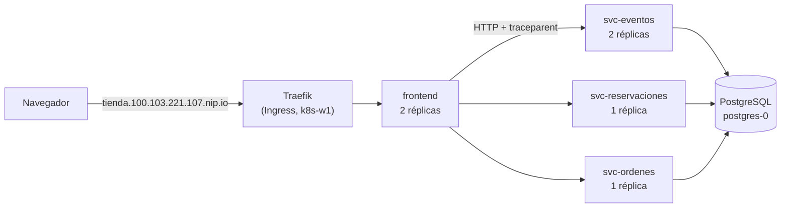

# Etapa 5 · Microservicios de la tienda

Proyecto 3 · Boletera de conciertos · DevOps 2026
Roles: Desarrollo / CI y Plataforma / CD · 18 de noviembre de 2026

Esta etapa construye la tienda: **cuatro microservicios** en Python (FastAPI),
cada uno con su imagen en Docker Hub, su Deployment y su Service, desplegados
por Argo CD. El flujo **catálogo → carrito → pedido** funciona de punta a punta
en **http://tienda.100.103.221.107.nip.io**. Cubre el rubro **Tienda y
microservicios** y deja listos los cimientos de monitoreo, logs y trazas.

El código está en [equipoEmpiroso-app](https://github.com/obeedt/equipoEmpiroso-app);
los manifiestos, en este repositorio (`tienda/` y `apps/`).

---

## Índice

1. [Resultado](#1-resultado)
2. [Arquitectura](#2-arquitectura)
3. [Qué pide la rúbrica y cómo se cumple](#3-qué-pide-la-rúbrica-y-cómo-se-cumple)
4. [Tecnología y versiones](#4-tecnología-y-versiones)
5. [La plantilla común de los cuatro servicios](#5-la-plantilla-común-de-los-cuatro-servicios)
6. [Los cuatro servicios](#6-los-cuatro-servicios)
7. [Imágenes en Docker Hub](#7-imágenes-en-docker-hub)
8. [Despliegue por GitOps](#8-despliegue-por-gitops)
9. [Pruebas](#9-pruebas)
10. [Cómo reproducir esta etapa](#10-cómo-reproducir-esta-etapa)
11. [Lo que sigue](#11-lo-que-sigue)
12. [Evidencias](#12-evidencias)

---

## 1. Resultado

```
$ kubectl get deploy,svc,ingress -n tienda
NAME                                READY   UP-TO-DATE   AVAILABLE
deployment.apps/frontend            2/2     2            2
deployment.apps/svc-eventos         2/2     2            2
deployment.apps/svc-ordenes         1/1     1            1
deployment.apps/svc-reservaciones   1/1     1            1

NAME                        TYPE        PORT(S)
service/frontend            ClusterIP   80/TCP
service/postgres            ClusterIP   5432/TCP
service/postgres-headless   ClusterIP   5432/TCP
service/svc-eventos         ClusterIP   80/TCP
service/svc-ordenes         ClusterIP   80/TCP
service/svc-reservaciones   ClusterIP   80/TCP

NAME                               CLASS     HOSTS                           ADDRESS
ingress.networking.k8s.io/tienda   traefik   tienda.100.103.221.107.nip.io   100.103.221.107
```

| Qué | Estado |
|---|---|
| Applications en Argo CD | 12, todas `Synced / Healthy` (4 nuevas: `frontend`, `svc-eventos`, `svc-reservaciones`, `svc-ordenes`) |
| Versiones desplegadas | `devops-frontend:d7a1e75` · `devops-eventos`, `devops-reservaciones` y `devops-ordenes:2219e3a` |
| La tienda | **http://tienda.100.103.221.107.nip.io** (desde la tailnet) |
| Compra de punta a punta | ✅ Orden **91442**: 2 boletos de Humbe por $2,400, hecha desde el navegador |

---

## 2. Arquitectura



- Solo el **frontend** se expone (Ingress). Los otros tres son internos (`ClusterIP`).
- El frontend genera las páginas en el servidor y llama a los otros servicios por sus Services internos (`http://svc-eventos`, …).
- Todo corre en **k8s-w1** (rol `app`), junto a PostgreSQL.

### El flujo de compra

| Paso | Página del frontend | Servicio | Qué pasa en la base |
|---|---|---|---|
| Ver catálogo | `GET /` | svc-eventos | Lee `eventos` y `ventas_por_evento` |
| Elegir concierto | `GET /evento/{id}` | svc-eventos | Secciones con precio y lugares disponibles |
| **Agregar al carrito** | `POST /carrito` | svc-reservaciones | Crea una reservación y **bloquea los mejores lugares** de la sección por 10 minutos |
| Ver el carrito | `GET /carrito` | svc-reservaciones | Asientos, total y cuenta regresiva |
| **Pagar** | `POST /pagar` | svc-ordenes | En una transacción: crea la orden, marca los asientos como vendidos y confirma la reservación |
| Confirmación | `GET /orden/{id}` | svc-ordenes | El pedido con su evento y asientos |

---

## 3. Qué pide la rúbrica y cómo se cumple

| Requisito del proyecto | Cómo se cumple |
|---|---|
| Mínimo 4 microservicios (frontend + 3 backend), cada uno con imagen, Deployment y Service | `frontend`, `svc-eventos`, `svc-reservaciones` (el distintivo del proyecto 3) y `svc-ordenes` |
| Flujo catálogo → carrito → pedido guardado en la base | Sección 2; probado con la orden 91442 |
| Containerfile e imagen en Docker Hub por servicio | `docker.io/obeedt/devops-*`, etiquetadas con el SHA del commit |
| `/health` en liveness y readiness, `/metrics` en formato Prometheus | En los cuatro: `/health` (readiness), `/health/vivo` (liveness), `/metrics` |
| Métricas: peticiones por código HTTP, latencia (histograma) y la de negocio | `http_requests_total`, `http_request_duration_seconds` y `boletera_boletos_vendidos` / `boletera_porcentaje_vendido` (svc-eventos) |
| `requests` y `limits` en todos los contenedores | En los cuatro Deployments |
| Frontend y al menos un backend con 2 réplicas o más | `frontend` y `svc-eventos` con 2 |
| Configuración en ConfigMap; credenciales en Secret, ningún Secret en Git | Un ConfigMap por servicio; la contraseña sale del Secret `postgres-app` (etapa 4) |
| Logs JSON en stdout con nivel, servicio y `trace_id` | Formato común en los cuatro (sección 5.2) |
| OpenTelemetry con FastAPI y el driver de la base, exportando por OTLP | Instrumentados FastAPI, psycopg y httpx; el destino (Jaeger) se configura con una variable (sección 5.4) |
| Script de inicialización con mínimo 20 productos | 22 conciertos (etapa 4) |

---

## 4. Tecnología y versiones

| Componente | Versión | Para qué |
|---|---|---|
| Imagen base | `python:3.14.10-slim-trixie` | Python 3.14 sobre Debian 13, imagen mínima |
| FastAPI | 0.162.0 | Framework web (el sugerido por el proyecto) |
| Uvicorn | 0.54.0 | Servidor ASGI |
| psycopg / psycopg-pool | 3.3.8 / 3.3.3 | Driver de PostgreSQL y pool de conexiones |
| prometheus-client | 0.26.0 | Métricas en `/metrics` |
| OpenTelemetry SDK / instrumentaciones | 1.45.2 / 0.66b2 | Trazas: FastAPI, psycopg y httpx |
| httpx | 0.28.1 | Llamadas del frontend a los otros servicios |
| Jinja2 · python-multipart | 3.1.6 · 0.0.34 | Plantillas HTML y formularios del frontend |
| pytest | 9.2.0 | Pruebas |

Todas fijadas en el `requirements.txt` de cada servicio. Una versión que no
existiera habría hecho fallar la construcción de la imagen; las cuatro se
construyeron sin errores.

---

## 5. La plantilla común de los cuatro servicios

Los cuatro tienen la misma estructura, así se mantienen y se revisan igual:

```
svc-<nombre>/
├── app/
│   ├── main.py            # endpoints, middleware de métricas y logs
│   ├── config.py          # configuración desde variables de entorno
│   ├── observabilidad.py  # logs JSON, trazas y métricas HTTP (idéntico en los 4)
│   └── repositorio.py     # acceso a PostgreSQL  (frontend: backends.py)
├── tests/                 # pytest, sin base de datos
├── Containerfile
├── requirements.txt       # versiones fijas
└── requirements-dev.txt   # + pytest
```

### 5.1 Configuración por variables de entorno

Nada está escrito en el código: el host de la base, el usuario, la URL de los
otros servicios, el nivel de log, `ERROR_RATE`, etc. vienen del ConfigMap de
cada servicio; la contraseña, del Secret `postgres-app`. La misma imagen corre
en cualquier ambiente.

### 5.2 Logs JSON con `trace_id`

Una línea JSON por evento en stdout, que es lo que recogerá Fluent Bit:

```json
{"timestamp": "2026-11-18T19:31:52.463+00:00", "nivel": "INFO", "servicio": "svc-ordenes",
 "mensaje": "Orden pagada", "trace_id": "d644c8737fa2b3c96f312fa1725c7856", "span_id": "3eefc73434ea5035",
 "orden_id": 91441, "evento_id": 22, "cantidad": 3, "total": "8100.00"}
```

- Campos fijos: `timestamp`, `nivel`, `servicio`, `mensaje`, `trace_id`, `span_id`; más los datos de cada evento.
- Cada petición deja una línea con método, ruta, código y duración. `/health` y `/metrics` no se registran salvo que fallen, para no llenar los logs.
- El log de acceso de Uvicorn se reemplaza por este, que sí lleva `trace_id`.

### 5.3 Métricas

| Métrica | En | Qué mide |
|---|---|---|
| `http_requests_total{method,route,status}` | los 4 | Peticiones por código HTTP. `route` es la plantilla (`/eventos/{evento_id}`), no la URL real, para no multiplicar las series. |
| `http_request_duration_seconds` | los 4 | Latencia (histograma; para el p95) |
| `boletera_info{servicio,version}` | los 4 | Qué versión (SHA) está desplegada |
| `boletera_boletos_vendidos`, `boletera_porcentaje_vendido`, `boletera_capacidad`, `boletera_boletos_disponibles` `{evento_id,evento,artista,recinto}` | svc-eventos | **Métrica de negocio**, leída de la vista `ventas_por_evento`. La alerta de negocio será `boletera_porcentaje_vendido > 90`. |
| `boletera_reservaciones_total{resultado}`, `boletera_boletos_bloqueados_total`, `…_canceladas_total`, `…_vencidas_total` | svc-reservaciones | Uso del carrito |
| `boletera_ordenes_total`, `boletera_ventas_boletos_total`, `boletera_ingresos_pesos_total`, `boletera_pagos_rechazados_total{motivo}` | svc-ordenes | Ventas en vivo y pagos rechazados |
| `boletera_llamadas_backend_total{servicio,resultado}` | frontend | Llamadas a cada servicio: `ok`, `error_5xx`, `sin_respuesta` |

Se desactivaron las series `*_created` que `prometheus_client` agrega a cada
contador: Prometheus no las usa y solo ensucian las consultas.

### 5.4 Trazas con OpenTelemetry

- **FastAPI** instrumentado: cada petición es una traza (o un tramo de una existente).
- **psycopg** instrumentado: cada consulta SQL aparece como tramo `postgresql`.
- **httpx** instrumentado (frontend): cada llamada a otro servicio lleva el encabezado `traceparent`, y el servicio que la recibe **continúa la misma traza**.
- El destino es `OTEL_EXPORTER_OTLP_ENDPOINT`. Mientras no exista Jaeger está vacío: igual se generan los `trace_id` de los logs, pero no se envían. Cambiar de Jaeger a otro backend solo cambia esa variable, no el código.

**Comprobado:** el log "Compra completada" del frontend y el log "Orden pagada"
de svc-ordenes tienen **el mismo `trace_id`** (`d644c873…`). La traza frontend →
svc-ordenes → PostgreSQL ya está completa; solo falta que Jaeger la reciba.

### 5.5 Salud

| Ruta | Sonda | Qué revisa |
|---|---|---|
| `/health` | `readinessProbe` | En los backends, que la base responda (`SELECT 1`): si no, 503 y Kubernetes deja de mandarle tráfico. En el frontend, solo que responda. |
| `/health/vivo` | `livenessProbe` | Que el proceso responda. No depende de la base, para que una caída de PostgreSQL no provoque reinicios en cadena. |

El `/health` del frontend **no depende** de los otros servicios a propósito:
si uno se cae, la tienda sigue en el Ingress y muestra su página de error, en
vez de desaparecer.

### 5.6 Fallas a propósito (demo 3)

`ERROR_RATE` (0 a 1) en el ConfigMap hace que esa fracción de peticiones
responda 500, con su log de error y su traza. Se cambia con un commit, como
todo lo demás. `/health` nunca falla por esto.

La configuración de cada servicio está en `tienda/<servicio>/config.env` y
Kustomize la convierte en un ConfigMap cuyo nombre lleva el *hash* de su
contenido. Al cambiar `ERROR_RATE` (o `BANNER` en el frontend), cambia el
nombre, el Deployment se actualiza y Kubernetes crea pods nuevos que leen el
valor nuevo. Sin esto, los pods seguirían con el valor viejo hasta reiniciarse.

### 5.7 Containerfile

```dockerfile
FROM docker.io/library/python:3.14.10-slim-trixie
RUN useradd --uid 10001 --no-create-home --shell /usr/sbin/nologin app
WORKDIR /app
COPY requirements.txt .
# Dependencias antes que el código: esta capa se reutiliza entre versiones
RUN pip install --root-user-action=ignore -r requirements.txt
COPY app ./app
# El SHA del commit queda dentro de la imagen
ARG VERSION=dev
ENV APP_VERSION=${VERSION}
USER 10001
CMD ["uvicorn", "--factory", "app.main:crear_app", "--host", "0.0.0.0", "--port", "8000"]
```

- Usuario sin privilegios con uid fijo (`runAsNonRoot` en Kubernetes).
- Dependencias antes que el código: si solo cambia el código, la capa de `pip` se reutiliza.
- El SHA del commit (`VERSION`) se ve en `/health`, en `boletera_info` y en el pie de la tienda.
- Imágenes de 160–180 MB.

---

## 6. Los cuatro servicios

### 6.1 svc-eventos · catálogo (solo lectura)

| Endpoint | Qué hace |
|---|---|
| `GET /eventos` | Conciertos activos por fecha; filtros `?ciudad=` y `?genero=` |
| `GET /eventos/{id}` | Un concierto con sus secciones: precio, total y disponibles |

Lee la disponibilidad de la vista `asientos_estado_actual` (un bloqueo vencido
cuenta como libre) y expone la **métrica de negocio** calculando
`ventas_por_evento` en cada lectura de `/metrics` (~130 ms los 22 eventos), así
refleja la venta de cualquier servicio. 2 réplicas.

### 6.2 svc-reservaciones · el carrito (servicio distintivo)

| Endpoint | Respuestas |
|---|---|
| `POST /reservaciones` (`evento_id`, `seccion`, `cantidad` 1–10, `sesion`) | `201` con asientos, total y vencimiento · `404` evento · `409` sin lugares (dice cuántos quedan) |
| `GET /reservaciones/{id}` | La reservación con sus asientos |
| `DELETE /reservaciones/{id}` | La cancela y libera los asientos · `409` si ya se pagó |

- Aparta los **mejores lugares disponibles** de la sección en una sola sentencia con `FOR UPDATE SKIP LOCKED`, todo o nada: dos compras simultáneas reciben lugares distintos.
- Los lugares quedan apartados `RESERVA_MINUTOS` (10). Cada `LIBERADOR_SEGUNDOS` (60), una tarea de fondo marca como `expirada` cada reservación sin pagar y libera sus asientos.

### 6.3 svc-ordenes · el pago

| Endpoint | Respuestas |
|---|---|
| `POST /ordenes` (`reservacion_id`, `cliente_nombre`, `cliente_email`) | `201` con la orden, el evento y los asientos · `404` · `409` con `motivo`: `ya_pagada` (con el número de su orden), `vencida`, `cancelada` |
| `GET /ordenes/{id}` | El pedido con su evento y asientos |

El pago es **una sola transacción**: bloquea la reservación, revisa que siga
activa y sin vencer, crea la orden con el total calculado por la base, marca
los asientos como `vendido` y confirma la reservación. Si el navegador
reintenta, el `UNIQUE` de `ordenes.reservacion_id` impide cobrar dos veces.

### 6.4 frontend · el sitio web

| Página | Qué muestra |
|---|---|
| `/` | Catálogo con filtros; barra de vendido y aviso **"¡Últimos boletos!"** arriba del 90 % |
| `/evento/{id}` | Secciones y formulario de sección y cantidad (las agotadas no se ofrecen) |
| `/carrito` | Asientos, total, **cuenta regresiva** y formulario de pago (simulado) |
| `/orden/{id}` | Confirmación del pedido |
| Error | "Algo salió mal" con un **folio de error** (el `trace_id`) |

- HTML generado en el servidor con **Jinja2**, sin dependencias externas (estilos incluidos en la página).
- El carrito vive en dos cookies: `sesion` y `reservacion`.
- El **folio de error** permite ir de lo que ve el usuario a la traza en Jaeger y a su log: es el recorrido de la demo 3.
- El pie muestra la **versión (SHA)** y la variable `BANNER` un aviso arriba de todas las páginas: cualquiera sirve como cambio visible en la demo 1.
- 2 réplicas, sin acceso a la base.

---

## 7. Imágenes en Docker Hub

| Servicio | Imagen |
|---|---|
| frontend | `docker.io/obeedt/devops-frontend` |
| svc-eventos | `docker.io/obeedt/devops-eventos` |
| svc-reservaciones | `docker.io/obeedt/devops-reservaciones` |
| svc-ordenes | `docker.io/obeedt/devops-ordenes` |

- Repositorios **públicos**: los nodos las descargan sin credenciales (por el espejo `mirror.gcr.io`, etapa 3).
- **Etiqueta = SHA corto del commit** de `equipoEmpiroso-app`. Una imagen corresponde exactamente a un commit.
- En esta etapa se construyeron en k8s-cp con **Podman 6.1.1**, clonando el repositorio y usando su SHA. La sesión de Docker Hub se inicia con un **token de acceso** (no con la contraseña).

```bash
git clone -q https://github.com/obeedt/equipoEmpiroso-app.git ~/build/app && cd ~/build/app
SHA=$(git rev-parse --short HEAD)
podman build -t docker.io/obeedt/devops-frontend:$SHA --build-arg VERSION=$SHA frontend
podman login docker.io -u obeedt          # token de acceso de Docker Hub
podman push docker.io/obeedt/devops-frontend:$SHA
```

En la siguiente etapa, **Tekton** hará estos pasos solo con cada commit.

---

## 8. Despliegue por GitOps

### 8.1 Archivos por servicio

```
tienda/<servicio>/
├── kustomization.yaml   # recursos + la etiqueta de la imagen (newTag) + el ConfigMap
├── config.env           # configuración del servicio (ConfigMap <servicio>-config-<hash>)
├── deployment.yaml      # réplicas, sondas, requests/limits, seguridad
├── service.yaml         # ClusterIP, puerto 80 → 8000
└── ingress.yaml         # solo el frontend
apps/<servicio>.yaml     # la Application de Argo CD
```

### 8.2 La versión vive en una sola línea

```yaml
images:
  - name: docker.io/obeedt/devops-frontend
    newTag: d7a1e75
```

El Deployment nombra la imagen sin etiqueta y Kustomize le pone `newTag`.
**Desplegar una versión nueva es cambiar esa línea** y hacer `git push`: Argo
CD crea los pods nuevos y retira los viejos sin cortar el servicio. Es lo que
automatizará Tekton.

**Orden de los pasos:** la imagen se publica primero y la etiqueta se sube a
Git después (o en el mismo paso). Así Argo CD nunca pide una imagen que todavía
no existe. Para no esperar los 3 minutos de revisión de Argo CD, se usa
*Refresh* en la interfaz.

### 8.3 Lo que comparten los Deployments

| Configuración | Para qué |
|---|---|
| `nodeSelector: boletera.io/app: "true"` | Todo en k8s-w1, junto a la base |
| `runAsNonRoot`, `runAsUser: 10001`, `allowPrivilegeEscalation: false`, `capabilities.drop: [ALL]` | Contenedores sin privilegios |
| `readinessProbe /health`, `livenessProbe /health/vivo` | Sección 5.5 |
| requests 50m / 96Mi, límite 256Mi | La rúbrica pide `requests` y `limits` |
| `DB_NAME` y `DB_USER` desde `postgres-config`; `DB_PASSWORD` desde el Secret `postgres-app` | Un solo lugar para esos datos; la contraseña nunca en Git |

### 8.4 Réplicas

| Servicio | Réplicas | Por qué |
|---|---|---|
| frontend | 2 | Lo pide la rúbrica; recibe todo el tráfico |
| svc-eventos | 2 | El backend con 2 réplicas que pide la rúbrica; el más consultado (cada página del catálogo) |
| svc-reservaciones | 1 | Suficiente para la carga de la demo |
| svc-ordenes | 1 | Suficiente para la carga de la demo |

### 8.5 La tienda por Ingress

`tienda/frontend/ingress.yaml` publica **http://tienda.100.103.221.107.nip.io**
por Traefik (etapa 3). Solo se abre desde equipos de la tailnet.

---

## 9. Pruebas

Antes de cada `git push` se probó cada servicio rápido, sin montar entornos
aparte: pruebas unitarias en un contenedor con la misma imagen de Python, y la
imagen real contra los servicios y la base del clúster. Lo que crearon las
pruebas se borró al terminar.

### 9.1 Pruebas unitarias (pytest, sin base de datos)

| Servicio | Pruebas | Qué cubren |
|---|---|---|
| svc-eventos | 10 | Catálogo, filtros, detalle, 404, salud, métricas HTTP y de negocio, `ERROR_RATE`, formato de log |
| svc-reservaciones | 15 | Reservar, sin lugares (409), validaciones (422), consultar, cancelar, no cancelar lo pagado, métricas |
| svc-ordenes | 12 | Pagar, no cobrar dos veces, vencida/cancelada (409), 404, validaciones, métricas de ventas |
| frontend | 13 | Catálogo, filtros, evento, compra completa con cookies, sin lugares, cancelar, carrito vencido, servicio caído (503 con folio), `BANNER` y versión |
| **Total** | **50** | |

Los backends usan un repositorio falso en memoria; el frontend reemplaza a
los otros servicios con `httpx.MockTransport`.

### 9.2 svc-eventos contra la base real

| Prueba | Resultado |
|---|---|
| `/health` | `ok` con la base conectada |
| `/eventos` | Los 22 conciertos, por fecha |
| `/eventos/5` | NSQK con sus 3 secciones, precios y disponibles |
| `?ciudad=Monterrey` | Los 5 de Monterrey |
| `/metrics` | Humbe 92, Los Bukis 96, Siddhartha 89.8 (133 ms) |

### 9.3 Flujo de compra con svc-reservaciones y svc-ordenes

Sobre el evento 22 (Rels B, 0 % vendido):

| Prueba | Resultado |
|---|---|
| Reservar 3 General | `activa`, fila 121 lugares 1–3, $4,050, vence en 10 min |
| **Dos reservaciones al mismo tiempo** en VIP | Lugares distintos, ninguno repetido |
| Pagar | `201`, orden con evento y asientos |
| **Pagar otra vez** | `409 ya_pagada` con el número de su orden |
| Cancelar y luego pagar | Libera los lugares; el pago da `409 cancelada` |
| Reservación vencida | El pago da `409 vencida`; el liberador la marca `expirada` y libera sus asientos |
| Limpieza | El evento 22 volvió a 0 vendidos y 20,000 disponibles |

### 9.4 El frontend contra los servicios del clúster

| Prueba | Resultado |
|---|---|
| Catálogo | 22 conciertos, 2 con "¡Últimos boletos!" |
| Compra | Rels B → 3 VIP → carrito ($8,100) → pago → orden |
| **Propagación de la traza** | Mismo `trace_id` en el frontend y en svc-ordenes (y en svc-reservaciones para el carrito) |
| En el navegador | Catálogo, página de evento y carrito con cuenta regresiva; se canceló y los lugares se liberaron |
| Limpieza | Orden y reservaciones de prueba borradas; Siddhartha sigue en 89.8 % |

### 9.5 En el clúster

Desplegados por Argo CD, los cuatro servicios están `Ready` y la tienda
responde en el Ingress. Desde el navegador se hizo la compra **91442**: 2
boletos de Humbe por $2,400.

```bash
kubectl -n tienda exec deploy/svc-eventos -- python -c "import urllib.request,json; \
  [print(s, json.load(urllib.request.urlopen(f'http://{s}/health'))['version']) \
   for s in ('svc-eventos','svc-reservaciones','svc-ordenes')]"
```

---

## 10. Cómo reproducir esta etapa

Con las etapas 1 a 4 listas:

1. **Código** en `equipoEmpiroso-app`: `svc-eventos/`, `svc-reservaciones/`, `svc-ordenes/` y `frontend/`.
2. **Imágenes**, en un equipo con Podman o Docker (sección 7):
   ```bash
   for s in eventos reservaciones ordenes; do
     podman build -t docker.io/obeedt/devops-$s:$SHA --build-arg VERSION=$SHA svc-$s; done
   podman build -t docker.io/obeedt/devops-frontend:$SHA --build-arg VERSION=$SHA frontend
   podman login docker.io -u obeedt
   for s in eventos reservaciones ordenes frontend; do podman push docker.io/obeedt/devops-$s:$SHA; done
   ```
3. **Etiquetas** en `tienda/*/kustomization.yaml` (`newTag: $SHA`) y `git push` de `tienda/` y `apps/`: Argo CD despliega todo.
4. Abrir **http://tienda.100.103.221.107.nip.io** y comprar.

---

## 11. Lo que sigue

| Etapa | Qué se agrega sobre esta base |
|---|---|
| CI con Tekton | Pruebas, construcción y publicación de las imágenes, y el cambio de `newTag` en este repo, con cada commit |
| Monitoreo | Un ServiceMonitor por servicio (`/metrics` en el puerto `http` de cada Service), dashboards y alertas, entre ellas `boletera_porcentaje_vendido > 90` |
| Logs y trazas | Fluent Bit recoge los logs JSON; `OTEL_EXPORTER_OTLP_ENDPOINT` apunta a Jaeger |

---

## 12. Evidencias

Van en [`docs/evidencias/`](evidencias/):

- `kubectl get deploy,svc -n tienda` (así lo verifica la rúbrica).
- Las Applications `frontend`, `svc-eventos`, `svc-reservaciones` y `svc-ordenes` en `Synced / Healthy`.
- La tienda: catálogo, página de un concierto, carrito con cuenta regresiva y confirmación del pedido.
- La orden en la base: `select * from ordenes where id = 91442;`.
- Las cuatro imágenes en Docker Hub con su etiqueta.
