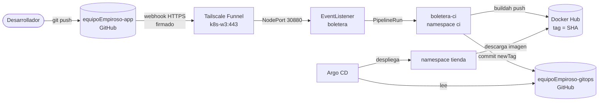

# Etapa 6 · CI con Tekton

Proyecto 3 · Boletera de conciertos · DevOps 2026
Roles: Desarrollo / CI y Plataforma / CD · 18 de noviembre de 2026

Esta etapa automatiza la construcción de la tienda. Cada `git push` a `main` del
repositorio de la aplicación pasa por cuatro pasos:

1. Dispara un **PipelineRun** de Tekton, que **prueba** los servicios que cambiaron.
2. Construye su imagen con **Buildah** y la publica en Docker Hub con **tag = SHA corto del commit**.
3. Cambia esa etiqueta en este repositorio.
4. **Argo CD** ve el commit y despliega la versión nueva.

Se cumple la regla central del proyecto: **Tekton construye, Argo CD despliega**.
Tekton nunca toca el namespace `tienda`, solo hace commits en Git.

Tekton se instala desde este repositorio (`plataforma/tekton/`). Sus Tasks,
el Pipeline y los Triggers viven en
[`equipoEmpiroso-app/tekton`](https://github.com/obeedt/equipoEmpiroso-app/tree/main/tekton),
como pide el proyecto. Los dos los aplica Argo CD; no se usó `kubectl apply`.

---

## Índice

1. [Resultado](#1-resultado)
2. [Versiones y compatibilidad](#2-versiones-y-compatibilidad)
3. [Arquitectura del flujo](#3-arquitectura-del-flujo)
4. [Archivos de esta etapa](#4-archivos-de-esta-etapa)
5. [Instalación de Tekton](#5-instalación-de-tekton)
6. [El pipeline `boletera-ci`](#6-el-pipeline-boletera-ci)
7. [Disparo por webhook: Triggers y Tailscale Funnel](#7-disparo-por-webhook-triggers-y-tailscale-funnel)
8. [Credenciales](#8-credenciales)
9. [La hora de los nodos](#9-la-hora-de-los-nodos)
10. [Verificación](#10-verificación)
11. [Cómo reproducir esta etapa](#11-cómo-reproducir-esta-etapa)
12. [Rubro de CI: qué queda cubierto](#12-rubro-de-ci-qué-queda-cubierto)
13. [Evidencias](#13-evidencias)

---

## 1. Resultado

Un commit que solo cambia `svc-eventos/README.md` (`0995a4d`, "Prueba Pipeline"):

```
$ kubectl -n ci get pipelineruns
NAME                       SUCCEEDED   REASON      STARTTIME   COMPLETIONTIME
boletera-ci-4tx5t          True        Completed   12m         10m
boletera-ci-manual-j59b4   True        Succeeded   4h33m       4h27m

$ kubectl -n ci logs boletera-ci-4tx5t-detectar-cambios-pod
Archivos que cambiaron entre 3283aff8d3e0e87ad562acdfeec10464379babb5 y 0995a4d:
  svc-eventos/README.md
A construir → eventos=si reservaciones=no ordenes=no frontend=no

$ kubectl -n ci logs boletera-ci-4tx5t-actualizar-gitops-pod
 tienda/svc-eventos/kustomization.yaml | 2 +-
Push listo: a3c4fc6 ci: desplegar 0995a4d en svc-eventos

$ kubectl -n tienda get deploy svc-eventos -o jsonpath='{.spec.template.spec.containers[0].image}'
docker.io/obeedt/devops-eventos:0995a4d
```

| Qué | Resultado |
|---|---|
| PipelineRun `boletera-ci-4tx5t` (por webhook) | ✅ **1 min 56 s**: pruebas y construcción solo de `svc-eventos`; las 6 tareas de los otros servicios se saltaron |
| Imagen | ✅ `obeedt/devops-eventos:0995a4d` en Docker Hub, digest `sha256:c2e02e5184…`, 56.9 MB |
| Repo GitOps | ✅ Commit `a3c4fc6` de *Tekton CI (boletera)*: una línea, `newTag: 3283aff → 0995a4d` |
| Argo CD | ✅ `svc-eventos` Synced / Healthy; reemplazó los 2 pods uno por uno, sin cortar la tienda |
| PipelineRun `boletera-ci-manual-j59b4` (manual, los 4 servicios) | ✅ **5 min 17 s**: 50 pruebas, 4 imágenes `3283aff` y commit `e2b2cec` |

En Tekton, **`Completed`** significa que la ejecución terminó bien pero algunas
tareas se saltaron a propósito, como aquí. **`Succeeded`** significa que corrieron
todas. Las dos son ejecuciones exitosas.

| Componente | Dónde corre |
|---|---|
| Tekton Pipelines, Triggers y Dashboard (8 pods) | k8s-w3, namespaces `tekton-pipelines` (7) y `tekton-pipelines-resolvers` (1) |
| EventListener `boletera` y los pods de cada ejecución | k8s-w3, namespace `ci` |
| Tailscale Funnel (la URL pública del webhook) | k8s-w3 |

---

## 2. Versiones y compatibilidad

| Componente | Versión | Por qué esa | Compatibilidad declarada |
|---|---|---|---|
| Tekton Pipelines | **v1.18.0** | Versión **LTS**, con soporte hasta octubre de 2027 | Kubernetes ≥ 1.28 |
| Tekton Triggers | **v0.37.2** | Línea LTS v0.37, la que acompaña a Pipelines v1.18 | — |
| Tekton Dashboard | **v0.74.0** | LTS; declara soporte para "Pipelines v1.18.x LTS, and Triggers v0.37.x LTS" | Kubernetes ≥ 1.34 |
| Buildah | **v1.45.1** (`quay.io/buildah/stable`) | Construye imágenes OCI sin Docker; es de la misma familia que Podman, que se usó en clase | — |
| git | `alpine/git:v2.54.0` | Imagen pequeña con git y `sh` | — |
| Python (pruebas) | `python:3.14.10-slim-trixie` | La misma base que los Containerfile de los servicios | — |
| Tailscale | **1.104.7** (Funnel) | Ya conecta los nodos; Funnel publica un solo puerto con HTTPS | — |

El clúster usa Kubernetes **1.37.2**, que cumple todos los mínimos. Las versiones
están fijas en los manifiestos: las imágenes por etiqueta exacta y Tekton por la
URL de su versión publicada, que no cambia.

Fuentes:
[Tekton Pipelines](https://github.com/tektoncd/pipeline/releases) ·
[Tekton Triggers](https://github.com/tektoncd/triggers/releases) ·
[Tekton Dashboard](https://github.com/tektoncd/dashboard/releases) ·
[Buildah](https://github.com/containers/buildah/releases) ·
[Tailscale Funnel](https://tailscale.com/kb/1223/funnel)

---

## 3. Arquitectura del flujo



| Quién | Qué puede tocar |
|---|---|
| Tekton | Docker Hub (con su token) y **solo** el repo GitOps (con un token limitado a ese repo) |
| Argo CD | El clúster, a partir de lo que dice el repo GitOps |
| El desarrollador | Solo `git push` al repo de la aplicación |

---

## 4. Archivos de esta etapa

**Este repositorio (instalación de Tekton):**

| Archivo | Qué hace |
|---|---|
| [`apps/tekton-pipelines.yaml`](../apps/tekton-pipelines.yaml) | Application de Tekton Pipelines. |
| [`apps/tekton-triggers.yaml`](../apps/tekton-triggers.yaml) | Application de Tekton Triggers y sus interceptores. |
| [`apps/tekton-dashboard.yaml`](../apps/tekton-dashboard.yaml) | Application del Dashboard. |
| [`apps/ci.yaml`](../apps/ci.yaml) | Application `ci`: aplica `equipoEmpiroso-app/tekton`. |
| [`plataforma/tekton/pipelines/kustomization.yaml`](../plataforma/tekton/pipelines/kustomization.yaml) | Manifiesto oficial v1.18.0 + ajustes (sección 5). |
| [`plataforma/tekton/triggers/kustomization.yaml`](../plataforma/tekton/triggers/kustomization.yaml) | Manifiestos oficiales v0.37.2 (`release.yaml` e `interceptors.yaml`). |
| [`plataforma/tekton/dashboard/`](../plataforma/tekton/dashboard/) | Dashboard v0.74.0 de solo lectura y su Ingress. |
| [`cluster/01-prerequisitos.yml`](../cluster/01-prerequisitos.yml) | chronyd con `makestep 1.0 -1` (sección 9). |

**[`equipoEmpiroso-app/tekton/`](https://github.com/obeedt/equipoEmpiroso-app/tree/main/tekton):**

| Archivo | Qué hace |
|---|---|
| `00-namespace.yaml` | Namespace `ci` con política de seguridad `privileged` (sección 6.4). |
| `01-cuentas.yaml` | ServiceAccounts `pipeline` (ejecuciones) y `disparador` (EventListener), con los roles de Triggers. |
| `10-tarea-clonar.yaml` | Task `clonar`. |
| `11-tarea-detectar-cambios.yaml` | Task `detectar-cambios`. |
| `12-tarea-pruebas.yaml` | Task `pruebas`. |
| `13-tarea-construir-imagen.yaml` | Task `construir-imagen` (Buildah). |
| `14-tarea-actualizar-gitops.yaml` | Task `actualizar-gitops`. |
| `20-pipeline.yaml` | Pipeline `boletera-ci`. |
| `30-triggers.yaml` | TriggerBinding, TriggerTemplate y EventListener. |
| `31-servicio-webhook.yaml` | Service `webhook-github` en el NodePort fijo 30880. |
| `manual/ejecutar-todo.yaml` | PipelineRun manual de los 4 servicios. Argo CD no lo aplica, porque es una subcarpeta. |

---

## 5. Instalación de Tekton

Tekton publica sus versiones como un solo `release.yaml`. Cada componente es una
carpeta de **Kustomize** que toma ese archivo por su URL fija y le aplica
nuestros ajustes, sin copiarlo al repositorio:

| Ajuste | Para qué |
|---|---|
| `nodeSelector: boletera.io/metricas: "true"` en todos los Deployments | Tekton corre en **k8s-w3**. Las construcciones usan CPU y memoria, y así no compiten con la tienda (k8s-w1). |
| `config-defaults`: `default-pod-template` y `default-affinity-assistant-pod-template` con el mismo `nodeSelector` | Los pods de **cada ejecución** también van a k8s-w3. |
| `config-defaults`: `default-timeout-minutes: "30"` | Ninguna ejecución corre más de 30 min. |
| Se quita el `HorizontalPodAutoscaler` del webhook | Necesita metrics-server, que el clúster no tiene. El webhook corre con 1 réplica. |

Opciones de las Applications:

| Opción | Por qué |
|---|---|
| `ServerSideApply=true` | Las CRDs de Tekton son grandes; aplicadas del lado del servidor no chocan con el límite de tamaño de las anotaciones. |
| `ignoreDifferences` + `RespectIgnoreDifferences=true` | Al arrancar, Tekton llena los certificados de sus webhooks, las reglas de admisión y el `caBundle` de las CRDs y de los ClusterInterceptor. Argo CD ignora esos campos; si no, los regresaría al valor del manifiesto y rompería los webhooks. |
| `SkipDryRunOnMissingResource=true` (Triggers y `ci`) | Sus recursos usan CRDs que instala otra Application; así no fallan si la CRD todavía no existe. |
| `retry` (5 intentos, de 30 s a 5 min) | La primera vez, los webhooks de Tekton tardan unos segundos en estar listos. |

El **Dashboard** es de **solo lectura**: muestra las ejecuciones y sus logs, pero
no permite crear ni borrar nada. Está en http://tekton.100.103.221.107.nip.io,
como Argo CD solo se abre desde la tailnet.

---

## 6. El pipeline `boletera-ci`

```
clonar → detectar-cambios ─┬─ pruebas-eventos ───────┐
                            ├─ pruebas-reservaciones ─┤  en paralelo
                            ├─ pruebas-ordenes ───────┤
                            └─ pruebas-frontend ──────┘
     construir-eventos → construir-reservaciones → construir-ordenes → construir-frontend
                                                                    → actualizar-gitops
```

### 6.1 Las Tasks

| Task | Imagen | Qué hace |
|---|---|---|
| `clonar` | `alpine/git` | Clona el repo de la aplicación y se coloca en el commit del push. Devuelve el SHA completo. |
| `detectar-cambios` | `alpine/git` | Compara el commit anterior del push con el nuevo (`git diff --name-only`) y decide qué servicios cambiaron. Devuelve el **tag** (SHA de 7 caracteres). |
| `pruebas` | `python:3.14.10-slim` | Crea un entorno virtual, instala `requirements-dev.txt` y corre `pytest`. Si falla una prueba, el pipeline se detiene y **no se publica ninguna imagen**. |
| `construir-imagen` | `buildah:v1.45.1` | `buildah build` del Containerfile del servicio, con `--build-arg VERSION=<tag>`, y `buildah push` a Docker Hub. Devuelve el digest. |
| `actualizar-gitops` | `alpine/git` | Clona este repo, cambia `newTag` en `tienda/<servicio>/kustomization.yaml` de cada servicio construido, hace commit y push. |

### 6.2 Decisiones del pipeline

| Decisión | Para qué |
|---|---|
| **Solo se procesa lo que cambió** (`when` con los resultados de `detectar-cambios`) | Un cambio en `frontend/` no reconstruye los otros tres servicios: el pipeline baja de ~5 min a ~2 min. Si no hay commit anterior (rama nueva, o una ejecución manual con `forzar=si`), se construyen los cuatro. |
| **Pruebas en paralelo, construcciones en serie** | Las pruebas son ligeras. Cada construcción pide hasta 2 GiB; una tras otra no saturan la memoria de k8s-w3. Una construcción que se salta no detiene a las siguientes. |
| **Tag = SHA corto (7 caracteres)** | Es el mismo SHA que muestra GitHub. Cada imagen corresponde a un commit exacto y se puede volver a una versión anterior cambiando una línea en Git. El SHA también queda dentro de la imagen (`APP_VERSION`). |
| **Primero la imagen, después Git** | `actualizar-gitops` corre al final, así que Argo CD nunca pide una imagen que todavía no existe. |
| **Un commit para todos los servicios construidos** | Un solo despliegue por push, con el SHA de la aplicación en el mensaje (`Imágenes construidas por Tekton desde equipoEmpiroso-app@<sha>`). |
| **Push con reintentos** (`pull --rebase`, hasta 3 veces) | Si alguien hizo push al repo GitOps mientras corría el pipeline, Tekton no pisa su cambio. |
| **Volumen de trabajo por ejecución** (`volumeClaimTemplate`, `local-path`, 1 GiB) | Cada PipelineRun tiene su propia copia del código en el disco de k8s-w3. El volumen se borra junto con el PipelineRun. |

### 6.3 Buildah en vez de Kaniko

El proyecto permite Kaniko o Buildah. Se eligió **Buildah**:

- Google **archivó Kaniko** el 3 de junio de 2025: ya no recibe correcciones.
- La imagen de su continuación (el fork de Chainguard) no se puede descargar sin cuenta.
- Buildah es de Red Hat, tiene mantenimiento activo y usa los mismos Containerfile que Podman, la herramienta vista en clase.
- Antes de escribir el pipeline se probó en un pod en k8s-w3: construyó la imagen de `svc-eventos` en 35 s.

Igual que containerd en los nodos (etapa 3, sección 9), Buildah descarga la
imagen base de Python por el **espejo `mirror.gcr.io`**. Así la construcción no
depende de Cloudflare ni del límite de descargas anónimas de Docker Hub.

### 6.4 El namespace `ci` y los privilegios de Buildah

Buildah necesita un contenedor **privilegiado** para montar las capas de la
imagen. Tekton instala `tekton-pipelines` con la política de seguridad
`restricted`, así que sus pods de ejecución van aparte, en el namespace **`ci`**,
con política `privileged`. Medidas que acotan ese privilegio:

| Medida | Efecto |
|---|---|
| Namespace `ci` dedicado | Solo los pods del pipeline pueden correr con privilegios; `tienda` y los demás conservan su política. |
| Solo en k8s-w3 | Un pod de construcción nunca corre junto a la tienda ni a la base de datos. |
| Almacenamiento de Buildah en `emptyDir` | Las capas se borran al terminar el pod. |
| Secrets montados como **solo lectura** | Las Tasks no pueden modificarlos. |
| Solo el paso de Buildah es privilegiado | `clonar`, `pruebas` y `actualizar-gitops` corren sin privilegios. |

---

## 7. Disparo por webhook: Triggers y Tailscale Funnel

### 7.1 La cadena

| Pieza | Qué hace |
|---|---|
| Webhook de GitHub (en `equipoEmpiroso-app`) | En cada push manda un POST a `https://k8s-w3.tail4f16c9.ts.net`, **firmado** con un secreto compartido (HMAC-SHA256). |
| **Tailscale Funnel** en k8s-w3 | Recibe la petición desde internet con HTTPS y la pasa a `http://127.0.0.1:30880`. |
| Service `webhook-github` (NodePort 30880) | Lleva la petición al pod del EventListener. |
| EventListener `boletera` → interceptor **`github`** | Verifica la firma con el Secret `github-webhook`. Sin firma válida, la petición se rechaza. Solo acepta eventos `push`. |
| → interceptor **`cel`** | `body.ref == 'refs/heads/main' && body.deleted == false`: solo pushes a `main`, nunca el borrado de una rama. |
| TriggerBinding `github-push` | Toma `after` (commit nuevo), `before` (commit anterior) y la URL del repo. |
| TriggerTemplate `boletera-ci` | Crea el PipelineRun con esos datos, la cuenta `pipeline`, el volumen de trabajo y los Secrets. |

El *ping* que GitHub manda al crear el webhook se responde, pero no lanza nada,
porque solo se aceptan `push`. En los logs del EventListener también se ve
rechazada una petición vacía que llegó a la URL pública: es lo que se espera de
cualquier petición que no venga de GitHub con la firma correcta.

### 7.2 Por qué Tailscale Funnel

El clúster no es accesible desde internet. El proyecto pide documentar el túnel
y menciona como ejemplos smee.io, ngrok o cloudflared. Se usó **Tailscale
Funnel**:

| Criterio | Tailscale Funnel |
|---|---|
| Software extra | Ninguno: Tailscale ya une los 4 nodos (etapa 1). |
| URL | Fija (`k8s-w3.tail4f16c9.ts.net`); el webhook de GitHub no hay que reconfigurarlo. |
| HTTPS | Certificado válido automático. |
| Qué expone | **Un solo puerto** (el del EventListener), no el clúster ni la tailnet. |
| Dependencia de Cloudflare | Ninguna. cloudflared sí depende de Cloudflare, que no respondía desde la red de la casa (etapa 3, sección 9.1). |
| Persistencia | `--bg` deja la configuración guardada; vuelve sola al reiniciar k8s-w3. |

Se activó una sola vez, en k8s-w3:

```bash
sudo tailscale funnel --bg --https=443 http://127.0.0.1:30880
```

```
$ tailscale funnel status
# Funnel on:
#     - https://k8s-w3.tail4f16c9.ts.net

https://k8s-w3.tail4f16c9.ts.net (Funnel on)
|-- / proxy http://127.0.0.1:30880
```

El NodePort es **fijo** (30880) para que Funnel siempre apunte al mismo puerto,
aunque el EventListener se recree.

---

## 8. Credenciales

Ningún Secret real está en Git. Se crearon una vez, a mano, en el namespace
`ci`. Los comandos leen el valor sin mostrarlo ni guardarlo en el historial; los
comandos completos están en `equipoEmpiroso-app/tekton/README.md`.

| Secret | Contenido | Permisos del token | Lo usa |
|---|---|---|---|
| `dockerhub` | `.dockerconfigjson` con un **token de acceso** de Docker Hub, no la contraseña | Read & Write | `construir-imagen` |
| `github-gitops` | Token **fine-grained** de GitHub | **Solo** el repo `equipoEmpiroso-gitops`, permiso *Contents: Read and write*, con fecha de expiración | `actualizar-gitops` |
| `github-webhook` | Secreto aleatorio de 32 bytes, el mismo que está en la configuración del webhook en GitHub | — | interceptor `github` |

- Si el token de GitHub se filtrara, solo serviría para escribir en el repo GitOps: no puede tocar el código ni otros repositorios.
- El token nunca aparece en los logs: git lo pide a un *credential helper* que lo lee del Secret montado.
- Los commits de Tekton llevan su propio autor, **Tekton CI (boletera)**, y en el historial se distinguen de los commits de las personas.

---

## 9. La hora de los nodos

### 9.1 Por qué importa en esta etapa

Kubernetes compara horas que vienen de **nodos distintos**:

- El API server, en k8s-cp, fecha cada objeto al crearlo.
- El controlador de Tekton, en k8s-w3, usa esa fecha para medir cuánto lleva una ejecución y aplicar el límite de 30 min.
- Los tokens de las ServiceAccounts también se firman con la hora de k8s-cp y los valida el kubelet de cada nodo.

Si los relojes no coinciden, un PipelineRun recién creado puede parecer
"vencido" y cancelarse antes de crear sus pods.

### 9.2 Las VMs de la laptop al suspenderla

k8s-cp y k8s-w1 son VMs de VMware Workstation en la laptop. Cuando la laptop se
suspende, las VMs se congelan y despiertan con la hora en que se durmieron. En
la prueba quedaron **2 h 51 min** atrasadas (10,270 s). Mientras tanto, k8s-w2 y
k8s-w3, en Proxmox, seguían con la hora real.

chronyd veía la diferencia, pero no la corregía de golpe. Rocky Linux trae
`makestep 1.0 3`, que solo permite **saltar** la hora en las 3 primeras
mediciones después de arrancar. Después la ajusta poco a poco (como máximo
83 ms por segundo), y con casi 3 horas de diferencia habría tardado más de un
día.

### 9.3 Qué se configuró

El playbook 01 deja chronyd así en los 4 nodos:

```yaml
- name: chronyd corrige la hora de golpe siempre que se desfase más de 1 s
  ansible.builtin.lineinfile:
    path: /etc/chrony.conf
    regexp: '^makestep\s'
    line: makestep 1.0 -1
  notify: Reiniciar chronyd

- name: chronyd habilitado
  ansible.builtin.service:
    name: chronyd
    state: started
    enabled: true
```

Con `-1`, chronyd **salta** la hora en cualquier momento si la diferencia pasa
de 1 s. Al despertar la laptop, las VMs recuperan la hora real en su siguiente
medición, en segundos.

Se aplicó con `ansible-playbook 01-prerequisitos.yml` desde k8s-cp. Al
reiniciarse chronyd, k8s-cp y k8s-w1 adelantaron su reloj de golpe, sin afectar
a los pods. Resultado:

```
$ ansible k8s -a "date -u +%T"     # y grep ^makestep /etc/chrony.conf
k8s-cp  01:14:34   makestep 1.0 -1
k8s-w1  01:14:33   makestep 1.0 -1
k8s-w2  01:14:34   makestep 1.0 -1
k8s-w3  01:14:34   makestep 1.0 -1
```

Está documentado también en `cluster/docs/01-cluster-desde-cero.md` (secciones
4.1 y 15, y problema 14 de la sección 17).

---

## 10. Verificación

### 10.1 Instalación

```bash
kubectl -n argocd get applications tekton-pipelines tekton-triggers tekton-dashboard ci
kubectl get pods -A -o wide | grep tekton             # 8 pods Running, todos en k8s-w3
kubectl get clusterinterceptors                       # github, cel, gitlab, bitbucket, slack
kubectl -n ci get tasks,pipelines,eventlisteners
kubectl -n ci get endpoints webhook-github            # IP del pod del EventListener, puerto 8080
```

Antes de subir las Tasks, el Pipeline y los Triggers se validaron contra el
Tekton ya instalado con `kubectl apply --dry-run=server`. Los webhooks de
Tekton aceptaron todos los recursos y no se creó nada.

### 10.2 Ejecución manual (los 4 servicios)

```bash
kubectl create -f ~/equipoEmpiroso-app/tekton/manual/ejecutar-todo.yaml
kubectl -n ci get pipelineruns -w
```

`boletera-ci-manual-j59b4`, sobre el commit `3283aff`:

| Tarea | Duración |
|---|---|
| clonar | 23 s |
| detectar-cambios | 7 s |
| pruebas (4 en paralelo) | 41–46 s · 10 + 15 + 12 + 13 = **50 pruebas** |
| construir-eventos / reservaciones / ordenes / frontend | 62 s / 59 s / 60 s / 55 s |
| actualizar-gitops | 6 s → commit `e2b2cec` "ci: desplegar 3283aff en svc-eventos svc-reservaciones svc-ordenes frontend" |
| **Total** | **5 min 17 s** |

### 10.3 Por webhook (un servicio)

Commit `0995a4d`, que solo cambia `svc-eventos/README.md`:

| Tarea | Duración |
|---|---|
| clonar | 10 s |
| detectar-cambios | 6 s → `eventos=si reservaciones=no ordenes=no frontend=no` |
| pruebas-eventos | 26 s · 10 pruebas |
| construir-eventos | 66 s → `devops-eventos:0995a4d` |
| actualizar-gitops | 8 s → commit `a3c4fc6` |
| **Total** | **1 min 56 s**, 6 tareas saltadas |

Argo CD revisa el repo cada 2 minutos y tomó el commit de Tekton unos minutos
después. En la demo se puede presionar **Refresh** en la Application para no
esperar.

### 10.4 Guion de la demo 1 (despliegue automático)

1. Cambiar algo **visible** en la tienda, por ejemplo un texto del `frontend/`. Hacer commit y push.
2. Mostrar en el **Tekton Dashboard** el PipelineRun nuevo: solo `pruebas-frontend` y `construir-frontend`.
3. Mostrar en Docker Hub la etiqueta nueva y en GitHub el commit de *Tekton CI* en el repo GitOps.
4. En **Argo CD**, *Refresh* de la Application `frontend`: los pods se reemplazan.
5. Recargar http://tienda.100.103.221.107.nip.io: el cambio aparece **sin usar `kubectl`**.

---

## 11. Cómo reproducir esta etapa

Con las etapas 1 a 5 listas:

1. **Instalar Tekton:** `git push` de `plataforma/tekton/` y de las Applications `apps/tekton-*.yaml` y `apps/ci.yaml`. Argo CD instala Tekton y después las Tasks, el Pipeline y los Triggers de `equipoEmpiroso-app/tekton`.
2. **Crear los tokens:**
   - En Docker Hub, *Personal access token* con permiso Read & Write.
   - En GitHub, token *fine-grained* solo para `equipoEmpiroso-gitops`, con *Contents: Read and write*.
3. **Crear los 3 Secrets** en el namespace `ci`, con los comandos de `equipoEmpiroso-app/tekton/README.md`.
4. **Primera ejecución manual:** `kubectl create -f tekton/manual/ejecutar-todo.yaml`.
5. **Funnel** en k8s-w3: `sudo tailscale funnel --bg --https=443 http://127.0.0.1:30880`.
6. **Webhook en GitHub:** *equipoEmpiroso-app → Settings → Webhooks*, con estos valores:
   - URL: `https://k8s-w3.tail4f16c9.ts.net`
   - Content type: `application/json`
   - Secret: el de `github-webhook`
   - Eventos: solo *push*
7. **Prueba:** un commit en un servicio genera su PipelineRun, su imagen y su commit en el repo GitOps.

---

## 12. Rubro de CI: qué queda cubierto

| Pide el proyecto | Estado |
|---|---|
| Tekton Pipelines + Tekton Triggers | ✅ v1.18.0 LTS y v0.37.2, instalados por Argo CD |
| clonar → pruebas → construir y publicar (Kaniko o Buildah) con tag = SHA → actualizar el tag en el repo GitOps | ✅ Sección 6, con Buildah |
| Disparo por webhook de GitHub hacia un EventListener | ✅ Firma verificada y solo pushes a `main` |
| Túnel documentado si el clúster no es accesible desde internet | ✅ Tailscale Funnel (sección 7.2) |
| Credenciales de Docker Hub y GitHub en Secrets | ✅ Sección 8; ninguna en Git |
| `tekton/` con Tasks, Pipeline, TriggerTemplate y EventListener en el repo de la app | ✅ `equipoEmpiroso-app/tekton` |
| **Verificación:** un commit genera un PipelineRun exitoso y una imagen nueva en Docker Hub con tag = SHA | ✅ `0995a4d` → `boletera-ci-4tx5t` → `obeedt/devops-eventos:0995a4d` |
| Regla central: Tekton construye, Argo CD despliega | ✅ Tekton solo hace commits; Argo CD es el único que toca `tienda` |

---

## 13. Evidencias

Van en [`docs/evidencias/`](evidencias/):

- Tekton Dashboard con `boletera-ci-4tx5t` (**Completed**) y `boletera-ci-manual-j59b4` (**Succeeded**).
- `kubectl -n ci get taskruns -l tekton.dev/pipelineRun=boletera-ci-4tx5t`.
- Logs de `detectar-cambios` (qué servicios cambiaron) y de `actualizar-gitops` (push del commit).
- Docker Hub: `obeedt/devops-eventos` con la etiqueta `0995a4d`.
- GitHub: commit `a3c4fc6` de *Tekton CI (boletera)* que cambia `newTag`.
- Argo CD: `svc-eventos` Synced / Healthy con la imagen `0995a4d`.
- *Recent Deliveries* del webhook en GitHub con respuesta 202.
- `tailscale funnel status` en k8s-w3.
- Las 4 Applications de Tekton (`tekton-pipelines`, `tekton-triggers`, `tekton-dashboard`, `ci`) en Synced / Healthy.
