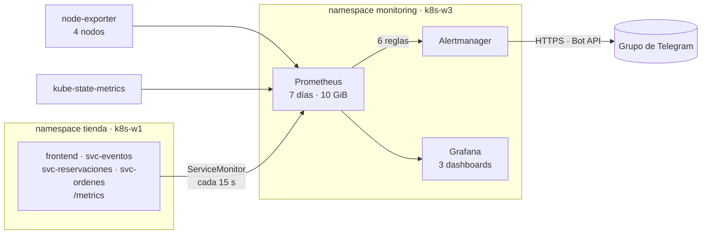

# Etapa 7 · Monitoreo y alertas

Proyecto 3 · Boletera de conciertos · DevOps 2026
Rol: SRE / Observabilidad · 18 de noviembre de 2026

Esta etapa le da ojos y voz a la plataforma, y cubre los rubros **Monitoreo**
y **Alertamiento**:

- **Prometheus** lee las métricas de los 4 microservicios, de los nodos y de Kubernetes.
- **Grafana** las muestra en 3 dashboards: infraestructura, aplicación y negocio.
- **Alertmanager** envía 6 alertas a un **grupo de Telegram**, también cuando se resuelven.

Todo se instala por GitOps con el chart **kube-prometheus-stack**. Lo propio
de la boletera vive en `monitoring/`: ServiceMonitors, reglas, la ruta a
Telegram y los dashboards en JSON. El token del bot está en un Secret, no en Git.

---

## Índice

1. [Resultado](#1-resultado)
2. [Versiones y compatibilidad](#2-versiones-y-compatibilidad)
3. [Arquitectura](#3-arquitectura)
4. [Archivos de esta etapa](#4-archivos-de-esta-etapa)
5. [Instalación: kube-prometheus-stack](#5-instalación-kube-prometheus-stack)
6. [Qué se mide: ServiceMonitors](#6-qué-se-mide-servicemonitors)
7. [Las 6 alertas](#7-las-6-alertas)
8. [Alertas en Telegram](#8-alertas-en-telegram)
9. [Los 3 dashboards](#9-los-3-dashboards)
10. [Generador de tráfico](#10-generador-de-tráfico)
11. [Configuración de los servicios con hash](#11-configuración-de-los-servicios-con-hash)
12. [Verificación y prueba de falla](#12-verificación-y-prueba-de-falla)
13. [Cómo reproducir esta etapa](#13-cómo-reproducir-esta-etapa)
14. [Rubros cubiertos](#14-rubros-cubiertos)
15. [Evidencias](#15-evidencias)

---

## 1. Resultado

```
$ kubectl -n argocd get applications kube-prometheus-stack monitoring trafico
NAME                    SYNC STATUS   HEALTH STATUS
kube-prometheus-stack   Synced        Healthy
monitoring              Synced        Healthy
trafico                 Synced        Healthy

$ kubectl -n monitoring get pods -o wide
alertmanager-kps-alertmanager-0           2/2  Running  k8s-w3
kps-grafana-…                             3/3  Running  k8s-w3
kps-kube-state-metrics-…                  1/1  Running  k8s-w3
kps-operator-…                            1/1  Running  k8s-w3
prometheus-kps-prometheus-0               2/2  Running  k8s-w3
kps-prometheus-node-exporter-… (×4)       1/1  Running  k8s-cp, k8s-w1, k8s-w2, k8s-w3
```

| Qué | Resultado |
|---|---|
| Targets de Prometheus | ✅ **32 en UP**, ninguno DOWN. Incluye las 6 réplicas de la tienda (frontend ×2, svc-eventos ×2, svc-reservaciones, svc-ordenes) |
| Reglas | ✅ 226 cargadas, 0 con error. Las **6 de la boletera** más las del chart |
| Dashboards | ✅ 3 en la carpeta **Boletera** de Grafana, con datos reales |
| Telegram | ✅ Llegan las alertas y su resolución al grupo del equipo |
| Prueba de falla | ✅ `ERROR_RATE=0.3` por commit: la alerta `Errores5xxAltos` llegó **7 min** después del commit y el mensaje de resuelta **5 min** después del commit que lo arregló (sección 12) |

Accesos, solo desde la tailnet:

| Aplicación | URL |
|---|---|
| Grafana | http://grafana.100.103.221.107.nip.io |
| Prometheus | http://prometheus.100.103.221.107.nip.io |
| Alertmanager | http://alertmanager.100.103.221.107.nip.io |

---

## 2. Versiones y compatibilidad

| Componente | Versión | Nota |
|---|---|---|
| **kube-prometheus-stack** (chart) | **92.18.0** (4 nov 2026) | Dos semanas publicado al instalar. La serie 93.x era una versión mayor de 11 días |
| Prometheus | v3.15.1 | |
| Alertmanager | v0.34.2 | Telegram es un receptor nativo |
| Prometheus Operator | v0.94.2 | CRDs: ServiceMonitor, PrometheusRule, AlertmanagerConfig… |
| Grafana | 13.3.0 | |
| kube-state-metrics | v2.20.0 | |
| node-exporter | v1.12.1 | |

El chart declara `kubeVersion: ">=1.25.0-0"` y el clúster usa **1.37.2**.

Fuentes:
[kube-prometheus-stack](https://github.com/prometheus-community/helm-charts/tree/main/charts/kube-prometheus-stack) ·
[Prometheus Operator](https://github.com/prometheus-operator/prometheus-operator/releases) ·
[Alertmanager: Telegram](https://prometheus.io/docs/alerting/latest/configuration/#telegram_config)

---

## 3. Arquitectura



- **node-exporter** publica CPU, memoria, red y disco de cada nodo, incluido el disco del NFS (`/srv/nfs`).
- **kube-state-metrics** publica el estado de los objetos de Kubernetes: nodos Ready, réplicas disponibles, reinicios de pods.
- Alertmanager **envía** los mensajes a `api.telegram.org`. Telegram nunca llama al clúster, así que no hace falta túnel como con el webhook de GitHub.

---

## 4. Archivos de esta etapa

| Archivo | Qué hace |
|---|---|
| [`apps/kube-prometheus-stack.yaml`](../apps/kube-prometheus-stack.yaml) | Application: chart 92.18.0 + nuestro `values.yaml`. |
| [`monitoring/kube-prometheus-stack/values.yaml`](../monitoring/kube-prometheus-stack/values.yaml) | Configuración del chart (sección 5). |
| [`apps/monitoring.yaml`](../apps/monitoring.yaml) | Application de lo propio de la boletera (`monitoring/`). |
| [`monitoring/kustomization.yaml`](../monitoring/kustomization.yaml) | Une ServiceMonitors, reglas y Telegram, y convierte los dashboards en ConfigMaps. |
| [`monitoring/servicemonitors/`](../monitoring/servicemonitors/) | Un ServiceMonitor por microservicio (sección 6). |
| [`monitoring/reglas/boletera.yaml`](../monitoring/reglas/boletera.yaml) | PrometheusRule con las 6 alertas (sección 7). |
| [`monitoring/alertmanager/telegram.yaml`](../monitoring/alertmanager/telegram.yaml) | AlertmanagerConfig: ruta y mensaje de Telegram (sección 8). |
| [`monitoring/dashboards/`](../monitoring/dashboards/) | `infraestructura.json`, `aplicacion.json` y `negocio.json` (sección 9). |
| [`apps/trafico.yaml`](../apps/trafico.yaml) + [`tienda/trafico/`](../tienda/trafico/) | Generador de tráfico, apagado por defecto (sección 10). |
| `tienda/<servicio>/config.env` | Configuración de cada servicio, en un ConfigMap con hash (sección 11). |

---

## 5. Instalación: kube-prometheus-stack

La Application usa **dos fuentes**, como Traefik en la etapa 3: el chart
oficial en versión fija y el `values.yaml` de este repo.

### 5.1 Decisiones del `values.yaml`

| Decisión | Para qué |
|---|---|
| Todo en **k8s-w3** (`nodeSelector: boletera.io/metricas`), salvo node-exporter | El monitoreo no compite con la tienda (k8s-w1) ni con los logs (k8s-w2, siguiente etapa). |
| node-exporter en los **4 nodos**, con `tolerations` para el control plane | k8s-cp también se vigila: ahí está el disco del NFS con los datos de PostgreSQL. |
| `instance` = nombre del nodo (relabeling) | Las gráficas y alertas dicen `k8s-w1` en vez de `100.103.221.107:9100`. |
| Volúmenes `local-path`: Prometheus 10 GiB, Grafana y Alertmanager 1 GiB | El proyecto pide los datos de Prometheus y Grafana en PVC. `local-path` es el disco del nodo: rápido, y SQLite (la base de Grafana) no se lleva bien con NFS. |
| Prometheus: `retention: 7d` y `retentionSize: 8GB` | Una semana de historia. Si el volumen se llena antes, se borran los datos más viejos en vez de fallar. |
| `*SelectorNilUsesHelmValues: false` | Prometheus toma **todos** los ServiceMonitors y PrometheusRules del clúster, no solo los que llevan la etiqueta del chart. |
| Sin recolectar etcd, kube-scheduler, kube-controller-manager ni kube-proxy | kubeadm deja sus métricas solo en `127.0.0.1` de cada nodo. Prometheus no las alcanza y aparecerían siempre DOWN, con alertas falsas. Se apagan también sus reglas. |
| Grafana con el Secret `grafana-admin` (`admin.existingSecret`) | El usuario y la contraseña no están en Git ni son los valores por defecto del chart. |
| Grafana con `deploymentStrategy: Recreate` | Su volumen es `ReadWriteOnce`: el pod viejo se detiene antes de crear el nuevo. |
| Ingress de Grafana, Prometheus y Alertmanager | Un nombre `nip.io` para cada uno, como Argo CD y Tekton. |
| `externalUrl` en Prometheus y Alertmanager | Los enlaces que generan apuntan a su URL real. |
| `ServerSideApply=true` y `ignoreDifferences` del `caBundle` de los webhooks | Las CRDs del chart son muy grandes. El job del chart escribe el certificado de sus webhooks después de instalarlos, y Argo CD no debe regresarlo a vacío. |

### 5.2 Memoria de k8s-w3

Proxmox muestra la memoria de k8s-w3 casi llena, pero cuenta también la
**caché de archivos**. Linux usa la RAM libre para guardar los archivos que
leyó, como las capas de imágenes de los builds de Tekton, y la libera en
cuanto un programa la necesita. Lo que importa es la memoria **disponible**
(`free -m`):

| k8s-w3 | Antes del monitoreo | Con monitoreo, Tekton y tráfico |
|---|---|---|
| Usada por programas | 1,233 MiB | 2,554 MiB |
| Disponible | 3,610 MiB | 2,289 MiB |

Consumo real de cada componente (`container_memory_working_set_bytes`):

| Componente | Memoria | Límite |
|---|---|---|
| Prometheus (94,430 series) | 497 MiB | 1.5 GiB |
| Grafana (+ 2 sidecars de 80 MiB) | 431 MiB | 768 MiB |
| Alertmanager | 40 MiB | 128 MiB |
| Prometheus Operator | 34 MiB | 256 MiB |
| kube-state-metrics | 25 MiB | 128 MiB |
| node-exporter (cada nodo) | 14–19 MiB | 64 MiB |

El límite de Grafana es de 768 MiB porque Grafana 13, con los dashboards del
chart y los de la boletera, usa ~430 MiB.

---

## 6. Qué se mide: ServiceMonitors

Un **ServiceMonitor** le dice a Prometheus qué Service leer, por qué puerto y
cada cuánto. Hay uno por microservicio, en el namespace `monitoring`:

```yaml
apiVersion: monitoring.coreos.com/v1
kind: ServiceMonitor
metadata:
  name: svc-eventos
  namespace: monitoring
spec:
  namespaceSelector:
    matchNames: [tienda]
  selector:
    matchLabels:
      app.kubernetes.io/name: svc-eventos
  endpoints:
    - port: http          # el puerto con nombre "http" del Service
      path: /metrics
      interval: 15s
```

Prometheus agrega a cada métrica las etiquetas `namespace`, `service` y
`pod`. Las alertas y los dashboards las usan para decir qué servicio falla.

Métricas que publican los servicios (etapa 5):

| Métrica | Tipo | Para qué |
|---|---|---|
| `http_requests_total{route, status}` | counter | Peticiones por segundo y % de errores 5xx |
| `http_request_duration_seconds` | histogram | Latencia p95 |
| `boletera_porcentaje_vendido{evento}` | gauge | **Métrica de negocio**: alerta de evento casi agotado |
| `boletera_boletos_vendidos`, `boletera_capacidad` | gauge | Dashboard de negocio |
| `boletera_reservaciones_total`, `_vencidas_total`, `_canceladas_total` | counter | Actividad del carrito |
| `boletera_llamadas_backend_total{servicio, resultado}` | counter | Llamadas del frontend a cada backend |
| `boletera_info{version}` | gauge | Versión desplegada (el SHA que construyó Tekton) |

---

## 7. Las 6 alertas

Están en una sola **PrometheusRule**. Todas llevan la etiqueta
`equipo: boletera`, que decide qué llega a Telegram (sección 8).

| # | Alerta | Condición | Espera | Severidad |
|---|---|---|---|---|
| 1 | `MicroservicioCaido` | `up == 0` para el servicio, **o** su Deployment con 0 réplicas disponibles | 1 min | critical |
| 2 | `PodReiniciandose` | más de 3 reinicios de un contenedor en 15 min, en cualquier namespace | 1 min | warning |
| 3 | `NodoNoListo` | `kube_node_status_condition{condition="Ready"}` distinto de true | 2 min | critical |
| 4 | `DiscoCasiLleno` | más de 80 % usado en `/` de cada nodo o en **`/srv/nfs`** (servidor NFS) | 5 min | warning |
| 5 | `Errores5xxAltos` | más de 5 % de respuestas 5xx | **5 min** | critical |
| 6 | `EventoCasiAgotado` | `boletera_porcentaje_vendido > 90` (**alerta de negocio**) | — | warning |

Decisiones:

- **Servicio caído con dos condiciones.** `up == 0` detecta un servicio que no responde. Pero si el servicio se **apaga** (0 réplicas), su target desaparece y no queda ningún `up` que valga 0. La segunda condición, con kube-state-metrics, cubre ese caso.
- **Los errores 5xx no cuentan `/health` ni `/metrics`.** Son peticiones de Kubernetes y de Prometheus, no de clientes. Las sondas generan tráfico constante y diluirían el porcentaje.
- **Una alerta por evento.** svc-eventos tiene 2 réplicas y las dos publican la métrica de negocio, así que se toma el máximo (`max by (evento…)`).
- **La alerta de negocio con severidad `warning`.** kube-prometheus-stack trae la regla `InfoInhibitor`, que silencia las alertas `info` para que solo se vean en el panel. Un evento a punto de agotarse sí debe avisar al equipo.
- **Las ~220 reglas del chart** (memoria de nodos, certificados, Kubernetes…) se ven en Prometheus, pero no van a Telegram, para que el grupo solo reciba lo que el equipo definió.

Con los datos de ejemplo, la alerta de negocio está activa para "La Despedida"
(96 %) y "Dueño del Cielo Tour Finale" (92 %). "Siddhartha" está en 89.8 %:
comprar 4 boletos en la tienda la pasa a 90.2 % y llega una alerta nueva.

Las reglas se revisaron con `promtool check rules` antes de subirlas:
`SUCCESS: 6 rules found`.

---

## 8. Alertas en Telegram

### 8.1 El bot y el grupo

1. En Telegram, **@BotFather** → `/newbot` crea el bot y entrega su **token**.
2. Se crea el grupo del equipo y se agrega al bot.
3. El **chat ID** del grupo, un número negativo, se obtiene de `getUpdates` de la Bot API, desde k8s-cp y sin que el token quede en pantalla:
   ```bash
   read -rsp "Token del bot: " T; echo
   curl -s "https://api.telegram.org/bot$T/getUpdates" | jq '[.result[] | (.message // .my_chat_member).chat | {id, title}] | unique'
   unset T
   ```
   Agregar el bot al grupo genera un evento `my_chat_member` con el ID. Por eso el filtro lee también ese tipo, además de los mensajes.
4. El token va a un Secret, creado a mano:
   ```bash
   read -rsp "Token del bot: " T; echo
   kubectl -n monitoring create secret generic telegram-bot --from-literal=token="$T"; unset T
   ```

El chat ID sí está en Git: sin el token no sirve para enviar mensajes.

### 8.2 La ruta: AlertmanagerConfig

```yaml
spec:
  route:
    receiver: telegram
    matchers:
      - { name: equipo, value: boletera, matchType: "=" }
    groupBy: [alertname, namespace, service]
    groupWait: 30s
    groupInterval: 2m
    repeatInterval: 4h
  receivers:
    - name: telegram
      telegramConfigs:
        - botToken: { name: telegram-bot, key: token }   # Secret, no Git
          chatID: -5428043398
          sendResolved: true
          parseMode: HTML
```

| Opción | Para qué |
|---|---|
| `matchers: equipo=boletera` | Solo las 6 alertas propias llegan al grupo. |
| `alertmanagerConfigMatcherStrategy: None` (en `values.yaml`) | Por defecto, el operador limita un AlertmanagerConfig a las alertas de su propio namespace (`monitoring`). Las nuestras son de `tienda`, de los nodos, etc. |
| `groupBy: [alertname, namespace, service]` | Las alertas iguales del mismo servicio llegan en un solo mensaje. Las dos de negocio, por ejemplo, llegan juntas. |
| `groupWait: 30s` | Junta las alertas que se disparan casi al mismo tiempo. |
| `repeatInterval: 4h` | Recordatorio si una alerta sigue activa. |
| `sendResolved: true` | Mensaje cuando la alerta se resuelve, como pide el proyecto. |

### 8.3 El mensaje

El proyecto pide que el mensaje indique **alerta, severidad, namespace y
servicio afectado**. Así se ve, por ejemplo:

```
🔴 ALERTA · Errores5xxAltos
Severidad: critical
Namespace: tienda
Servicio: svc-eventos
svc-eventos responde con error 5xx al 32% de las peticiones.
```

Cuando se resuelve llega el mismo mensaje, que empieza con **✅ RESUELTA**.
Para las alertas sin `service`, el campo Servicio toma el nombre del nodo, del
contenedor o del disco, según la alerta. Los valores se escapan con `html`:
nombres como "Interpol & Queens of the Stone Age" no rompen el formato. La
plantilla se probó con `amtool template render` antes de subirla.

---

## 9. Los 3 dashboards

Están en `monitoring/dashboards/` como **JSON de Grafana** (exportables e
importables). Kustomize convierte cada uno en un ConfigMap con la etiqueta
`grafana_dashboard: "1"` y la anotación `grafana_folder: Boletera`. El
*sidecar* de Grafana los carga solo en la carpeta **Boletera**. Para cambiar
un dashboard se edita su JSON y se hace push.

| Dashboard | Paneles | Qué muestra |
|---|---|---|
| **Infraestructura** | 19 | Nodos Ready, pods Running y con problemas, reinicios, % del disco NFS, PVC en Bound. CPU, memoria, red y carga por nodo. Disco por nodo y punto de montaje. Pods y memoria por namespace. Tabla de pods reiniciados y de volúmenes |
| **Aplicación** | 11 | Targets UP y versión desplegada por servicio. Peticiones/s, **% de errores 5xx** (con la línea del 5 %), **latencia p95**, peticiones por código HTTP, llamadas del frontend a cada backend y rutas más usadas |
| **Negocio** | 11 | Boletos vendidos, aforo total, eventos arriba de 90 %, reservaciones del día. **Porcentaje vendido por evento** (rojo arriba de 90 %), tabla de detalle, los 5 eventos más vendidos en el tiempo y actividad del carrito |

Antes de subirlos, las 37 consultas de los paneles se probaron contra
Prometheus. Todas son válidas, y las de infraestructura y negocio ya
devolvían datos.

Decisiones de los paneles:

- Los paneles de tráfico **no cuentan `/health` ni `/metrics`**, igual que las alertas: miden lo que viven los clientes.
- El % de errores muestra **0 %** en los servicios sin errores, en lugar de no mostrarlos.
- Si no hay tráfico, las gráficas dejan un **hueco** en vez de unir los puntos: así se ve que no hubo peticiones.

---

## 10. Generador de tráfico

Los paneles de aplicación y la alerta de errores 5xx necesitan **peticiones de
clientes**: sin ellas no hay peticiones por segundo ni porcentaje de errores.
Para no depender de navegar la tienda a mano, `tienda/trafico/` tiene un
generador **apagado por defecto**.

Cada 2 segundos simula un cliente nuevo, con sus propias cookies:
1. Abre el catálogo y un concierto al azar.
2. Cada 5 clientes aparta 2 lugares, ve el carrito y lo cancela.
3. Consulta un pedido existente.

Así recorre los 4 servicios, unas 2 peticiones/s en total. **Nunca paga**: no
cambia los boletos vendidos ni la alerta de negocio.

Es un **CronJob suspendido**: no corre por horario. Cada ejecución se lanza a
mano, dura 20 minutos y termina sola:

```bash
kubectl -n tienda create job trafico-$(date +%H%M) --from=cronjob/trafico   # encender
kubectl -n tienda logs -f -l app.kubernetes.io/name=trafico                 # resumen cada minuto
kubectl -n tienda delete job -l app.kubernetes.io/name=trafico              # apagar antes
```

| Decisión | Para qué |
|---|---|
| CronJob suspendido + `create job --from` | Se enciende y se apaga sin tocar Git: Argo CD sigue en Synced. Así se puede probar con y sin tráfico. |
| Termina solo (`DURACION_MIN=20`, tope `activeDeadlineSeconds`) | No se queda encendido por olvido. |
| `ttlSecondsAfterFinished: 900` | Los Jobs terminados se borran solos. |
| Script en Python estándar, montado desde un ConfigMap | Usa la imagen de Python que ya usan los servicios; no hay imagen propia que construir. |
| Sin root, sistema de archivos de solo lectura, límite de 96 MiB | Mínimos privilegios. |

En la prueba, 48 clientes en 1 minuto dieron 176 respuestas 200. Las 16
reservaciones que creó se cancelaron, así que no quedaron lugares apartados.

---

## 11. Configuración de los servicios con hash

Los servicios leen su configuración (`ERROR_RATE`, `BANNER`…) del ConfigMap
**al arrancar**. Para que un commit que cambia un valor llegue a los pods, la
configuración de cada servicio está en `tienda/<servicio>/config.env` y
Kustomize la convierte en un ConfigMap con el **hash de su contenido** en el
nombre:

```yaml
configMapGenerator:
  - name: svc-eventos-config
    envs: [config.env]          # → svc-eventos-config-hg472gthgk
```

Al cambiar un valor cambia el nombre. Kustomize lo actualiza en el
Deployment, y Kubernetes crea pods nuevos que leen el valor nuevo, uno por
uno y sin cortar el servicio. Es lo que permite provocar la falla de la demo 3
con un commit (`ERROR_RATE`) y mostrar un cambio visible en la demo 1
(`BANNER`).

---

## 12. Verificación y prueba de falla

### 12.1 Comandos

```bash
kubectl -n argocd get applications kube-prometheus-stack monitoring trafico
kubectl -n monitoring get pods -o wide
kubectl -n monitoring get servicemonitors,prometheusrules,alertmanagerconfigs
```

En Prometheus (http://prometheus.100.103.221.107.nip.io):
- **Status → Targets**: 32 en UP, entre ellos `serviceMonitor/monitoring/svc-eventos/0` y los demás servicios de la tienda.
- **Alerts**: las 6 reglas del grupo `boletera.*` sin errores.

### 12.2 Prueba: errores 5xx provocados por commit

Con el generador de tráfico encendido:

| Hora (CST) | Qué pasó |
|---|---|
| 23:00:11 | Commit "Prueba de alertas": `ERROR_RATE=0.3` en `tienda/svc-eventos/config.env` |
| 23:02:35 | Argo CD desplegó los pods nuevos. Los errores pasan de 5 % y la alerta queda **pendiente** para svc-eventos (23:03:05 para el frontend, que muestra error cuando svc-eventos le falla) |
| 23:07:35 | 5 minutos seguidos arriba de 5 %: la alerta se **dispara**. Llega a Telegram 🔴 **Errores5xxAltos**, `critical`, `tienda`, `svc-eventos`, y otra para `frontend` |
| — | Máximo: **32 %** de errores en svc-eventos y **28 %** en el frontend |
| 23:13:01 | Commit "Prueba de alertas terminada": `ERROR_RATE=0` |
| 23:18:20 | El promedio de 5 minutos baja de 5 %: llega a Telegram ✅ **RESUELTA** para los dos servicios |

La falla se provocó y se arregló **solo con commits**, sin `kubectl`. El
mensaje de resuelta llega cuando el promedio de errores de los últimos 5
minutos baja de 5 %, unos 5 minutos después del arreglo.

La alerta del frontend muestra la **cascada** real: el frontend no tiene
ninguna falla propia, pero responde con error cuando svc-eventos le falla. En
la siguiente etapa, las trazas mostrarán ese camino de un servicio a otro.

### 12.3 Guion para la demo 3 (parte de monitoreo)

1. Encender el generador de tráfico y abrir el dashboard **Aplicación**.
2. Commit con `ERROR_RATE=0.3` en `svc-eventos`; *Refresh* en Argo CD.
3. En Grafana sube el % de errores 5xx de svc-eventos (y del frontend) por encima de la línea del 5 %.
4. Unos 5 minutos después llega la alerta a Telegram con severidad, namespace y servicio. Mientras tanto se sigue la petición fallida en las trazas y su log de error (etapa de logs y trazas).
5. Commit con `ERROR_RATE=0` y, minutos después, el mensaje de resuelta.

Para una falla más rápida, poner `replicas: 0` en un servicio por commit
dispara `MicroservicioCaido` en 1 minuto.

---

## 13. Cómo reproducir esta etapa

Con las etapas 1 a 6 listas:

1. **Bot de Telegram:** crearlo con @BotFather, agregarlo al grupo del equipo y obtener el chat ID (sección 8.1). Poner el chat ID en `monitoring/alertmanager/telegram.yaml`.
2. **Secrets** en `monitoring`, a mano:
   ```bash
   read -rsp "Contraseña para Grafana: " P; echo
   kubectl -n monitoring create secret generic grafana-admin \
     --from-literal=admin-user=admin --from-literal=admin-password="$P"; unset P
   read -rsp "Token del bot: " T; echo
   kubectl -n monitoring create secret generic telegram-bot --from-literal=token="$T"; unset T
   ```
3. **`git push`** de `apps/kube-prometheus-stack.yaml`, `apps/monitoring.yaml`, `apps/trafico.yaml`, `monitoring/` y `tienda/trafico/`. Argo CD instala el chart y después lo propio de la boletera; `monitoring` reintenta hasta que existen las CRDs.
4. Comprobar: targets UP en Prometheus, los 3 dashboards en Grafana → Boletera y las 2 alertas de negocio en Telegram.
5. Encender el generador de tráfico y hacer la prueba de falla (sección 12.2).

---

## 14. Rubros cubiertos

**Monitoreo**

| Pide el proyecto | Estado |
|---|---|
| kube-prometheus-stack (Prometheus, Alertmanager, Grafana, node-exporter, kube-state-metrics) | ✅ chart 92.18.0, por Argo CD |
| Un ServiceMonitor por microservicio, targets UP | ✅ 4 ServiceMonitors, 6 réplicas en UP |
| 3 dashboards exportados en JSON: infraestructura, aplicación (peticiones/s, 5xx, p95 por servicio) y negocio | ✅ `monitoring/dashboards/` |
| Prometheus y Grafana guardan sus datos en PVC | ✅ `local-path`, 10 GiB y 1 GiB |
| **Verificación:** targets UP y 3 dashboards con datos reales | ✅ Con el generador de tráfico, o navegando la tienda |

**Alertamiento**

| Pide el proyecto | Estado |
|---|---|
| Reglas en PrometheusRule, mínimo 6 | ✅ Las 6 pedidas (sección 7) |
| Alertmanager → grupo de Telegram con bot propio, `send_resolved: true` | ✅ AlertmanagerConfig |
| El mensaje indica alerta, severidad, namespace y servicio | ✅ Sección 8.3 |
| El token del bot en un Secret, nunca en Git | ✅ Secret `telegram-bot` |
| **Verificación:** la falla provocada llega a Telegram con severidad y servicio, y llega el resuelto | ✅ Prueba de la sección 12.2 |

---

## 15. Evidencias

Van en [`docs/evidencias/`](evidencias/):

- Prometheus → Status → Targets con los servicios de la tienda en **UP**.
- Prometheus → Alerts con las 6 reglas de la boletera.
- Los 3 dashboards de Grafana con datos (aplicación con el generador encendido).
- El dashboard de aplicación durante la prueba: % de errores 5xx arriba de la línea del 5 %.
- Telegram: las alertas `EventoCasiAgotado`, la alerta `Errores5xxAltos` y su mensaje **RESUELTA**.
- Argo CD con `kube-prometheus-stack`, `monitoring` y `trafico` en Synced / Healthy.
